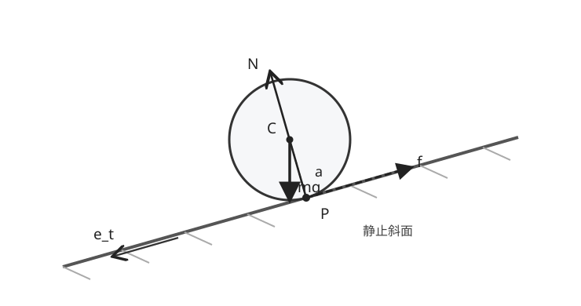

# RBD14 非ホロノミック転がりと反力

<!-- definition-example-audit: strict -->

[RBD13の無滑り接触](../RBD13/index.md#def-rbd13-no-slip)では、接している**二つの物質点の相対速度が零**であることを確認しました。しかし、速度が零という条件だけでは、円柱が斜面をどれだけ速く下るか、摩擦力が上向きか下向きか、また本当に無滑りを維持できるかは決まりません。力と回転の運動方程式が必要です。

本講では、まず直線に沿う円柱・球の転がりで反力を実際に解きます。次に、**速度拘束は必ずしも位置だけの拘束ではない**ことを、平面上の球が正方形の経路を転がる例で確かめます。転がりを「いつでも $x=a\varphi$ と書ける」と一般化しないことが核心です。

## 1. 斜面の接点に作用する三つの力

質量 $m>0$、半径 $a>0$ の円形対称な円柱または球が、傾斜角 $0\le\alpha<\pi/2$ の**静止した剛体斜面**を下る状況を考えます。斜面に沿って下向きの単位ベクトルを $e_t$、斜面から離れる単位法線を $e_n$ とし、$e_z=e_t\times e_n$ と定めます。円柱なら軸は $e_z$ に平行、球なら $e_z$ 軸以外の回転成分がない運動に限定します。

重力 $mg$ は重心 $C$ に、法線反力 $N e_n$ と静止摩擦力 $-f e_t$ はその時刻の接点 $P$ に働きます。$f$ は**符号付き未知数**であり、最初から正値とは決めません。重心から接点へのベクトルは $r_{CP}=-a e_n$ です。

図の $f$ は斜面を上る向きを正とした表示です。実際にその向きになるかどうかは運動方程式から判定します。法線反力は床への侵入を防ぎ、静止摩擦力は接点の接線方向の相対運動を防ぎます。二つの力は役割が違います。

物体の中心速度を $v_C=u e_t$、下り方向への転がり角速度を $\omega=-\Omega e_z$ と記します。$u=\dot s$、$\Omega=\dot\varphi$ として、$s$ は重心の下り距離、$\varphi$ は下り向き回転角です。[剛体点の速度場](../RBD3/index.md#prop-rbd3-point-velocity)を接点へ使うと

$$
\begin{aligned}
v_P&=u e_t+(-\Omega e_z)\times(-a e_n)\\
&=u e_t+a\Omega(e_z\times e_n)\\
&=(u-a\Omega)e_t.
\end{aligned}
$$

二行目から三行目では $e_z=e_t\times e_n$ と $e_z\times e_n=-e_t$ を使いました。接点の**車輪側物質点**の速度です。静止斜面に対する無滑りなら $u=a\Omega$ となります。

## 2. 直線転がりでは速度拘束を積分できる

運動の各瞬間の速度成分について一次式を課すものを、ここでは**速度拘束**と呼びます。もし座標間の等式 $F(q,t)=0$ としてその運動全体を指定できるなら、これを**位置拘束（ホロノミック拘束）**と呼びます。逆に、許される速度の条件を一般には独立な位置等式へ積分できない場合が**非ホロノミック拘束**です。位置拘束の時間微分が速度拘束になることと、任意の速度拘束が位置拘束に戻せることは同じではありません。

<!-- formal-statement-start -->
### 定義（転がりの速度拘束と非ホロノミック拘束）

配置変数 $q=(q^1,\ldots,q^n)$ の許される速度が、各時刻に

$$
\sum_{j=1}^n A_{ij}(q,t)\dot q^j+b_i(q,t)=0
\quad(i=1,\ldots,r)
$$

を満たすとする。これを速度拘束と呼ぶ。その速度条件が、考える運動領域で適切な位置等式 $F_k(q,t)=0$ の時間微分から得られる拘束と同等である場合をホロノミック、そうした位置等式への還元が一般には不可能な場合を非ホロノミックという。独立な拘束数が局所的に一定の正則な領域を考える。
<!-- formal-statement-end -->

<!-- definition-example-start: def-rbd14-holonomic-rolling -->
### 直接例：直線レールに沿う円盤

接点が静止している円盤の一方向運動では、配置を $(s,\varphi)$ として

$$
\dot s-a\dot\varphi=0
\quad\Longleftrightarrow\quad
\frac{d}{dt}(s-a\varphi)=0.
$$

時間区間が連結なら積分して $s-a\varphi=c$ です。これは定義の $F(s,\varphi)=s-a\varphi-c$ に相当する**位置拘束**です。局所的に円盤の回転角を実数値で追跡する設定であり、$2\pi$ ごとに角度を同一視するときは巻数を区別します。つまり**無滑りだから必ず非ホロノミック、という主張は誤り**です。一般の球の例は第5節で扱います。
<!-- definition-example-end -->

## 3. 無滑り時の加速度と接点反力

重心まわりの、紙面に垂直な軸の慣性モーメントを $I>0$ とします。[慣性テンソルと回転エネルギー](../../MECH/MECH8/index.md#thm-mech8-inertia-relations)で扱った回転主軸を用いており、$I$ は**接点まわりではなく重心まわり**の値です。比

$$
\kappa=\frac{I}{ma^2}>0
$$

を導入しておくと、物体形状の違いが一つの係数にまとまります。

[外力付きNewton–Euler方程式](../RBD7/index.md#thm-rbd7-newton-euler)で重心まわりの外力モーメントを取ります。重力と法線反力はこの軸のモーメントを生まず、摩擦力だけが

$$
r_{CP}\times(-f e_t)=(-a e_n)\times(-f e_t)=-af e_z
$$

を生みます。ここで角速度ベクトルは $-\Omega e_z$ なので、$z$ 成分の回転方程式に両辺の負号を反映すると

$$
m\dot u=mg\sin\alpha-f,\qquad
I\dot\Omega=af,\qquad
N=mg\cos\alpha.
$$

これらは接点を固定支点とみなした式ではありません。中心速度が時間とともに変化しても、**その瞬間に接している物質点が入れ替わる**ことは[RBD13の接点の定義](../RBD13/index.md#def-rbd13-no-slip)と両立します。

<!-- formal-statement-start -->
### 定理（直線斜面の無滑り転がりと必要な静止摩擦）

質量 $m>0$、半径 $a>0$、重心まわりの回転軸慣性モーメント $I>0$ の軸対称剛体が、静止した直線斜面（$0\le\alpha<\pi/2$）に一点または一直線で接し、中心は斜面方向に運動し、回転軸は斜面の横断方向に保たれるとする。接触は維持され、空気抵抗・転がり抵抗はなく、重力と接点反力のみが働く。無滑り $u=a\Omega$ が維持されるなら、$\kappa=I/(ma^2)$ として

$$
\boxed{\dot u=\frac{g\sin\alpha}{1+\kappa}},\qquad
\boxed{f=\frac{\kappa}{1+\kappa}mg\sin\alpha},\qquad
\boxed{N=mg\cos\alpha}.
$$

静止摩擦の上限を $|f|\le\mu_sN$（$\mu_s\ge0$）でモデル化すると、無滑り解がこの摩擦限界と整合する必要十分条件は

$$
\frac{\kappa}{1+\kappa}\tan\alpha\le\mu_s.
$$

この「必要十分」は、記載した剛体・接触・摩擦上限モデルの内部での整合性をいう。$\alpha>0$ なら摩擦の向きは斜面上向きである。
<!-- formal-statement-end -->

### 証明の見取り図

並進方程式から摩擦力を消去するため、回転方程式へ無滑り条件の時間微分 $\dot u=a\dot\Omega$ を代入します。法線方向のつり合いを別に用い、最後に必要な摩擦力の大きさを上限と比較します。

<!-- proof-start -->
### 証明

先に求めた[Newton–Euler方程式](../RBD7/index.md#thm-rbd7-newton-euler)は

$$
m\dot u=mg\sin\alpha-f,\quad
I\dot\Omega=af,\quad N=mg\cos\alpha.
$$

無滑りを運動区間で保つなら $u-a\Omega=0$ だから $\dot\Omega=\dot u/a$ です。これを回転式へ入れ、

$$
f=\frac{I\dot u}{a^2}=\kappa m\dot u.
$$

並進式は $m\dot u=mg\sin\alpha-\kappa m\dot u$。$m>0$ と $1+\kappa>0$ を用いて

$$
(1+\kappa)\dot u=g\sin\alpha,\qquad
\dot u=\frac{g\sin\alpha}{1+\kappa}.
$$

これを $f=\kappa m\dot u$ に戻して所望の $f$ を得ます。$N=mg\cos\alpha>0$ なので、静止摩擦の条件 $|f|\le\mu_sN$ を $N$ で割り、

$$
\frac{|f|}{N}
=\frac{\kappa}{1+\kappa}\frac{\sin\alpha}{\cos\alpha}
=\frac{\kappa}{1+\kappa}\tan\alpha.
$$

他の反力は既に一意に決まっており、上限内ならこの値をとる静止摩擦が存在し、上限を超せば静止摩擦モデルには解がありません。したがって主張した範囲で必要十分です。
<!-- proof-end -->

### 直接例：一様円柱と一様球

[MECH8の慣性モーメントの定義](../../MECH/MECH8/index.md#def-mech8-moment-of-inertia)は回転軸からの距離の二乗を質量で積分するものです。一様中実円柱の軸まわりでは $I=ma^2/2$ です。中実球について、半径座標 $r$、極角 $\vartheta$、方位角 $\chi$ と密度 $\rho=3m/(4\pi a^3)$ を用いると、回転軸からの距離は $r\sin\vartheta$ だから

$$
\begin{aligned}
I&=\rho\int_0^a r^4\,dr
\int_0^\pi\sin^3\vartheta\,d\vartheta
\int_0^{2\pi}d\chi\\
&=\rho\,\frac{a^5}{5}\cdot\frac43\cdot2\pi
=\frac25ma^2.
\end{aligned}
$$

従って一様円柱では $\kappa=1/2$、中実球では $\kappa=2/5$ を上の定理に代入します。

| 物体 | $\kappa$ | 下り加速度 $\dot u$ | 上り摩擦の大きさ $f$ | 最小 $\mu_s$ |
|---|---:|---:|---:|---:|
| 一様中実円柱 | $1/2$ | $(2/3)g\sin\alpha$ | $(1/3)mg\sin\alpha$ | $(1/3)\tan\alpha$ |
| 一様中実球 | $2/5$ | $(5/7)g\sin\alpha$ | $(2/7)mg\sin\alpha$ | $(2/7)\tan\alpha$ |

斜面を下るとき摩擦力は運動方向と逆ですが、**接点の相対速度を零に保つ静止摩擦**であり、滑りによるエネルギー損失を意味しません。$\alpha=0$ では $\dot u=f=0$、速度が一定なら摩擦が働かずに無滑りを続けられます。

## 4. d'Alembert原理とエネルギーの検算

[AMECH2の理想拘束](../../AMECH/AMECH2/index.md#def-amech2-ideal-constraint)では、許された仮想変位に対して拘束反力の仮想仕事が零になることを使います。斜面上の直線転がりでは $\delta s=a\,\delta\varphi$、法線方向の仮想変位は零です。接点摩擦の並進仕事と回転仕事を合わせると

$$
\delta W_{\mathrm{friction}}
=(-f)\delta s+(af)\delta\varphi
=-f(a\delta\varphi)+af\delta\varphi=0.
$$

これは[AMECH2のd'Alembert原理](../../AMECH/AMECH2/index.md#principle-amech2-dalembert)がこの拘束に適用できることの直接確認です。**仮想仕事が零だから摩擦力 $f$ が零なのではありません。** 接点が無滑りなら実際の仕事率も $-fu+af\Omega=-f(u-a\Omega)=0$ ですが、摩擦は並進運動エネルギーから回転運動エネルギーへ寄与を移しています。

<!-- formal-statement-start -->
### 命題（無滑り転がりのエネルギー収支）

前定理の仮定のもとで、重心の斜面沿い座標を $s$（下向き正）とし、$u=a\Omega$ が成り立つとする。位置エネルギーを $V(s)=V(0)-mg\,s\sin\alpha$ とおけば、

$$
E=\frac12mu^2+\frac12 I\Omega^2+V(s)
=\frac12m(1+\kappa)u^2+V(s)
$$

は時間に依存せず一定である。静止から高さ $h\ge0$ だけ下れば、

$$
u^2=\frac{2gh}{1+\kappa}.
$$
<!-- formal-statement-end -->

### 証明の見取り図

並進式に $u$、回転式に $\Omega$ を掛け、接点速度の項がちょうど消えることを示します。重力の仕事と位置エネルギーの変化を対応させます。

<!-- proof-start -->
### 証明

[Newton–Euler方程式](../RBD7/index.md#thm-rbd7-newton-euler)に $u,\Omega$ をそれぞれ掛けると

$$
\begin{aligned}
\frac{d}{dt}\left(\frac12mu^2+\frac12I\Omega^2\right)
&=mu\dot u+I\Omega\dot\Omega\\
&=(mg\sin\alpha-f)u+(af)\Omega\\
&=mg\sin\alpha\,u-f(u-a\Omega).
\end{aligned}
$$

無滑りにより最後の摩擦項は零です。また $\dot V=-mg\sin\alpha\,\dot s=-mg\sin\alpha\,u$。従って $\dot E=0$ です。$\Omega=u/a$ と $I=\kappa ma^2$ を用いれば $K=\tfrac12m(1+\kappa)u^2$。初期静止から $V(0)-V(s)=mgh$ の落差を取ると

$$
\frac12m(1+\kappa)u^2=mgh,\qquad
u^2=\frac{2gh}{1+\kappa}.
$$
<!-- proof-end -->

### 滑りが始まったら何が変わるか

接点の斜面下向き滑り速度を $w=u-a\Omega$ とします。$w>0$ の間、動摩擦係数を $\mu_k\ge0$ とする Coulomb モデルでは、斜面上向きの摩擦は $f_k=\mu_kN=\mu_kmg\cos\alpha$ です。先ほどの式に $f=f_k$ を代入して

$$
\dot u=g\sin\alpha-\mu_k g\cos\alpha,\qquad
\dot\Omega=\frac{\mu_kg\cos\alpha}{\kappa a}.
$$

よって

$$
\dot w=g\sin\alpha-\mu_kg\cos\alpha
\left(1+\frac1\kappa\right).
$$

この式は**$w>0$ の区間だけ**の式です。$w<0$ なら摩擦の向きを反転し、$w=0$ に達したら静止摩擦で拘束可能かを再判定しなければなりません。

<!-- formal-statement-start -->
### 命題（滑り接触の散逸率）

前節の剛体・斜面・重力の仮定の下で、接点の接線方向滑り速度が $w=u-a\Omega\ne0$ であり、動摩擦の大きさが $f_k=\mu_kmg\cos\alpha$、向きが滑りと反対であるとする。このとき

$$
\frac{d}{dt}(K+V)=-f_k|w|\le0,
\qquad
K=\frac12mu^2+\frac12I\Omega^2.
$$
<!-- formal-statement-end -->

<!-- proof-start -->
### 証明

滑り方向の符号を $\sigma=\operatorname{sgn}(w)$ とすれば摩擦力の斜面下向き成分は $-\sigma f_k$、回転軸まわりのモーメントは $-a\sigma f_k e_z$ です。したがって

$$
m\dot u=mg\sin\alpha-\sigma f_k,\qquad
I\dot\Omega=a\sigma f_k.
$$

それぞれに $u$、$\Omega$ を掛けて加えると

$$
\dot K
=mg\sin\alpha\,u-\sigma f_k(u-a\Omega)
=mg\sin\alpha\,u-f_k|w|.
$$

$\dot V=-mg\sin\alpha\,u$ なので主張を得ます。
<!-- proof-end -->

**適用限界**：この摩擦モデルは滑り中の接線方向の力だけを定めます。接点の変形、転がり抵抗、有限幅の接触面、速度依存摩擦は含みません。静止摩擦の上限不足を確認してから動摩擦の式へ切り替えます。

## 5. 一般の球ではなぜ位置に積分できないか

球が水平な静止床を、鉛直上向き $e_z$ の下で転がるとします。中心速度を $(\dot x,\dot y,0)$、空間角速度を $(\omega_x,\omega_y,\omega_z)$ とすると、[RBD13の球の無滑り命題](../RBD13/index.md#prop-rbd13-sphere-rolling)により

$$
v_P=(\dot x-a\omega_y,\ \dot y+a\omega_x,\ 0).
$$

従って無滑りは $\dot x=a\omega_y$、$\dot y=-a\omega_x$ です。鉛直軸まわりのスピン $\omega_z$ は接点の速度からは決まりません。以下ではあえて $\omega_z=0$ も課し、中心の動きによって回転が一意に決まる場合を考えます。

<!-- formal-statement-start -->
### 命題（平面上の球の閉路転がりによる姿勢変化）

半径 $a>0$ の球が水平な静止床上を、各辺の長さ $L=a\theta$（$0<\theta\le\pi/2$）の正方形の辺に沿って、中心位置を $+x,+y,-x,-y$ の順に移動させる。各辺は無滑りとし、鉛直軸まわりの瞬間スピンを零とする。初期姿勢行列を $R(0)=I$ とすると、最後の中心位置は初期位置と同じだが姿勢は一般に元へ戻らない。とくに $\theta=\pi/2$ なら

$$
R_{\mathrm{final}}
=R_x(\pi/2)R_y(-\pi/2)R_x(-\pi/2)R_y(\pi/2)
\ne I.
$$

ここで $R_x,R_y$ はそれぞれ固定空間軸に関する能動回転行列である。
<!-- formal-statement-end -->

### 証明の見取り図

進む方向を変えると、無滑りに必要な回転**軸**が変わります。空間固定軸の有限回転は[RBD2の回転合成](../RBD2/index.md#prop-rbd2-noncommuting)のように順序に依存するため、位置の移動を打ち消しても姿勢は打ち消されません。

<!-- proof-start -->
### 証明

無滑り速度式から、$+x$ 方向へ距離 $L$ 進むと $\omega_y=\dot x/a$ なので $y$ 軸まわりに $\theta$ 回ります。$+y$ 方向では $\omega_x=-\dot y/a$ なので $x$ 軸まわりに $-\theta$ 回ります。逆向き二辺では順に $y$ 軸 $-\theta$、$x$ 軸 $+\theta$ です。

[RBD3の空間角速度の姿勢方程式](../RBD3/index.md#def-rbd3-angular-velocity)において、空間角速度が各辺で一定軸なら回転行列は**左から**掛かります。初期 $I$ に対して

$$
\begin{aligned}
R_1&=R_y(\theta),\\
R_2&=R_x(-\theta)R_y(\theta),\\
R_3&=R_y(-\theta)R_x(-\theta)R_y(\theta),\\
R_4&=R_x(\theta)R_y(-\theta)R_x(-\theta)R_y(\theta).
\end{aligned}
$$

$\theta=\pi/2$ のとき、$e_z=(0,0,1)$ へ右側から順に適用すると

$$
e_z\xrightarrow{R_y(\pi/2)}e_x
\xrightarrow{R_x(-\pi/2)}e_x
\xrightarrow{R_y(-\pi/2)}e_z
\xrightarrow{R_x(\pi/2)}-e_y.
$$

したがって $R_4e_z=-e_y\ne e_z$ であり、$R_4\ne I$ です。中心は四辺の変位和 $(L,0)+(0,L)+(-L,0)+(0,-L)=0$ により元の場所に戻ります。
<!-- proof-end -->

これは[非ホロノミック拘束の定義](#def-rbd14-holonomic-rolling)の具体的な現象です。重要なのは、大きな正方形だけの特殊効果ではないことです。[微小回転の順序差](../RBD2/index.md#prop-rbd2-small-commutator)をここで $X=\widehat{e_x}$、$Y=\widehat{e_y}$ に適用すると、辺長 $a\theta$ の十分小さな閉路の回転積は

$$
\begin{aligned}
R_4&=e^{\theta X}e^{-\theta Y}e^{-\theta X}e^{\theta Y}\\
&=I-\theta^2[X,Y]+O(\theta^3)\\
&=I-\theta^2\widehat{e_z}+O(\theta^3).
\end{aligned}
$$

最後の等号では $[X,Y]=XY-YX=\widehat{e_z}$ を用いました。中心位置の変位は厳密に零ですが、姿勢は十分小さい $\theta\ne0$ でも二次の量だけ変わります。特にスピンまで零に制限した二自由度の速度条件は、局所的な二次元の位置拘束面の接空間にはなりません。もしそのような位置拘束面で姿勢が中心の $(x,y)$ の関数として局所的に定まれば、小さい閉路で元の $(x,y)$ へ戻った際、姿勢も元へ戻るはずだからです。$\theta=\pi/2$ は差を大きく見せる直接例です。

円盤が**直線上**に拘束された第2節の $s-a\varphi=c$ と、球の**平面上の任意方向**への転がりを同一視してはいけません。非ホロノミックとは「保存エネルギーがない」ことでも「必ず摩擦が散逸する」ことでもありません。無滑り理想拘束であれば接点反力の仕事率は零のままです。

## 演習

## Level A

### 問題 A1：円柱の加速度・摩擦・必要係数

一様中実円柱（$m=3,\ a=0.2,\ I=ma^2/2$）が静止斜面を下る。$g=10,\ \sin\alpha=3/5,\ \cos\alpha=4/5$ とする。無滑りを仮定して加速度、接点の摩擦力、法線反力、必要な最小静止摩擦係数を求めよ。

- Level: A

<!-- solution-start -->
### 詳細解答

[無滑り斜面定理](#thm-rbd14-incline-rolling)で $\kappa=1/2$、$g\sin\alpha=6$ です。従って

$$
\dot u=\frac6{1+1/2}=4,\quad
f=\frac{1/2}{3/2}(3)(6)=6,\quad
N=3(10)(4/5)=24.
$$

$f$ は斜面上向きに $6$、$\mu_{s,\min}=|f|/N=6/24=1/4$ です。別に $\frac{\kappa}{1+\kappa}\tan\alpha=\frac13\cdot\frac34=\frac14$ でも検算できます。
<!-- solution-end -->

### 問題 A2：球の反力を数値で検算する

一様中実球（$m=1,\ a>0,\ I=2ma^2/5$）で $g=10,\ \sin\alpha=3/5,\ \cos\alpha=4/5$ とする。無滑りを保つ加速度、摩擦力、最小 $\mu_s$ を求めよ。

- Level: A

<!-- solution-start -->
### 詳細解答

$\kappa=2/5$ を[斜面定理](#thm-rbd14-incline-rolling)に入れると

$$
\dot u=\frac{6}{7/5}=\frac{30}{7},\qquad
f=\frac{2/5}{7/5}(1)(6)=\frac{12}{7}.
$$

$N=mg\cos\alpha=8$ ですから、$\mu_{s,\min}=(12/7)/8=3/14$。摩擦は上り向きですが、静止摩擦なら接点で滑らないため散逸ではありません。
<!-- solution-end -->

### 問題 A3：水平面では摩擦が必要か

半径 $a$、慣性モーメント $I>0$ の円柱が水平な静止床を一定の $u>0$ で転がり、$\Omega=u/a$ とする。外から水平方向の力やトルクを加えない。摩擦力と角加速度を求め、無滑りと矛盾しない理由を述べよ。

- Level: A

<!-- solution-start -->
### 詳細解答

$\alpha=0$ を[斜面定理](#thm-rbd14-incline-rolling)に入れると $\dot u=0,\ f=0,\ N=mg$。回転方程式は $I\dot\Omega=af=0$ なので $\dot\Omega=0$。初期に $u=a\Omega$ が満たされていれば、その後も両方一定で $u-a\Omega=0$ です。静止摩擦は**必要に応じて働く反力**であり、無滑りのたびに非零とは限りません。
<!-- solution-end -->

### 問題 A4：落差から速さを求める

無滑りの中実球が静止から鉛直落差 $h$ を下る。滑りなし、$I=2ma^2/5$ とする。重心速度の二乗と、同じ高さから摩擦のない斜面を滑る非回転の質点の速度二乗との比を求めよ。

- Level: A

<!-- solution-start -->
### 詳細解答

[転がりのエネルギー命題](#prop-rbd14-energy)で $\kappa=2/5$ だから

$$
u^2=\frac{2gh}{1+2/5}=\frac{10}{7}gh.
$$

非回転の質点は $\tfrac12mu_{\mathrm{point}}^2=mgh$ より $u_{\mathrm{point}}^2=2gh$。したがって比は $(10gh/7)/(2gh)=5/7$。転がる球では並進だけでなく回転にもエネルギーが分配されます。
<!-- solution-end -->

### 問題 A5：滑り速度から角速度を逆算する

半径 $a=1/2$ の球が水平床上を $v_C=(2,3,0)$ で動き、角速度が $\omega=(p,q,\lambda)$ とする。無滑りを満たす $p,q$ を求め、$\lambda$ が制約されない理由を説明せよ。

- Level: A

<!-- solution-start -->
### 詳細解答

[球の接点速度](../RBD13/index.md#prop-rbd13-sphere-rolling)は

$$
v_P=(2-\tfrac12q,\ 3+\tfrac12p,\ 0).
$$

二成分を零とすると $q=4$、$p=-6$。一方 $\lambda e_z\times(-a e_z)=0$ なので $\lambda$ は接点速度を変えません。無滑りだけでは鉛直軸スピンを定められません。
<!-- solution-end -->

## Level B

### 問題 B1：摩擦限界を超えた円柱

一様中実円柱が傾斜角 $\alpha=\pi/4$ の静止斜面で、初期 $u(0)=\Omega(0)=0$ から動き出す。静止摩擦係数 $\mu_s=1/5$、滑り中の動摩擦係数 $\mu_k=1/10$、$g=10$、半径 $a=1/2$ とする。無滑りが可能か判定し、滑りが下り方向となる時間区間で $\dot u,\dot\Omega,w(t)$ を導け。

- Level: B

<!-- solution-start -->
### 詳細解答

$\kappa=1/2$ なので、[無滑り限界](#thm-rbd14-incline-rolling)は $\mu_s\ge(1/3)\tan(\pi/4)=1/3$ が必要です。$1/5<1/3$ なので静止摩擦では保持できません。

$w>0$ の[動摩擦モデル](#prop-rbd14-slip-dissipation)では

$$
\dot u=10\frac{\sqrt2}{2}\left(1-\frac1{10}\right)
=\frac{9\sqrt2}{2},
$$

$$
\dot\Omega=\frac{\mu_k g\cos\alpha}{\kappa a}
=\frac{(1/10)\,10\,(\sqrt2/2)}{(1/2)(1/2)}
=2\sqrt2.
$$

初期速度が共に零なので

$$
w(t)=u-a\Omega
=\left(\frac{9\sqrt2}{2}-\frac12(2\sqrt2)\right)t
=\frac{7\sqrt2}{2}\,t>0\qquad(t>0).
$$

求めた滑りの向きが最初の仮定と一致します。
<!-- solution-end -->

### 問題 B2：反力の仮想仕事を自分で消す

直線斜面上で円柱が無滑りで転がる。接点摩擦を $-f e_t$、その回転軸まわりの一般化トルクを $af$ とする。許された仮想変位 $\delta s=a\delta\varphi$ に対する摩擦の仮想仕事を求め、$f=0$ と結論してよいか判定せよ。また実際の仕事率を求めよ。

- Level: B

<!-- solution-start -->
### 詳細解答

[理想拘束の定義](../../AMECH/AMECH2/index.md#def-amech2-ideal-constraint)で用いる仮想仕事は、並進と回転の寄与の和です。

$$
\delta W=-f\,\delta s+af\,\delta\varphi
=-fa\,\delta\varphi+af\,\delta\varphi=0.
$$

任意の許容 $\delta\varphi$ で零でも $f$ が消えたとはいえません。実際の仕事率は $-fu+af\Omega=-f(u-a\Omega)=0$。一方、斜面では[無滑り斜面定理](#thm-rbd14-incline-rolling)により一般に $f=\frac{\kappa}{1+\kappa}mg\sin\alpha>0$ です。接触摩擦は零の仕事率で並進・回転間の配分を変えます。
<!-- solution-end -->

### 問題 B3：正方形の転がりと回転順序

水平な静止床を球が無滑り・鉛直軸スピン零で、中心を $+x,+y,-x,-y$ の順に各辺長 $L=\pi a/2$ だけ移す。初期姿勢は $I$ とする。姿勢の回転行列積を導き、最後の $e_z$ の行き先を計算せよ。位置拘束へ積分できない例として何が重要か説明せよ。

- Level: B

<!-- solution-start -->
### 詳細解答

[球の無滑り式](../RBD13/index.md#prop-rbd13-sphere-rolling)から、移動距離 $L$ に必要な角度は $\theta=L/a=\pi/2$ です。進む順に空間軸の回転は

$$
R_y(\theta),\quad R_x(-\theta),\quad
R_y(-\theta),\quad R_x(\theta).
$$

後から起こる空間回転は左から掛けるので、[閉路命題](#prop-rbd14-square-holonomy)の

$$
R_f=R_x(\theta)R_y(-\theta)R_x(-\theta)R_y(\theta)
$$

となります。右から $e_z$ へ作用させると $e_z\to e_x\to e_x\to e_z\to-e_y$ です。一方、中心位置は四辺の変位で元に戻ります。回転をスカラー角の加減算のように相殺できないことが、位置拘束に還元できない仕組みです。
<!-- solution-end -->

### 問題 B4：滑り中のエネルギー損失

一定角度の斜面を円柱が滑りながら転がり、接点の下向き相対速度が $w(t)=ct$（$c>0$）、動摩擦の大きさが一定 $f_k>0$ である時間 $0<t<T$ を考える。$E(T)-E(0)$ を求め、摩擦がないときと比較せよ。

- Level: B

<!-- solution-start -->
### 詳細解答

[滑りの散逸命題](#prop-rbd14-slip-dissipation)の適用条件は $w=ct>0$（$t>0$）で満たされるので、

$$
\dot E=-f_k|w|=-f_kct.
$$

時間で積分すると

$$
E(T)-E(0)=-f_kc\int_0^Tt\,dt
=-\frac12 f_kcT^2.
$$

端点 $t=0$ では $w=0$ ですが積分値には影響せず、直後から滑る運動を考えています。$f_k=0$ ならこのモデルの散逸は零です。摩擦が静止摩擦で無滑りのときも、別の理由（$w=0$）で散逸が零になります。
<!-- solution-end -->

## Level C

### 問題 C1：静止摩擦から動摩擦への切替を総合判定する

質量 $m>0$、半径 $a>0$、$\kappa=I/(ma^2)=1/2$ の中実円柱が、角度 $\alpha$（$0<\alpha<\pi/2$）の斜面で静止から下る。静止摩擦係数 $\mu_s$、動摩擦係数 $\mu_k$ は $0\le\mu_k\le\mu_s$ とし、転がり抵抗は無視する。

1. 無滑り可能な係数の範囲を求め、可能なら $u(t)$、$\Omega(t)$、落差 $h$ での速さを求めよ。
2. $\mu_s<\frac13\tan\alpha$ なら、動摩擦下で接点が下り向きに滑ることを確認し、$u(t)$、$\Omega(t)$、$w(t)$ を求めよ（$t>0$）。
3. (2) の時間 $T>0$ までの力学的エネルギー減少を $m,g,\alpha,\mu_k,T$ で表せ。重心の重力による位置エネルギーの減少と、散逸を区別せよ。

- Level: C

<!-- solution-start -->
### 詳細解答

**1. 静止摩擦で保持できる場合**：[斜面定理](#thm-rbd14-incline-rolling)で $\kappa=1/2$ とすると

$$
\mu_s\ge\frac13\tan\alpha,\qquad
\dot u=\frac23g\sin\alpha,\qquad
f=\frac13mg\sin\alpha.
$$

初期静止より

$$
u(t)=\frac23g\sin\alpha\,t,\qquad
\Omega(t)=\frac{u(t)}a=\frac{2g\sin\alpha}{3a}t.
$$

[無滑りエネルギー命題](#prop-rbd14-energy)で $\kappa=1/2$、高さの落差 $h$ を入れると

$$
u^2=\frac{2gh}{3/2}=\frac43gh,\qquad
u=\sqrt{\frac43gh}.
$$

**2. 限界を超えて滑る場合**：$\mu_k\le\mu_s<\frac13\tan\alpha$ より

$$
\mu_k(1+1/\kappa)\cos\alpha
=3\mu_k\cos\alpha<\sin\alpha.
$$

従って滑り速度の微分は正であり、下り滑りの向きを仮定した式が自己整合します。動摩擦は $f_k=\mu_kmg\cos\alpha$ で、[滑り運動式](#prop-rbd14-slip-dissipation)から

$$
\begin{aligned}
u(t)&=g(\sin\alpha-\mu_k\cos\alpha)t,\\
\Omega(t)&=\frac{\mu_k g\cos\alpha}{\kappa a}t
=\frac{2\mu_k g\cos\alpha}{a}t,\\
w(t)&=u(t)-a\Omega(t)\\
&=g(\sin\alpha-3\mu_k\cos\alpha)t>0.
\end{aligned}
$$

**3. 散逸と位置エネルギー**：$w(t)>0$ なので[散逸命題](#prop-rbd14-slip-dissipation)より

$$
\begin{aligned}
E(T)-E(0)
&=-\int_0^T f_kw(t)\,dt\\
&=-\mu_kmg\cos\alpha\,
g(\sin\alpha-3\mu_k\cos\alpha)
\int_0^Tt\,dt\\
&=-\frac12\mu_k m g^2\cos\alpha
(\sin\alpha-3\mu_k\cos\alpha)T^2.
\end{aligned}
$$

一方、中心の下り距離は $\int_0^T u(t)\,dt=\frac12g(\sin\alpha-\mu_k\cos\alpha)T^2$。位置エネルギーの減少は

$$
V(0)-V(T)
=\frac12mg^2\sin\alpha
(\sin\alpha-\mu_k\cos\alpha)T^2.
$$

これは摩擦散逸より一般に大きく、差が運動エネルギーの増加です。実際に $K=\frac12mu^2+\frac12I\Omega^2$ へ (2) の式を代入しても、重力の仕事から散逸を差し引いた値と一致します。
<!-- solution-end -->

---

直線転がりの反力と非ホロノミックな姿勢変化を区別できれば、次講の**接点衝突における力積・角力積**でも、作用点と運動拘束を混同せずに計算できます。