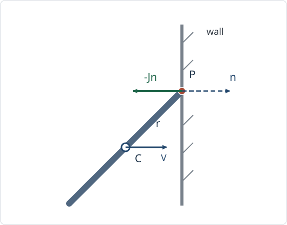

# RBD15 剛体の衝突と接点の衝撃量

<!-- definition-example-audit: strict -->

[RBD7の外力付きNewton–Euler方程式](../RBD7/index.md#thm-rbd7-newton-euler)は、外力を積分すれば並進速度と角速度の変化を記述できます。しかし衝突では、非常に短い時間に大きな接触力が働きます。力の時間波形を知らずに、衝突直後の運動を求めるにはどうすればよいでしょうか。

鍵は**力の大きさそのものではなく、その時間積分（衝撃量）**です。さらに衝突点が重心から外れている場合、同じ衝撃量が重心を動かすとともに回転を生みます。本講では接点の法線相対速度から衝撃量を一意に求め、質量・慣性・反発係数・エネルギーを一つの計算で結び付けます。

対象は**摩擦のない単一接点の瞬間的な法線衝突**です。多点同時衝突、接線摩擦、塑性変形の詳細な応力分布はこのモデルからは決まりません。

## 1. 短時間の力を衝撃量へまとめる

慣性系（空間系）で質量 $m>0$、重心 $C$、重心まわりの空間慣性テンソル $I_s$ を持つ剛体を考えます。接点 $P$ に対し、重心からの腕を $r=x_P-c$ とします。$v$ は重心速度、$\omega$ は空間角速度です。[RBD3の剛体点の速度場](../RBD3/index.md#prop-rbd3-point-velocity)から、**接触している剛体側の物質点**の速度は

$$
v_P=v+\omega\times r
$$

です。幾何学的な接点位置 $P(t)$ の移動速度と混同しません。

時刻 $t_-$ から $t_+$ までの短い衝突区間を考え、直前・直後の量を上付き $-$、$+$ で記します。接触力 $f(t)$ の時間積分

$$
\mathcal J:=\lim_{\varepsilon\to0+}
\int_{t_0-\varepsilon}^{t_0+\varepsilon}f(t)\,dt
$$

を考えます。極限では力は大きくなっても積分値は有限と仮定します。$\mathcal J$ は力とは異なり運動量の単位 $\mathrm{kg\,m/s}$ を持ちます。重力など衝突区間で有界な力の積分は区間長とともに零になります。

<!-- formal-statement-start -->
### 定義（接点の衝撃量と角力積）

剛体の重心を $C$、衝突瞬間の接点を $P$、$r=x_P-c$ とする。接点の合接触力 $f(t)$ の衝撃量を $\mathcal J=\int f(t)\,dt$ の瞬間衝突極限とし、重心まわりの**角力積**を

$$
\mathcal K_C:=\int (x_P(t)-c(t))\times f(t)\,dt
$$

の極限と定める。衝突中の姿勢・腕 $r$ の変位が無視でき、$r$ が極限で一定なら

$$
\mathcal K_C=r\times\mathcal J.
$$
<!-- formal-statement-end -->

<!-- definition-example-start: def-rbd15-contact-impulse -->
### 直接例：同じ横向きの衝撃でも腕が違えば回転する

**定義の確認**：力の時間積分と、その重心まわりの腕とのベクトル積を別々に求めます。接点が $r=(0,a,0)$（$a>0$）にあり、衝突力が $f(t)=(-F(t),0,0)$、$\int F(t)\,dt=J>0$ とします。すると

$$
\mathcal J=(-J,0,0),\qquad
\mathcal K_C=(0,a,0)\times(-J,0,0)=(0,0,aJ).
$$

力の積分は左向き、角力積は $+z$ 方向です。同じ力積が重心に直接作用すると $r=0$ で角力積は零になり、並進速度だけが変化します。接点位置も力の向きも指定しなければ、回転の変化は求まりません。
<!-- definition-example-end -->

[RBD7の外力付きNewton–Euler方程式](../RBD7/index.md#thm-rbd7-newton-euler)を衝突区間で積分すると、剛体の運動量 $mv$ と重心まわりの角運動量 $I_s\omega$ は

$$
m(v^+-v^-)=\mathcal J,\qquad
I_s(\omega^+-\omega^-)=r\times\mathcal J.
$$

第二式では $I_s$ と姿勢を衝突瞬間のものに固定します。厳密には時間依存する空間角運動量 $L_s=I_s(t)\omega(t)$ の**差**を先に積分し、衝突中に姿勢変化が消える極限で上式を得ます。有限時間の運動に無条件で $I_s\Delta\omega=r\times\mathcal J$ を適用してはいけません。

## 2. 二物体の接点速度と反発係数

互いに接する剛体を $A$、$B$ とし、共通の接触位置を $P$ とします。接触位置は一つでも、そこにいる **$A$ 側と $B$ 側の物質点は別々**です。それぞれの重心から接点への腕を $r_A,r_B$ とし、法線単位ベクトル $n$ は $A$ から $B$ へ向けます。

$$
v_{A,P}=v_A+\omega_A\times r_A,\qquad
v_{B,P}=v_B+\omega_B\times r_B.
$$

法線方向の相対速度を $u:=n\cdot(v_{B,P}-v_{A,P})$ と定めます。**$u^-<0$ は接近、$u^->0$ は離反**です。この符号規約のもとでは、摩擦のない接点は $A$ に $-Jn$、$B$ に $+Jn$ の衝撃量を与えます（$J\ge0$）。一方向だけの法線接触では、引っ張る衝撃量 $J<0$ は認めません。

接近中の衝突では、衝突後の離反の法線相対速さを衝突前の接近の法線相対速さで割った比を $e$ と記します。この比を定義する際、前後の速度は同じ接点位置、同じ法線 $n$ で評価します。

<!-- formal-statement-start -->
### 定義（法線反発係数）

二剛体 $A,B$ が摩擦なしの単一接点 $P$ で衝突し、$A$ から $B$ へ向く単位法線を $n$、両側の接点物質点の速度を $v_{A,P}^{\pm},v_{B,P}^{\pm}$ とする。衝突前に $u^-=n\cdot(v_{B,P}^--v_{A,P}^-)<0$ とする。衝突後の法線相対速度を $u^+$ とするとき、

$$
e:=-\frac{u^+}{u^-},\qquad
u^+=-e\,u^-.
$$

を満たす定数 $e$ を法線反発係数という。本講では $0\le e\le1$ の受動的な衝突を仮定する。$e=0$ は法線方向の衝突直後の相対速度が零、$e=1$ は法線方向の速さが反転して等しくなる場合である。
<!-- formal-statement-end -->

<!-- definition-example-start: def-rbd15-restitution -->
### 直接例：二つの接点が速さ3で近づく

**定義の確認**：$n=e_x$、$v_{A,P}^-=2e_x$、$v_{B,P}^-=-e_x$ なら $u^-=-3<0$ であり、接近という仮定が成り立ちます。$e=1/2$ なら $u^+=-(1/2)(-3)=3/2>0$ です。定義へ戻して

$$
-\frac{u^+}{u^-}=-\frac{3/2}{-3}=\frac12
$$

を確認できます。接近していない $u^-\ge0$ に同じ反発式を適用することは、この定義の仮定外です。
<!-- definition-example-end -->

法線反発係数は**接点の法線相対速度**に関する条件であり、二物体の重心の速度比でも角速度比でもありません。$e=0$ でも両重心が同速になる必要はなく、接線方向の相対速度が零になることも要求しません。

## 3. 有効質量：回転の自由度も接点に効く

一つの法線衝撃量 $J$ が接点の法線相対速度をどれだけ変えるかを計算しましょう。質量と重心位置だけでなく、慣性テンソルと腕が必要です。

以下 $I_A,I_B$ は衝突瞬間の**空間系・重心まわり**の慣性テンソルです。両物体の質量 $m_A,m_B>0$、$I_A,I_B$ は正定値と仮定します。正定値なら逆行列が存在し、$w\ne0$ では $w\cdot I_i^{-1}w>0$ です。[RBD6の慣性テンソルの正定値性](../RBD6/index.md#prop-rbd6-positivity)が、この判断の根拠です。

<!-- formal-statement-start -->
### 定理（単一法線接点の有効質量）

質量 $m_A,m_B>0$ と正定値の重心慣性テンソル $I_A,I_B$ を持つ二剛体が、衝突瞬間に共通点 $P$ で接し、そのときの重心からの腕を $r_A,r_B$、$A$ から $B$ への単位法線を $n$ とする。摩擦のない法線衝撃量が $A$ に $-Jn$、$B$ に $+Jn$（$J\ge0$）働き、衝突中の位置・姿勢変化が無視できるとする。このとき法線相対速度の変化は

$$
u^+-u^-=DJ
$$

であり、係数 $D$ は

$$
\begin{aligned}
D={}&\frac1{m_A}+\frac1{m_B}\\
&+(r_A\times n)\cdot I_A^{-1}(r_A\times n)\\
&+(r_B\times n)\cdot I_B^{-1}(r_B\times n)>0.
\end{aligned}
$$

正の数 $m_{\mathrm{eff}}:=D^{-1}$ を、その接点・法線についての**有効質量**という。
<!-- formal-statement-end -->

### 証明の見取り図

各剛体の[衝撃量と角力積](#def-rbd15-contact-impulse)を重心速度と角速度の跳びに変換し、[剛体点速度](../RBD3/index.md#prop-rbd3-point-velocity)へ代入します。ベクトル三重積を使い、回転の寄与が正の二次形式になることを確かめます。

<!-- proof-start -->
### 証明

$A$ 側は $-Jn$、$B$ 側は $+Jn$ の衝撃を受けるので、運動量・角運動量の跳びは

$$
\begin{aligned}
v_A^+-v_A^-&=-\frac J{m_A}n,\\
\omega_A^+-\omega_A^-&=-J I_A^{-1}(r_A\times n),\\
v_B^+-v_B^-&=\frac J{m_B}n,\\
\omega_B^+-\omega_B^-&=J I_B^{-1}(r_B\times n).
\end{aligned}
$$

同じ接点と同じ $r_i$ を衝突前後で使用できる瞬間衝突極限を用います。$u=n\cdot(v_{B,P}-v_{A,P})$ と $v_{i,P}=v_i+\omega_i\times r_i$ から

$$
\begin{aligned}
u^+-u^-={}&n\cdot(\Delta v_B-\Delta v_A)\\
&+n\cdot(\Delta\omega_B\times r_B)
-n\cdot(\Delta\omega_A\times r_A).
\end{aligned}
$$

第一項は $J(1/m_A+1/m_B)$ です。任意のベクトル $w$ について、スカラー三重積の巡回性から

$$
n\cdot(w\times r_i)=w\cdot(r_i\times n).
$$

したがって $B$ の回転項は

$$
n\cdot(\Delta\omega_B\times r_B)
=J(r_B\times n)\cdot I_B^{-1}(r_B\times n)
$$

となり、$A$ の回転項も前に付いたマイナスと $\Delta\omega_A$ のマイナスが打ち消し合い、同じ形の正項になります。これらを加えると $DJ$ の式です。

各回転項は半正定値の二次形式です。加えて $1/m_A+1/m_B>0$ だから、腕が法線と平行でも $D>0$ です。ゆえに $m_{\mathrm{eff}}=1/D>0$ と定義できます。□
<!-- proof-end -->

壁を固定する極限では $B$ 側の並進・回転が変化せず、

$$
D_{\mathrm{wall}}=\frac1m+(r\times n)\cdot I^{-1}(r\times n)
$$

となります。平面内の衝突で角速度が $z$ 軸まわりだけの場合、重心まわりの慣性モーメントを $I>0$、腕を $r=(r_x,r_y,0)$、法線を $n=e_x$ とすれば、$r\times n=-r_y e_z$ なので

$$
D_{\mathrm{wall}}=\frac1m+\frac{r_y^2}{I}.
$$

これは「回転のために接点が動きやすくなる」ことを表します。$r_y=0$ の真正面の衝突なら $D_{\mathrm{wall}}=1/m$、$r_y\ne0$ の偏心衝突なら $D_{\mathrm{wall}}>1/m$ です。

## 4. 衝撃量を一意に決め、エネルギーを検算する

有効質量の式は $u^+-u^-=DJ$ でした。一方、[反発係数の定義](#def-rbd15-restitution)から $u^+-u^-=-(1+e)u^-$ です。両式をつなげると衝撃量が求まります。

<!-- formal-statement-start -->
### 定理（摩擦なし単一接点の衝撃量と速度更新）

質量 $m_A,m_B>0$、正定値の空間慣性テンソル $I_A,I_B$ を持つ二剛体 $A,B$ が、共通点 $P$ に単一の摩擦なし法線接触をする。接点での位置・姿勢は衝突中不変とみなし、法線は $A$ から $B$ へ向く単位ベクトル $n$、重心から接点への腕は $r_A,r_B$ とする。[有効質量の定理](#thm-rbd15-effective-mass)の係数 $D>0$ を用い、衝突前の相対法線速度 $u^-=n\cdot(v_{B,P}^--v_{A,P}^-)<0$、法線反発係数 $0\le e\le1$ とする。衝撃量の大きさは

$$
J=-\frac{(1+e)u^-}{D}
=(1+e)m_{\mathrm{eff}}(-u^-)>0
$$

であり、衝突後の各重心速度と角速度は、前定理の証明にある四つの更新式で求まる。接点が既に離反している $u^->0$ ときは、新たな接触衝撃は加えず $J=0$ とする。$u^-=0$ でもこの瞬間衝突モデルの衝撃量は $J=0$ である。
<!-- formal-statement-end -->

### 証明の見取り図

接近中の $u^-<0$ という条件によって、求めた $J$ は非負になります。離反中には反発式を逆向きに使わず、片側接触が引張り力積を伝達できないことから $J=0$ とします。

<!-- proof-start -->
### 証明

[有効質量の定理](#thm-rbd15-effective-mass)から $D>0$、$u^+-u^-=DJ$ です。[反発係数の定義](#def-rbd15-restitution)による $u^+=-eu^-$ を代入して

$$
DJ=-eu^--u^-=-(1+e)u^-.
$$

$u^-<0$、$1+e>0$、$D>0$ なので $J>0$ です。衝撃量の向きと大きさを四つの速度更新式に代入すれば各物体の衝突後速度が定まり、再び接点速度を計算すると $u^+=-eu^-$ を満たします。

既に離反する $u^->0$ に同じ式を形式的に代入すると $J<0$ となり、接点が引っ張ることになるため片側接触条件 $J\ge0$ に違反します。そこで接触衝撃なしとします。$u^-=0$ では非負の式の右辺が零です。□
<!-- proof-end -->

速度を更新したあと、**全運動エネルギー**でも検算できます。衝突瞬間の重心速度と回転速度に対して

$$
T=\sum_{i=A,B}\left(\frac12m_i|v_i|^2+
\frac12\omega_i\cdot I_i\omega_i\right)
$$

とします。衝突時間は無視できるので位置と姿勢は変化せず、外部の有界な力の仕事は零です。

<!-- formal-statement-start -->
### 命題（法線衝突における運動エネルギー損失）

質量が正で重心まわりの空間慣性テンソルが正定値の二剛体 $A,B$ が、単一接点 $P$ で摩擦なしの法線瞬間衝突を行い、他の衝撃量はないとする。接点・姿勢・法線は衝突中一定とし、$A$ から $B$ へ向く単位法線について、衝突前相対法線速度 $u^-<0$、反発係数 $0\le e\le1$ とする。[有効質量](#thm-rbd15-effective-mass)を $m_{\mathrm{eff}}>0$ と記す。二剛体の衝突前後の全運動エネルギー差は

$$
T^+-T^-=-\frac12m_{\mathrm{eff}}(1-e^2)(u^-)^2\le0.
$$

$e=1$ ならこの理想法線衝突で全運動エネルギーは保存され、$e<1$ かつ $u^-<0$ なら減少する。
<!-- formal-statement-end -->

### 証明の見取り図

速度更新をエネルギーの二次式へ代入し、一次項は接点の初期相対速度 $Ju^-$、二次項は $DJ^2/2$ にまとまることを確かめます。

<!-- proof-start -->
### 証明

衝突中の $I_i$ を一定として、各剛体の運動エネルギー差を平方展開します。$A$ について一次項と二次項に分ければ

$$
\begin{aligned}
\Delta T_A={}&m_Av_A^-\cdot\Delta v_A
+\omega_A^-\cdot I_A\Delta\omega_A\\
&+\frac12m_A|\Delta v_A|^2
+\frac12\Delta\omega_A\cdot I_A\Delta\omega_A\\
={}&-J\,n\cdot(v_A^-+\omega_A^-\times r_A)
+\frac{J^2}{2}
\left(\frac1{m_A}+
(r_A\times n)\cdot I_A^{-1}(r_A\times n)\right).
\end{aligned}
$$

同様に $B$ では衝撃が $+Jn$ なので、一次項は $+J\,n\cdot v_{B,P}^-$、二次項は $B$ 側の正項になります。両者を加えると

$$
\Delta T=J\,n\cdot(v_{B,P}^--v_{A,P}^-)+\frac12DJ^2
=Ju^-+\frac12DJ^2.
$$

ここへ $J=-(1+e)u^-/D$ を代入して、二項を別々に整理すると

$$
\begin{aligned}
\Delta T
&=-\frac{(1+e)(u^-)^2}{D}
+\frac{(1+e)^2(u^-)^2}{2D}\\
&=\frac{(1+e)(e-1)(u^-)^2}{2D}\\
&=-\frac{1-e^2}{2}m_{\mathrm{eff}}(u^-)^2.
\end{aligned}
$$

$m_{\mathrm{eff}}>0$、$0\le e\le1$ なので主張を得ます。□
<!-- proof-end -->

この損失は**二物体の全並進・全回転エネルギーの和**についてです。一方の物体だけの運動エネルギーは衝突によって増えることがあります。また反発係数が $1$ 未満のとき減少した機械的エネルギーの行先を、この理想剛体モデルは微視的には記述しません。

## 5. 偏心した棒の端が固定壁に当たる

壁を $x=\text{一定}$ の固定平面とし、法線を棒から壁へ向かう $n=e_x$ とします。長さ $2\ell$、質量 $m$ の一様で細い棒が、重心 $C$ から右上の端 $P$ へ $\theta=\pi/4$ 傾いた状態で、重心速度 $v^- =V e_x$（$V>0$）、角速度 $\omega^-=0$ のまま右側の壁へ当たります。棒のほかの部分は壁から離れており、初接触は端 $P$ の一点です。

図の矢印 $-Jn$ は**棒へ働く**力積です。$n$ は棒から壁へ向く法線であり、棒へ働く力積とは反対向きです。衝突点から重心へ引いた線と法線が平行ではないため、棒は回転し始めます。**時計回りとは決め付けず**、腕と力積のベクトル積で符号を確認します。

この平面運動に関する重心慣性モーメントは $I=m(2\ell)^2/12=m\ell^2/3$ です。[MECH8の慣性テンソルと運動エネルギー](../../MECH/MECH8/index.md#thm-mech8-inertia-relations)に従って重心を基準にします。

$$
r=(\ell/\sqrt2,\ell/\sqrt2,0),\qquad
r\times n=-(\ell/\sqrt2)e_z.
$$

[有効質量の公式](#thm-rbd15-effective-mass)の壁極限を用いると、$r_y=\ell/\sqrt2$ だから

$$
D=\frac1m+\frac{\ell^2/2}{m\ell^2/3}
=\frac{5}{2m},\qquad
m_{\mathrm{eff}}=\frac{2m}{5}.
$$

壁側の速度は零で $u^-=-V$ なので、[衝撃量の定理](#thm-rbd15-impact-law)から

$$
J=\frac{2m}{5}(1+e)V.
$$

棒への力積 $-Je_x$ は、重心の $x$ 速度を $J/m$ だけ減らし、$r\times(-Je_x)=+(J\ell/\sqrt2)e_z$ の角力積を与えます。よって

$$
\begin{aligned}
v_C^+&=\left(1-\frac{2}{5}(1+e)\right)V e_x
=\frac{3-2e}{5}V e_x,\\
\omega^+&=\frac{J\ell/\sqrt2}{m\ell^2/3}e_z
=\frac{3\sqrt2}{5}(1+e)\frac V\ell e_z.
\end{aligned}
$$

最初は回っていなかった棒が **$+z$ 方向に回り始める**ことを、力積の腕から求められました。端の衝突後 $x$ 速度をもう一度計算すると

$$
\begin{aligned}
(v_P^+)_x
&=(v_C^+)_x-\omega_z^+r_y\\
&=\frac{3-2e}{5}V
-\frac{3\sqrt2}{5}(1+e)\frac V\ell\frac{\ell}{\sqrt2}\\
&=-eV.
\end{aligned}
$$

$e=0$ では直後の接点の法線速度が零、$e=1$ では速度が $-V$ に反転します。完全反発 $e=1$ の場合、重心の右向き速度は $V/5$ のままでも接点は左向きに離反します。**重心が跳ね返ること**と**接点が離反すること**を取り違えてはいけません。

## 6. 回る二物体が衝突する数値例

次は壁ではなく、両方の物体が動く例です。平面内の二剛体の質量・慣性モーメント・腕を

$$
m_A=2,\quad m_B=1,\quad I_A=I_B=1,\quad
r_A=(0,1),\quad r_B=(0,-1/2),\quad n=e_x
$$

とします（単位は一貫した質量・長さ・時間系）。衝突前には $v_A^-=2e_x$、$v_B^-=-e_x$、$\omega_A^-=\omega_B^-=0$ とし、$e=1/2$ です。

接点速度の公式で $u^-=-3$、腕のベクトル積で $r_A\times n=-e_z$、$r_B\times n=(1/2)e_z$ です。ゆえに

$$
D=\frac12+1+1+\frac14=\frac{11}{4},\qquad
J=-\frac{(1+1/2)(-3)}{11/4}=\frac{18}{11}.
$$

各物体について並進・回転の変化を別々に代入します。

$$
\begin{aligned}
v_A^+&=\left(2-\frac{J}{2}\right)e_x
=\frac{13}{11}e_x,&
\omega_A^+&=+Je_z=\frac{18}{11}e_z,\\
v_B^+&=(-1+J)e_x
=\frac7{11}e_x,&
\omega_B^+&=\frac J2e_z=\frac9{11}e_z.
\end{aligned}
$$

$P$ における衝突後速度の法線成分は

$$
(v_{A,P}^+)_x=\frac{13}{11}-\frac{18}{11}=-\frac5{11},\quad
(v_{B,P}^+)_x=\frac7{11}+\frac{9}{22}=\frac{23}{22},
$$

したがって $u^+=23/22-(-5/11)=3/2=-eu^-$ です。$e<1$ なので[エネルギー損失の命題](#prop-rbd15-energy-loss)により

$$
T^+-T^-=-\frac12\frac4{11}\left(1-\frac14\right)9
=-\frac{27}{22}.
$$

実際に $T^-=9/2$、$T^+=36/11$ であり、差は $36/11-9/2=-27/22$ です。質量の和だけで相対速度を扱うと、ここでの回転項 $1+1/4$ を落として誤った結果になります。

## 7. このモデルが扱わないもの

1. **離反している接点**：$u^-\ge0$ に接近用の反発式を適用して負の力積を作らない。新たな接触力積は零です。
2. **摩擦のある接触**：ここでの衝撃量は $Jn$ のみです。接線力積を含めると、法線と接線の速度変化が慣性テンソルを介して結合し得ます。[RBD14の滑り散逸](../RBD14/index.md#prop-rbd14-slip-dissipation)の連続時間の摩擦力を、根拠なく衝撃時間へ転用してはいけません。
3. **複数接点の同時衝突**：一つの $D$ と一つの反発式では閉じません。接触点ごとの拘束と力積の同時解が必要です。
4. **実物体の変形**：反発係数は散逸を代表する経験的なパラメータです。剛体という近似だけでは、微視的な塑性変形・弾性波や接触時間は計算できません。

## 演習

## Level A

### 問題 A1：接点の法線速度はどちら向きか

$n=e_x$、$r_A=(0,2,0)$、$v_A=(4,0,0)$、$\omega_A=(0,0,1)$、$B$ は静止しているとする。$u^-$ を求め、接近か離反かを判定せよ。

- Level: A

<!-- solution-start -->
### 詳細解答

[剛体点の速度公式](../RBD3/index.md#prop-rbd3-point-velocity)に $r_A$ と $\omega_A$ を代入します。

$$
\omega_A\times r_A=(0,0,1)\times(0,2,0)=(-2,0,0),
\quad v_{A,P}=(2,0,0).
$$

$B$ は静止するので $v_{B,P}=0$ です。$n=e_x$ を法線相対速度へ代入すると

$$
u^-=e_x\cdot(0-2e_x)=-2<0.
$$

接点は速さ $2$ で接近しています。重心の速さ $4$ だけを比較すれば回転による減速を見落とします。
<!-- solution-end -->

### 問題 A2：横向きの力積と角力積

$r=(0,-a,0)$（$a>0$）の接点に $+Je_x$（$J>0$）の衝撃量を受ける物体について、角力積と重心速度の変化を、質量 $m>0$ で表せ。

- Level: A

<!-- solution-start -->
### 詳細解答

[接点の衝撃量と角力積の定義](#def-rbd15-contact-impulse)に $r$ と $\mathcal J=Je_x$ を代入します。

$$
\mathcal K_C=(0,-a,0)\times(J,0,0)=(0,0,aJ).
$$

並進は衝撃量を質量で割るため

$$
\Delta v=\frac{\mathcal J}{m}=\frac Jm e_x.
$$

角力積は $+z$ 向きです。角速度の変化まで出すには重心慣性テンソルまたは対応する主慣性モーメントが必要です。
<!-- solution-end -->

### 問題 A3：反発係数の符号

接近速度 $u^-=-5$ の衝突で $e=3/5$ とする。$u^+$ を求めよ。また $u^-=+5$ に同じ式を当てはめてはいけない理由を答えよ。

- Level: A

<!-- solution-start -->
### 詳細解答

[反発係数の定義](#def-rbd15-restitution)の適用条件 $u^-<0$ を満たすので

$$
u^+=-eu^-=-\frac35(-5)=3.
$$

接近が離反へ切り替わります。$u^-=+5$ は衝突前から離反しており定義の仮定外です。もし形式的に反発式を使うと、[衝撃量の定理](#thm-rbd15-impact-law)で負の衝撃量を要求し、接点が引張り力積を伝えるという片側接触に反した予測になります。したがって新たな衝撃量は零です。
<!-- solution-end -->

### 問題 A4：回転を生じない正面衝突

二つの球の中心を結ぶ線が法線 $n$ と一致する衝突を考える。$m_A=2,m_B=3$、$u^-=-5$、$e=1$ とする。法線衝撃量の大きさと、角速度が変わらない理由を求めよ。

- Level: A

<!-- solution-start -->
### 詳細解答

各球の中心と接点が法線上にあるので $r_A\times n=r_B\times n=0$ です。[有効質量の定理](#thm-rbd15-effective-mass)から回転項は消え、

$$
D=\frac12+\frac13=\frac56,\qquad m_{\mathrm{eff}}=\frac65.
$$

よって[衝撃量の定理](#thm-rbd15-impact-law)で

$$
J=-(1+1)\frac{-5}{5/6}=12.
$$

各物体の重心速度は $A$ が法線方向に $-12/2=-6$、$B$ が $+12/3=+4$ だけ変化します。角速度更新式では $r_i\times n=0$ なので、角力積が零で角速度は変わりません。
<!-- solution-end -->

### 問題 A5：壁に当たる斜め棒の完全非弾性極限

第5節と同じ一様棒と壁の設定で $e=0$ とする。棒の衝突後の重心速度、角速度、接点の法線速度を求めよ。

- Level: A

<!-- solution-start -->
### 詳細解答

$r_y=\ell/\sqrt2$、$I=m\ell^2/3$ なので、[有効質量の定理](#thm-rbd15-effective-mass)で $D=5/(2m)$ です。$u^-=-V$、$e=0$ から

$$
J=\frac{V}{5/(2m)}=\frac{2mV}{5}.
$$

[速度更新の定理](#thm-rbd15-impact-law)より

$$
v_C^+=\left(V-\frac Jm\right)e_x=\frac35Ve_x,\qquad
\omega_z^+=\frac{J\ell/\sqrt2}{m\ell^2/3}
=\frac{3\sqrt2}{5}\frac V\ell.
$$

接点の速度は

$$
(v_P^+)_x=\frac35V-\frac{3\sqrt2}{5}\frac V\ell\frac{\ell}{\sqrt2}=0.
$$

$e=0$ が意味するのは衝突直後の**法線接点相対速度零**であり、重心が静止することではありません。
<!-- solution-end -->

## Level B

### 問題 B1：偏心棒の完全反発とエネルギー

第5節の斜め棒について $e=1$ とする。並進・回転エネルギーを別々に計算し、衝突前と和が一致することを示せ。

- Level: B

<!-- solution-start -->
### 詳細解答

法線速度 $u^-=-V$、$D=5/(2m)$ なので $e=1$ の力積は $J=4mV/5$ です。重心速度と角速度を先に更新すると

$$
v_C^+=\left(V-\frac{4V}{5}\right)e_x=\frac V5e_x,\quad
\omega^+=\frac{(4mV/5)(\ell/\sqrt2)}{m\ell^2/3}e_z
=\frac{6\sqrt2}{5}\frac V\ell e_z.
$$

衝突前の角速度は零で $T^-=\tfrac12mV^2$ です。衝突後の並進エネルギーは

$$
T_{\mathrm{trans}}^+=\frac12m\left(\frac V5\right)^2
=\frac1{50}mV^2.
$$

回転エネルギーは $I=m\ell^2/3$ により

$$
T_{\mathrm{rot}}^+=\frac12\frac{m\ell^2}{3}
\left(\frac{6\sqrt2 V}{5\ell}\right)^2
=\frac{12}{25}mV^2.
$$

したがって

$$
T^+=\left(\frac1{50}+\frac{24}{50}\right)mV^2
=\frac12mV^2=T^-.
$$

[エネルギー損失の命題](#prop-rbd15-energy-loss)の $e=1$ と一致します。並進だけを比較すると、回転へ分配された分を損失と誤認します。
<!-- solution-end -->

### 問題 B2：二物体の回転が衝突で生まれる

平面剛体 $A,B$ で $m_A=m_B=1$、$I_A=I_B=1$、$r_A=(0,1)$、$r_B=(0,-1)$、$n=e_x$、$v_A^-=e_x$、$v_B^-=0$、$\omega_A^-=\omega_B^-=0$、$e=1$ とする。$J$ と四つの衝突後速度を求め、反発係数を接点速度で検算せよ。

- Level: B

<!-- solution-start -->
### 詳細解答

$r_A\times n=-e_z$、$r_B\times n=e_z$ です。衝突前の接点法線相対速度は $u^-=-1$ なので、

$$
D=1+1+1+1=4,\qquad J=-\frac{2(-1)}4=\frac12.
$$

[有効質量の定理の証明](#thm-rbd15-effective-mass)の四つの速度更新式に代入すると

$$
\begin{aligned}
v_A^+&=\frac12e_x,&\omega_A^+&=+\frac12e_z,\\
v_B^+&=\frac12e_x,&\omega_B^+&=+\frac12e_z.
\end{aligned}
$$

重心速度は等しくなりますが、接点速度は一致しません。$r_A=(0,1)$、$r_B=(0,-1)$ を代入すると

$$
(v_{A,P}^+)_x=\frac12-\frac12=0,\qquad
(v_{B,P}^+)_x=\frac12+\frac12=1.
$$

よって $u^+=1=-u^-$ で $e=1$ を満たします。並進と回転の両方を含めた全エネルギーは、衝突前 $\tfrac12$、衝突後 $4(\tfrac12\times\tfrac14)=\tfrac12$ で保存されます。
<!-- solution-end -->

### 問題 B3：離反しているのに反発式を使う誤り

二物体について $D=2$、$u^-=+3$、仮に $e=1/2$ とする。衝突式を形式的に使うとどんな $J$ が出るか。その値が不適切な理由と、正しい瞬間衝撃量を答えよ。

- Level: B

<!-- solution-start -->
### 詳細解答

衝突式を接近条件を無視して代入すると

$$
J_{\mathrm{formal}}=-\frac{(1+1/2)3}{2}=-\frac94.
$$

負の $J$ は $A$ に $-Jn$ ではなく $+|J|n$、$B$ に $-|J|n$ の引張り衝撃を与え、**離れつつある物体を瞬間的に引き戻す**仮定になります。これは摩擦のない片側接触の法線反力が圧縮だけを伝える条件と矛盾します。[衝撃量の定理](#thm-rbd15-impact-law)では $u^->0$ の分岐を使い $J=0$ です。反発係数はこの離反事象の更新に使いません。
<!-- solution-end -->

### 問題 B4：法線方向が重心を貫くときの縮約質量

正面衝突で $r_A\times n=r_B\times n=0$、質量 $m_A,m_B>0$ とする。$m_{\mathrm{eff}}=m_Am_B/(m_A+m_B)$ を導き、$m_B\to\infty$ の固定壁極限を求めよ。なぜ重心の法線速度のみによって衝突が決まるか説明せよ。

- Level: B

<!-- solution-start -->
### 詳細解答

[有効質量の定理](#thm-rbd15-effective-mass)の二つの回転項が、腕と法線が平行という仮定から零になります。したがって

$$
D=\frac1{m_A}+\frac1{m_B}
=\frac{m_A+m_B}{m_Am_B}.
$$

正値なので逆数を取って

$$
m_{\mathrm{eff}}=\frac1D=\frac{m_Am_B}{m_A+m_B}.
$$

$m_B\to\infty$ の極限は分子分母を $m_B$ で割り、

$$
m_{\mathrm{eff}}=\frac{m_A}{1+m_A/m_B}\longrightarrow m_A.
$$

また $n\cdot(\omega_i\times r_i)=\omega_i\cdot(r_i\times n)=0$ です。したがって法線相対速度 $u^-$ は重心の法線方向速度の差そのものとなり、衝撃量もそれで決まります。$r_i$ の法線方向成分が零でなければならないわけではなく、**平行**で十分です。
<!-- solution-end -->

## Level C

### 問題 C1：初期回転のある二物体の偏心衝突

摩擦のない平面二剛体の単一法線衝突を考える。質量・重心まわりの慣性モーメント・接点への腕・初速度を次で与える（すべて同一の整合した単位系）。

$$
\begin{aligned}
&m_A=2,\quad I_A=1,\quad r_A=(0,1),\quad
v_A^-=2e_x,\quad \omega_A^-=e_z,\\
&m_B=1,\quad I_B=2,\quad r_B=(0,-1),\quad
v_B^-=-e_x,\quad\omega_B^-=-\tfrac12e_z,\\
&n=e_x,\qquad e=\tfrac12.
\end{aligned}
$$

1. 衝突前の二つの接点速度と $u^-$ を計算し、接近を確認せよ。
2. $D$、$m_{\mathrm{eff}}$、$J$ を求めよ。
3. 衝突後の二つの重心速度と角速度を求め、接点で反発式を直接検算せよ。
4. 衝突前後の並進・回転を含む全エネルギー差を直接求め、[エネルギー損失の命題](#prop-rbd15-energy-loss)と一致することを示せ。

- Level: C

<!-- solution-start -->
### 詳細解答

**1. 接近速度。** $z$ 軸まわりの角速度 $\omega_z$ と腕 $(0,r_y)$ に対して $(\omega\times r)_x=-\omega_z r_y$ です。[RBD3の速度公式](../RBD3/index.md#prop-rbd3-point-velocity)へ各値を代入すると

$$
(v_{A,P}^-)_x=2-(1)(1)=1,\qquad
(v_{B,P}^-)_x=-1-(-1/2)(-1)=-\frac32.
$$

したがって

$$
u^-=-\frac32-1=-\frac52<0.
$$

**2. 有効質量と力積。** 腕のベクトル積は $r_A\times n=-e_z$、$r_B\times n=+e_z$ です。質量項と回転項を別々に書けば

$$
D=\frac12+1+\frac{1^2}{1}+\frac{1^2}{2}=3,\qquad
m_{\mathrm{eff}}=\frac13.
$$

[衝撃量の定理](#thm-rbd15-impact-law)を適用できるのは第1問で $u^-<0$ を確認したためです。

$$
J=-\frac{(1+1/2)(-5/2)}3=\frac54.
$$

**3. 速度更新と反発式。** $A$ に $-Je_x$、$B$ に $+Je_x$、それぞれの角力積は $A$ が $+Je_z$、$B$ が $+Je_z$ です。したがって

$$
\begin{aligned}
v_A^+&=\left(2-\frac{5/4}{2}\right)e_x=\frac{11}{8}e_x,\\
\omega_A^+&=\left(1+\frac{5/4}{1}\right)e_z=\frac94e_z,\\
v_B^+&=\left(-1+\frac54\right)e_x=\frac14e_x,\\
\omega_B^+&=\left(-\frac12+\frac{5/4}{2}\right)e_z=\frac18e_z.
\end{aligned}
$$

衝突後の接点速度は

$$
(v_{A,P}^+)_x=\frac{11}{8}-\frac94=-\frac78,\qquad
(v_{B,P}^+)_x=\frac14-\frac18(-1)=\frac38.
$$

その差は

$$
u^+=\frac38-\left(-\frac78\right)=\frac54
=-\frac12\left(-\frac52\right)=-eu^-.
$$

**4. エネルギー。** 回転を衝突前から持っているため、初期の回転エネルギーを落とさないことが重要です。

$$
\begin{aligned}
T^-&=\frac12(2)(2)^2+\frac12(1)(1)^2
+\frac12(1)(1)^2+\frac12(2)(-1/2)^2\\
&=4+\frac12+\frac12+\frac14=\frac{21}{4}.
\end{aligned}
$$

衝突後は並進・回転の四項を同じ質量・慣性値で計算して

$$
\begin{aligned}
T^+&=\frac12(2)\left(\frac{11}{8}\right)^2
+\frac12(1)\left(\frac14\right)^2\\
&\quad+\frac12(1)\left(\frac94\right)^2
+\frac12(2)\left(\frac18\right)^2\\
&=\frac{121}{64}+\frac2{64}+\frac{162}{64}+\frac1{64}
=\frac{143}{32}.
\end{aligned}
$$

よって $\Delta T=143/32-21/4=-25/32$ です。他方、[エネルギー損失の命題](#prop-rbd15-energy-loss)では

$$
-\frac12\frac13\left(1-\frac14\right)
\left(-\frac52\right)^2
=-\frac12\cdot\frac13\cdot\frac34\cdot\frac{25}{4}
=-\frac{25}{32}.
$$

両者は一致します。$e=1/2<1$ と接近速度が非零であるため、減少は厳密に負です。重心速度だけを更新したり、初期回転を無視したりすれば、この一致は失われます。
<!-- solution-end -->

## 学びの確認

接点の法線相対速度を定めて接近を判定し、$D$ から $J$ を求め、二つの運動量・角運動量の跳びを計算して、最後に反発係数と全エネルギーを再検算できれば、本講の衝突モデルを一貫して使えます。次講では、このような運動方程式を刻み幅をもつ数値計算へ移すときの姿勢のずれとエネルギー・角運動量の数値誤差の監査を扱います。
