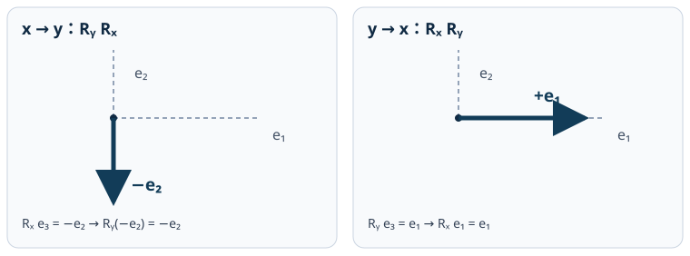

# RBD2 回転行列・軸角・非可換な有限回転

<!-- definition-example-audit: strict -->

> **前提**：[RBD1 の向きを保つ回転](../RBD1/index.md#def-rbd1-proper-rotation)、[剛体配置の合成と逆変換](../RBD1/index.md#prop-rbd1-composition)、[MECH8 の剛体](../../MECH/MECH8/index.md#def-mech8-rigid-body)。ここでは列ベクトルに左から作用する**能動回転**を用います。

## 1. 九個の成分ではなく、軸と角で姿勢を読みたい

[RBD1 の回転行列](../RBD1/index.md#def-rbd1-proper-rotation)は $R^{\mathsf T}R=I_3,\ \det R=1$ を満たします。しかし、行列を見ただけでは「どの方向を中心に何度回したか」を読み取りにくいのが難点です。三次元では、同じ二つの回転でも順序を変えると姿勢が変わります。

実験室に固定した右手系の正規直交基底を $e_1,e_2,e_3$ とし、ベクトルは列で表します。まず回転を**軸に沿う部分を保ち、垂直な平面だけを回す操作**として構成します。

$|n|=1$ のとき任意の $v$ は

$$
v=v_{\parallel}+v_{\perp},\quad
v_{\parallel}=n(n\cdot v),\quad
v_{\perp}=v-n(n\cdot v)
$$

と分解され、$n\cdot v_\perp=n\cdot v-|n|^2(n\cdot v)=0$ です。$n$ は軸、$\theta$ はその軸から右ねじの方向へ測る角度を表します。

<!-- formal-statement-start -->
### 定義（回転の軸角表示）

単位ベクトル $n\in\mathbb R^3$ と角度 $\theta\in\mathbb R$ について、$n$ を固定し、その直交平面 $n^\perp$ を右手系の正方向に $\theta$ だけ回す $R\in SO(3)$ を、軸角表示 $(n,\theta)$ の回転といい、$R(n,\theta)$ と書く。
<!-- formal-statement-end -->

<!-- definition-example-start: def-rbd2-axis-angle -->
### 直接例：$z$ 軸の90度回転

**定義の確認**：条件を一つずつ確認します。$n=e_3=(0,0,1)^{\mathsf T}$ は単位長です。行列

$$
Q=\begin{pmatrix}0&-1&0\\1&0&0\\0&0&1\end{pmatrix}
$$

は $Qe_3=e_3$ なので軸を固定します。$n^\perp$ の正向き基底 $(e_1,e_2)$ において $Qe_1=e_2,\ Qe_2=-e_1$ なので平面上の正向き90度回転です。さらに列が正規直交し $Q^{\mathsf T}Q=I_3$、左上の $2\times2$ 行列式が $1$ なので $\det Q=1$。従って $Q=R(e_3,\pi/2)\in SO(3)$ です。
<!-- definition-example-end -->

## 2. Eulerの回転定理――固定軸は常に存在するか

定義では先に軸を指定しました。反対に、任意に与えられた $R\in SO(3)$ から固定軸を見つけられるでしょうか。三次元であることと、回転が向きを保つことが鍵になります。

<!-- formal-statement-start -->
### 定理（Eulerの回転定理）

任意の $R\in SO(3)$ に対して単位ベクトル $n$ と実数 $\theta$ が存在し、$R=R(n,\theta)$ と書ける。特に $Rn=n$ である。$R\ne I_3$ なら固定軸の直線は一意で、$(n,\theta)$ と $(-n,-\theta)$ は同じ回転を表し、角度は $2\pi$ の整数倍だけ変えてよい。
<!-- formal-statement-end -->

### 証明の見取り図

$\det(R-I_3)=0$ を示して固有値 $1$ の実ベクトルを作ります。その軸の垂直平面が不変になり、そこで向きを保つ二次元の回転しか起こり得ないと証明します。

<!-- proof-start -->
### 証明

$R^{\mathsf T}R=I_3,\ \det R=1$ より $R^{-1}=R^{\mathsf T}$。行列式の積を用いて

$$
\begin{aligned}
\det(R-I_3)&=\det R\det(I_3-R^{-1})\\
&=\det(I_3-R^{\mathsf T})=\det(I_3-R).
\end{aligned}
$$

しかし三次元なので $\det(I_3-R)=(-1)^3\det(R-I_3)=-\det(R-I_3)$。従って $\det(R-I_3)=0$ となり、実ベクトル $n\ne0$ で $Rn=n$ が存在します。長さで割って $|n|=1$ にします。

$n^\perp=\{v:n\cdot v=0\}$ について、$R^{\mathsf T}n=n$ なので

$$
n\cdot Rv=(R^{\mathsf T}n)\cdot v=n\cdot v=0.
$$

よって $n^\perp$ は不変です。この平面の正向き正規直交基底 $u,w$ を選び $(u,w,n)$ を右手系にすると、$R$ は

$$
\begin{pmatrix}A&0\\0&1\end{pmatrix},\quad
A^{\mathsf T}A=I_2,\quad\det A=1
$$

と表示されます。$A$ の第1列を $(a,b)^{\mathsf T}$ とすれば $a^2+b^2=1$、第2列は直交条件と行列式 $1$ より $(-b,a)^{\mathsf T}$ です。よって

$$
A=\begin{pmatrix}a&-b\\b&a\end{pmatrix}
=\begin{pmatrix}\cos\theta&-\sin\theta\\\sin\theta&\cos\theta\end{pmatrix}.
$$

すなわち $R=R(n,\theta)$ です。$R\ne I_3$ で固定ベクトルが独立に二本あれば、それらを正規直交化した $u,w$ と、右手系の向きを保つことから $u\times w$ も固定されます。三本の基底すべてを固定するので $R=I_3$ となり矛盾です。ゆえに固定軸は直線として一意。軸を反対に向けると正の回転方向も逆になるため $(n,\theta)$ と $(-n,-\theta)$ が同じ操作です。$R=I_3$ は全方向を固定する例外です。
<!-- proof-end -->

ここでいう「固有軸」は単なる図示でなく、一次方程式 $(R-I_3)n=0$ の非零解として計算できます。ただし軸の**向き**と角度の符号を一緒に扱う必要があります。

## 3. ベクトル積を反対称行列へ変える

軸に垂直な方向を90度回すには $n\times v$ が便利です。これは $v$ に線形なので、行列として計算できます。$n=(n_1,n_2,n_3)^{\mathsf T}$ と書くと、ベクトル積の成分は $(n_2v_3-n_3v_2,\ n_3v_1-n_1v_3,\ n_1v_2-n_2v_1)^{\mathsf T}$ です。

<!-- formal-statement-start -->
### 定義（ベクトル積の反対称行列）

$n=(n_1,n_2,n_3)^{\mathsf T}\in\mathbb R^3$ について

$$
\widehat n=\begin{pmatrix}
0&-n_3&n_2\\n_3&0&-n_1\\-n_2&n_1&0
\end{pmatrix}
$$

と定める。任意の $v\in\mathbb R^3$ について $\widehat nv=n\times v$、また $\widehat n^{\mathsf T}=-\widehat n$ となる。
<!-- formal-statement-end -->

<!-- definition-example-start: def-rbd2-hat -->
### 直接例：$n=e_3$ の場合

**定義の確認**：成分を代入すると

$$
\widehat{e_3}=\begin{pmatrix}0&-1&0\\1&0&0\\0&0&0\end{pmatrix}.
$$

任意の $v=(a,b,c)^{\mathsf T}$ に掛けると $(-b,a,0)^{\mathsf T}$ となり、$e_3\times v$ の成分計算と一致します。また転置で上右の $-1$ と下左の $1$ が入れ替わり全体が負になるので反対称性を直接確認しました。
<!-- definition-example-end -->

$|n|=1$ とするとベクトル三重積から

$$
\widehat n^2v=n\times(n\times v)=n(n\cdot v)-v.
$$

すべての $v$ に成立するので

$$
\boxed{\widehat n^2=nn^{\mathsf T}-I_3},\qquad
\widehat n n=0,\qquad \widehat n^3=-\widehat n
$$

です。ここが次の公式を二つの三角関数だけで表せる理由です。

## 4. Rodrigues公式を軸に平行・垂直な成分から導く

$v_\perp\ne0$ のとき、$v_\perp$ と $n\times v_\perp$ は同じ長さで直交し、$n$ から見て正向きの平面基底になります。そこで二次元の回転公式を当てはめれば、

$$
Rv=v_\parallel+\cos\theta\,v_\perp+
\sin\theta(n\times v_\perp)
$$

です。$n\times v_\parallel=0$ なので $n\times v_\perp=n\times v$ を使えます。

<!-- formal-statement-start -->
### 定理（Rodriguesの回転公式）

$|n|=1$、$\theta\in\mathbb R$ とする。軸角表示 $R(n,\theta)$ は

$$
\boxed{R(n,\theta)=I_3+\sin\theta\,\widehat n+
(1-\cos\theta)\widehat n^2}
$$

と表せ、任意の $v\in\mathbb R^3$ に対して

$$
\boxed{Rv=v\cos\theta+(n\times v)\sin\theta+
n(n\cdot v)(1-\cos\theta)}
$$

が成り立つ。特に $Rn=n,\ R^{\mathsf T}R=I_3,\ \det R=1$ である。
<!-- formal-statement-end -->

### 証明の見取り図

軸方向と垂直方向に分けた $v$ を使い、$v_\perp$ を元の $v$ で表し直します。$\widehat n^2=nn^{\mathsf T}-I_3$ により行列形へ直し、軸に合わせた直交基底で直交性・行列式を検証します。

<!-- proof-start -->
### 証明

$|v_\perp|^2=|n\times v_\perp|^2$ は $|n|=1$、$n\cdot v_\perp=0$ から従い、$v_\perp\cdot(n\times v_\perp)=0$ です。前節で確かめた平面内の正向きの回転の成分表示を使うと

$$
\begin{aligned}
Rv&=n(n\cdot v)+\cos\theta[v-n(n\cdot v)]
+\sin\theta(n\times v)\\
&=v\cos\theta+n(n\cdot v)(1-\cos\theta)
+(n\times v)\sin\theta.
\end{aligned}
$$

$v_\perp=0$ のときも両辺は $v$ に等しいです。これを $\widehat nv=n\times v$ と $\widehat n^2v=n(n\cdot v)-v$ で書き直すと、任意の $v$ に対する等式

$$
Rv=[I_3+\sin\theta\,\widehat n+(1-\cos\theta)\widehat n^2]v
$$

が得られるため行列形が成立します。$v=n$ を代入すると $Rn=n$。$u\perp n,\ |u|=1$ を選び基底 $(u,n\times u,n)$ に直すと、行列は

$$
\begin{pmatrix}\cos\theta&-\sin\theta&0\\
\sin\theta&\cos\theta&0\\0&0&1\end{pmatrix}.
$$

その転置との積は $I_3$、行列式は $\cos^2\theta+\sin^2\theta=1$ です。基底は正規直交かつ右手系なので、元の座標で $R^{\mathsf T}R=I_3,\det R=1$ も成立します。
<!-- proof-end -->

$e_1,e_2$ 軸に $\theta=\pi/2$ を代入すると、今後何度も使う二つの回転が得られます。

$$
R_x=\begin{pmatrix}1&0&0\\0&0&-1\\0&1&0\end{pmatrix},
\qquad
R_y=\begin{pmatrix}0&0&1\\0&1&0\\-1&0&0\end{pmatrix}.
$$

$R_xe_2=e_3$、$R_xe_3=-e_2$、$R_ye_3=e_1$、$R_ye_1=-e_3$ として軸と向きも確認できます。

### 行列から角度・軸を取り戻す

軸に垂直な二次元部分の対角成分はどちらも $\cos\theta$ で、軸の成分は $1$ です。また $\widehat n$ は反対称、$\widehat n^2$ は対称です。従って

$$
\boxed{\operatorname{tr}R=1+2\cos\theta},\qquad
\boxed{R-R^{\mathsf T}=2\sin\theta\,\widehat n}.
$$

前者から $\theta\in[0,\pi]$ を選び、$\sin\theta\ne0$ のとき後者から軸の向きを復元できます。ただし $\theta=0$ は恒等回転で軸が非一意、$\theta=\pi$ は $\sin\theta=0$ なので**反対称部分を割ってはいけません**。後者では $(R-I_3)n=0$ を直接解きます。

## 5. なぜ指数関数が回転になるか

行列の指数関数を冪級数

$$
\exp(A)=\sum_{k=0}^{\infty}\frac{A^k}{k!}
$$

で定めます。固定サイズの行列では各成分を有限定数で抑えられるため、この級数は任意の行列で絶対収束します。$\widehat n^3=-\widehat n$ なら高次の冪が二種類にまとまります。

<!-- formal-statement-start -->
### 命題（回転の指数表示）

$|n|=1$、$\theta\in\mathbb R$ とすると、

$$
\boxed{\exp(\theta\widehat n)=R(n,\theta)}.
$$
<!-- formal-statement-end -->

### 証明の見取り図

奇数冪の係数が正弦の級数、偶数冪の係数が $1-\cos\theta$ の級数となることを明示します。

<!-- proof-start -->
### 証明

$\widehat n^3=-\widehat n$ から帰納的に

$$
\widehat n^{2j+1}=(-1)^j\widehat n\quad(j\ge0),\qquad
\widehat n^{2j}=(-1)^{j-1}\widehat n^2\quad(j\ge1).
$$

従って

$$
\begin{aligned}
e^{\theta\widehat n}
&=I_3+\left[\sum_{j=0}^{\infty}
\frac{(-1)^j\theta^{2j+1}}{(2j+1)!}\right]\widehat n
+\left[\sum_{j=1}^{\infty}
\frac{(-1)^{j-1}\theta^{2j}}{(2j)!}\right]\widehat n^2\\
&=I_3+\sin\theta\,\widehat n+(1-\cos\theta)\widehat n^2
=R(n,\theta).
\end{aligned}
$$

最後の等号は[Rodrigues公式](#thm-rbd2-rodrigues)です。
<!-- proof-end -->

小角 $\theta$ では

$$
R(n,\theta)=I_3+\theta\widehat n+\frac{\theta^2}{2}\widehat n^2+O(\theta^3).
$$

一次近似 $I_3+\theta\widehat n$ は**厳密には有限回転でない**ことに注意します。なぜなら

$$
(I_3+\theta\widehat n)^{\mathsf T}
(I_3+\theta\widehat n)=I_3-\theta^2\widehat n^2
$$

となり、一般に $I_3$ ではないからです。

## 6. 二回の回転の順序を比較する

[剛体配置の合成則](../RBD1/index.md#prop-rbd1-composition)では、列ベクトルに先に作用する行列が**右側**です。先に $x$ 軸、次に $y$ 軸なら $R_yR_x$。逆順なら $R_xR_y$ と書きます。

<!-- formal-statement-start -->
### 命題（有限回転の非可換性）

$R_x=R(e_1,\pi/2)$、$R_y=R(e_2,\pi/2)$ とすると

$$
R_yR_x=\begin{pmatrix}0&1&0\\0&0&-1\\-1&0&0\end{pmatrix},
\qquad
R_xR_y=\begin{pmatrix}0&0&1\\1&0&0\\0&1&0\end{pmatrix}.
$$

特に $R_yR_x\ne R_xR_y$ である。
<!-- formal-statement-end -->

### 証明の見取り図

[Rodriguesの回転公式](#thm-rbd2-rodrigues)から得た二つの行列を両順に掛け、同じベクトル $e_3$ の像を比較します。

<!-- proof-start -->
### 証明

具体的に

$$
\begin{aligned}
R_yR_x&=
\begin{pmatrix}0&0&1\\0&1&0\\-1&0&0\end{pmatrix}
\begin{pmatrix}1&0&0\\0&0&-1\\0&1&0\end{pmatrix}
=\begin{pmatrix}0&1&0\\0&0&-1\\-1&0&0\end{pmatrix},\\
R_xR_y&=
\begin{pmatrix}1&0&0\\0&0&-1\\0&1&0\end{pmatrix}
\begin{pmatrix}0&0&1\\0&1&0\\-1&0&0\end{pmatrix}
=\begin{pmatrix}0&0&1\\1&0&0\\0&1&0\end{pmatrix}.
\end{aligned}
$$

$R_xe_3=-e_2$、$R_ye_2=e_2$、$R_ye_3=e_1$、$R_xe_1=e_1$ なので

$$
R_yR_xe_3=-e_2,\qquad R_xR_ye_3=e_1.
$$

同じ入力の像が異なるので二つの行列は等しくありません。
<!-- proof-end -->

静止図は**初期ベクトル $e_3$ の最終方向**を同じ空間基底で示します。左では最初の $R_x$ で $-e_2$ となり、次の $R_y$ はその方向を固定します。右では $R_y$ で $e_1$ となり、次の $R_x$ が固定します。

[順序の切替・コマ送り・逆再生ができる操作教材](https://insuns21.github.io/toukei-kentei_grade1_preparation/textbook/volumes/dream_thater/物理系/RBD/RBD2/assets/rotation-order-player.html)も用意しました。各段階の三本の物体固定軸は、実際に $R_{\mathrm{step}}e_i$ を計算したものです。表示だけを変える偽の軌道ではありません。

## 7. 微小回転では差が二次になる

二軸の角度を $\varepsilon,\delta$ とし、$K_x=\widehat{e_1}$、$K_y=\widehat{e_2}$ と置きます。指数表示によって

$$
R_x(\varepsilon)=I_3+\varepsilon K_x+O(\varepsilon^2),\qquad
R_y(\delta)=I_3+\delta K_y+O(\delta^2)
$$

です。ここで剰余は行列の各成分についての評価です。

<!-- formal-statement-start -->
### 命題（微小回転の順序差）

$\varepsilon,\delta\to0$ のとき、

$$
R_x(\varepsilon)R_y(\delta)-R_y(\delta)R_x(\varepsilon)
=\varepsilon\delta\,\widehat{e_3}
+O\!\left(|\varepsilon\delta|(|\varepsilon|+|\delta|)\right).
$$
<!-- formal-statement-end -->

### 証明の見取り図

積の一次項は相殺され、異なるのは二次の交換子 $K_xK_y-K_yK_x$ です。

<!-- proof-start -->
### 証明

$A=R_x(\varepsilon)-I_3$、$B=R_y(\delta)-I_3$ と書くと、正確に

$$
(I_3+A)(I_3+B)-(I_3+B)(I_3+A)=AB-BA
$$

です。$A=\varepsilon K_x+O(\varepsilon^2)$、$B=\delta K_y+O(\delta^2)$ を代入して

$$
AB-BA=\varepsilon\delta(K_xK_y-K_yK_x)
+O(|\varepsilon\delta|(|\varepsilon|+|\delta|)).
$$

任意の $v$ に対してベクトル三重積を二回展開すると、

$$
\begin{aligned}
(K_xK_y-K_yK_x)v
&=e_1\times(e_2\times v)-e_2\times(e_1\times v)\\
&=(e_1\times e_2)\times v
=e_3\times v=\widehat{e_3}v.
\end{aligned}
$$

従って交換子は $\widehat{e_3}$ です。
<!-- proof-end -->

角度を両方半分にすると、順序差の主項は四分の一です。**微小角の一次の近似で可換に見えても、有限回転を足し算してよいわけではありません**。例外として同じ固定軸では平面の二次元回転の合成により $R(n,\alpha)R(n,\beta)=R(n,\alpha+\beta)$ です。

## 8. 回転する物体と座標系の回転を混同しない

ここまでの能動回転は $v\mapsto Rv$ として物理ベクトルを動かしました。一方、動かさない空間ベクトルの成分を、$R$ の三列を新しい基底として測り直す**受動的な座標成分の読み替え**では、空間成分を $v_s$、物体成分を $v_b$ と書いて $v_s=Rv_b$ です。[向きを保つ回転](../RBD1/index.md#def-rbd1-proper-rotation)は $R^{-1}=R^{\mathsf T}$ なので、

$$
\boxed{v_b=R^{\mathsf T}v_s}.
$$

例えば $R_z(\pi/2)e_1=e_2$ ですが、動かさない $e_1$ の新しい基底成分は $R_z(\pi/2)^{\mathsf T}e_1=-e_2$。符号が違う理由は、対象となる操作が違うからです。

---

## 9. 演習と詳細解答

### Level A

### 問題 A1：軸角の直接検算

$n=e_3$、$\theta=\pi/2$ の $\widehat n$ と $R(n,\theta)$ を求め、$Rn=n$、$R^{\mathsf T}R=I_3$、$\det R=1$ を確かめよ。

- Level: A

<!-- solution-start -->
### 詳細解答

[ベクトル積の反対称行列](#def-rbd2-hat)の定義より

$$
\widehat n=\begin{pmatrix}0&-1&0\\1&0&0\\0&0&0\end{pmatrix},\quad
\widehat n^2=\begin{pmatrix}-1&0&0\\0&-1&0\\0&0&0\end{pmatrix}.
$$

[Rodrigues公式](#thm-rbd2-rodrigues)で $\sin\theta=1,\cos\theta=0$ を代入すれば

$$
R=I_3+\widehat n+\widehat n^2
=\begin{pmatrix}0&-1&0\\1&0&0\\0&0&1\end{pmatrix}.
$$

第3列は $n$ なので $Rn=n$。第1・2列は直交して長さ1、第3列とも直交するので $R^{\mathsf T}R=I_3$。行列式は左上の $2\times2$ 部分から $1$ です。
<!-- solution-end -->

### 問題 A2：軸上の点が動かない理由

$|n|=1$、$v=\lambda n$ のとき、任意の $\theta$ で $R(n,\theta)v=v$ を[Rodriguesの回転公式](#thm-rbd2-rodrigues)のベクトル形から示せ。

- Level: A

<!-- solution-start -->
### 詳細解答

$n\times(\lambda n)=0$、$n\cdot(\lambda n)=\lambda$ です。[公式](#thm-rbd2-rodrigues)へ代入すると

$$
Rv=\lambda n\cos\theta+0+
n\lambda(1-\cos\theta)
=\lambda n.
$$

軸上のベクトルは平行成分しか持たず、固定されます。
<!-- solution-end -->

### 問題 A3：180度の軸角逆算

$R=\operatorname{diag}(-1,-1,1)$ の $SO(3)$ 所属を示し、$\theta\in[0,\pi]$ と軸の直線を求めよ。$R-R^{\mathsf T}$ のみで軸が求まらない理由も述べよ。

- Level: A

<!-- solution-start -->
### 詳細解答

$R^{\mathsf T}R=R^2=I_3$、$\det R=(-1)(-1)(1)=1$ より $R\in SO(3)$。[跡の公式](#thm-rbd2-rodrigues)で $\operatorname{tr}R=-1=1+2\cos\theta$ なので $\cos\theta=-1$、指定範囲で $\theta=\pi$。$Rn=n$ は $n_1=n_2=0$、よって軸は $e_3$ 方向の直線です。$\sin\pi=0$ なので $R-R^{\mathsf T}=2\sin\pi\,\widehat n=0$ となり、これを割ることはできません。
<!-- solution-end -->

### 問題 A4：二つの順序の像

$R_x,R_y$ がともに90度の回転のとき、$R_yR_xe_3$ と $R_xR_ye_3$ を途中の像を示して求めよ。

- Level: A

<!-- solution-start -->
### 詳細解答

先に $x$ 軸、次に $y$ 軸なら $R_xe_3=-e_2$、$R_y(-e_2)=-e_2$ なので $R_yR_xe_3=-e_2$。逆順では $R_ye_3=e_1$、$R_xe_1=e_1$ だから $R_xR_ye_3=e_1$ です。[合成順序の規則](../RBD1/index.md#prop-rbd1-composition)では先に作用するものが右側です。
<!-- solution-end -->

### 問題 A5：能動と受動の違い

$R=R(e_3,\pi/2)$ とする。$Re_1$ と $R^{\mathsf T}e_1$ を求め、どちらが物体の回転でどちらが成分の変換か答えよ。

- Level: A

<!-- solution-start -->
### 詳細解答

$$
Re_1=\begin{pmatrix}0\\1\\0\end{pmatrix}=e_2,\qquad
R^{\mathsf T}e_1=\begin{pmatrix}0\\-1\\0\end{pmatrix}=-e_2.
$$

前者は空間における $e_1$ の能動的な回転、後者は**動かさない** $e_1$ の、新しい基底での成分です。後者は $e_1=R(-e_2)$ からも確認できます。
<!-- solution-end -->

### Level B

### 問題 B1：二回合成の固定軸と角度

$P=R_xR_y$ を計算し、$Pn=n$、$|n|=1$ から固定軸の方向、跡から $0<\theta\le\pi$ の角度を求めよ。$P-P^{\mathsf T}$ で正角に対応する $n$ の符号も検証せよ。

- Level: B

<!-- solution-start -->
### 詳細解答

[有限回転の非可換性](#prop-rbd2-noncommuting)より

$$
P=\begin{pmatrix}0&0&1\\1&0&0\\0&1&0\end{pmatrix},\quad
P(a,b,c)^{\mathsf T}=(c,a,b)^{\mathsf T}.
$$

$Pn=n$ から $a=b=c$、単位化して $n=(1,1,1)^{\mathsf T}/\sqrt3$ と選びます。$\operatorname{tr}P=0$ なので $0=1+2\cos\theta$、よって $\theta=2\pi/3$。また

$$
P-P^{\mathsf T}=
\begin{pmatrix}0&-1&1\\1&0&-1\\-1&1&0\end{pmatrix}
=\sqrt3\,\widehat n
=2\sin(2\pi/3)\widehat n.
$$

正の角度と選んだ軸の向きが一致しました。
<!-- solution-end -->

### 問題 B2：指数表示を冪級数から導く

$|n|=1$ として、$\widehat n^3=-\widehat n$ を使い $\exp(\theta\widehat n)$ を計算してRodrigues公式を再現せよ。

- Level: B

<!-- solution-start -->
### 詳細解答

$\widehat n^2=nn^{\mathsf T}-I_3$ から $\widehat n^3=(\widehat n n)n^{\mathsf T}-\widehat n=-\widehat n$。帰納的に奇数冪は $(-1)^j\widehat n$（$2j+1$ 次）、偶数冪は $(-1)^{j-1}\widehat n^2$（$2j$ 次、$j\ge1$）なので

$$
\begin{aligned}
e^{\theta\widehat n}
&=I_3+\left(\theta-\frac{\theta^3}{3!}+\cdots\right)\widehat n
+\left(\frac{\theta^2}{2!}-\frac{\theta^4}{4!}+\cdots\right)\widehat n^2\\
&=I_3+\sin\theta\,\widehat n+(1-\cos\theta)\widehat n^2.
\end{aligned}
$$

これは[Rodrigues公式](#thm-rbd2-rodrigues)そのものです。
<!-- solution-end -->

### 問題 B3：微小回転の交換子

$X(t)=\exp(t\widehat{e_1})$、$Y(t)=\exp(t\widehat{e_2})$ について、$X(t)Y(t)-Y(t)X(t)$ の主項を求め、$e_1$ への作用を計算せよ。

- Level: B

<!-- solution-start -->
### 詳細解答

$A=X-I_3=t\widehat{e_1}+O(t^2)$、$B=Y-I_3=t\widehat{e_2}+O(t^2)$。同じ一次項を持つので

$$
XY-YX=AB-BA=t^2[\widehat{e_1},\widehat{e_2}]+O(t^3).
$$

[交換子の証明](#prop-rbd2-small-commutator)で括弧は $\widehat{e_3}$ でした。よって

$$
(XY-YX)e_1=t^2(e_3\times e_1)+O(t^3)=t^2e_2+O(t^3).
$$

$O(t^3)$ は各成分に関する誤差です。
<!-- solution-end -->

### 問題 B4：半回転の対称性

$|n|=1$、$R=R(n,\pi)$ とする。$R=2nn^{\mathsf T}-I_3$ を導き、$Ru=-u$（$u\perp n$）と $Rn=n$、$R-R^{\mathsf T}=0$ を説明せよ。

- Level: B

<!-- solution-start -->
### 詳細解答

[Rodrigues公式](#thm-rbd2-rodrigues)へ $\sin\pi=0$、$\cos\pi=-1$ を入れると

$$
R=I_3+2\widehat n^2
=I_3+2(nn^{\mathsf T}-I_3)
=2nn^{\mathsf T}-I_3.
$$

$n^{\mathsf T}n=1$ なので $Rn=2n-n=n$。$u\perp n$ なら $n^{\mathsf T}u=0$ より $Ru=-u$。また $nn^{\mathsf T}$ と $I_3$ は対称なので $R=R^{\mathsf T}$ です。反対称部分だけでは軸が読めず、固有方程式 $(R-I_3)n=0$ が必要になります。
<!-- solution-end -->

### Level C

### 問題 C1：合成行列を軸角へ戻し、座標変換と比較する

$P=R_yR_x$、$v=(1,0,2)^{\mathsf T}$ とする。次の問いに答えよ。

1. $P$ と $Pv$ を求めよ。
2. 固有値 $1$ の軸と $0<\theta\le\pi$ の角を求め、$P-P^{\mathsf T}$ で軸の向きを確認せよ。
3. [Rodriguesの回転公式](#thm-rbd2-rodrigues)で $Pv$ を再計算せよ。
4. 動かさない空間ベクトル $w_s=e_3$ の物体基底成分 $w_b$ を求めよ。

- Level: C

<!-- solution-start -->
### 詳細解答

**(1)** 先に $R_x$、次に $R_y$ なので、

$$
P=\begin{pmatrix}0&1&0\\0&0&-1\\-1&0&0\end{pmatrix},\quad
Pv=\begin{pmatrix}0\\-2\\-1\end{pmatrix}.
$$

**(2)** $P(a,b,c)^{\mathsf T}=(b,-c,-a)^{\mathsf T}$ なので固定条件から $a=b=-c$。単位軸の候補は $\pm(1,1,-1)^{\mathsf T}/\sqrt3$。跡は $0$ だから $0=1+2\cos\theta$、$\theta=2\pi/3$ です。

$$
P-P^{\mathsf T}
=\begin{pmatrix}0&1&1\\-1&0&-1\\-1&1&0\end{pmatrix}
=\sqrt3\,\widehat{(1,1,-1)/\sqrt3}.
$$

$\sin\theta=\sqrt3/2>0$ なので、正角の単位軸は $n=(1,1,-1)^{\mathsf T}/\sqrt3$ と取ります。

**(3)** $n\cdot v=-1/\sqrt3$、$n\times v=(2,-3,-1)^{\mathsf T}/\sqrt3$。$\cos\theta=-1/2$、$\sin\theta=\sqrt3/2$ なので

$$
\begin{aligned}
Pv&=v\cos\theta+(n\times v)\sin\theta+n(n\cdot v)(1-\cos\theta)\\
&=-\frac12(1,0,2)^{\mathsf T}
+\frac12(2,-3,-1)^{\mathsf T}
-\frac12(1,1,-1)^{\mathsf T}\\
&=(0,-2,-1)^{\mathsf T}.
\end{aligned}
$$

(1)の直接行列積と一致しました。

**(4)** $w_s$ 自体は回さず基底を取り替えるので $w_b=P^{\mathsf T}w_s$ です。

$$
P^{\mathsf T}e_3=
\begin{pmatrix}0&0&-1\\1&0&0\\0&-1&0\end{pmatrix}e_3
=(-1,0,0)^{\mathsf T}.
$$

確かに $P(-e_1)=e_3$。$Pv$ は能動回転、$P^{\mathsf T}w_s$ は動かさないベクトルの成分を物体基底で読み替えたものなので混同しません。
<!-- solution-end -->

## 10. 次に学ぶこと

[Eulerの回転定理](#thm-rbd2-euler-axis)で回転軸の存在を証明し、[Rodrigues公式](#thm-rbd2-rodrigues)と[指数表示](#prop-rbd2-exponential)で軸と角度から行列を作れるようになりました。また[有限回転の非可換性](#prop-rbd2-noncommuting)は微小角の二次の順序差へつながります。次の **RBD3** では $R(t)$ を時間微分し、物体系と空間系の角速度、回転系の輸送定理を導きます。
