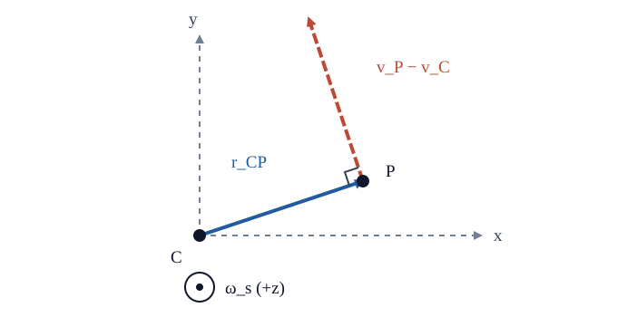

# RBD3 角速度と回転系の輸送定理

<!-- definition-example-audit: strict -->

> **前提**：[RBD1 の剛体配置](../RBD1/index.md#def-rbd1-configuration)、[RBD2 のベクトル積の反対称行列](../RBD2/index.md#def-rbd2-hat)、[MECH8 の回転基底での時間微分](../../MECH/MECH8/index.md#prop-mech8-rotating-basis-derivative)。ベクトルは列、外積は右手系、空間系は慣性系とします。

## 1. 回転行列を時間微分したい

[RBD2 の有限回転](../RBD2/index.md#thm-rbd2-rodrigues)では一時刻の姿勢を扱いました。しかし「回る速さ」は一つの時刻の行列だけでは分かりません。実験室では棒の先端が動き、棒に固定された観測者には同じ先端が静止して見えます。この違いを同じ計算で記述するのが本講の目標です。

時間区間 $I\subset\mathbb R$ 上で $R:I\to SO(3)$ を少なくとも $C^2$ 級とします。時刻 $t$ での物体固定正規直交基底の空間成分を $R$ の三列とし、任意の幾何学的ベクトル $a$ の空間・物体成分をそれぞれ $a_s,a_b$ と書きます。従って

$$
a_s(t)=R(t)a_b(t),\qquad a_b(t)=R(t)^{\mathsf T}a_s(t).
$$

ここで添字 $s,b$ は**別の物理ベクトルではなく、同じベクトルの成分表示**を意味します。$R^{\mathsf T}R=I_3$ の時間微分は

$$
\dot R^{\mathsf T}R+R^{\mathsf T}\dot R=0.
$$

そこで $R^{\mathsf T}\dot R$ と $\dot RR^{\mathsf T}$ は転置を取ると負になる、すなわち反対称行列です。[RBD2 のハット記法](../RBD2/index.md#def-rbd2-hat)により、三次元の反対称行列は一意なベクトルに対応します。

<!-- formal-statement-start -->
### 定義（空間角速度と物体角速度）

$R:I\to SO(3)$ が $C^1$ 級のとき、空間角速度 $\omega_s(t)\in\mathbb R^3$ と物体角速度 $\omega_b(t)\in\mathbb R^3$ を

$$
\boxed{\widehat{\omega_s}=\dot RR^{\mathsf T}},
\qquad
\boxed{\widehat{\omega_b}=R^{\mathsf T}\dot R}
$$

で定義する。ハットは $\widehat u v=u\times v$ を意味する。単位は角度をラジアンで測れば $\mathrm{s}^{-1}$ である。
<!-- formal-statement-end -->

<!-- definition-example-start: def-rbd3-angular-velocity -->
### 直接例：時間とともに角度が変わる円板

$R(t)=R_z(\theta(t))$、$\theta\in C^2(I)$ とします。$c=\cos\theta,s=\sin\theta$ と略記すると

$$
R=\begin{pmatrix}c&-s&0\\s&c&0\\0&0&1\end{pmatrix},
\quad
\dot R=\dot\theta\begin{pmatrix}-s&-c&0\\c&-s&0\\0&0&0\end{pmatrix}.
$$

二つを実際に掛けると

$$
\dot RR^{\mathsf T}
=R^{\mathsf T}\dot R
=\dot\theta\begin{pmatrix}0&-1&0\\1&0&0\\0&0&0\end{pmatrix}
=\widehat{\dot\theta e_3}.
$$

**定義の確認**：両行列は反対称であり、ハットを外すと $\omega_s=\omega_b=\dot\theta e_3$ です。これは $z$ 軸まわりの特例で、一般に両座標系の三成分が同じになるわけではありません。
<!-- definition-example-end -->

## 2. 空間表示と物体表示の対応

回転行列 $R$ が動かすのは数値成分だけでなく、外積の向きでもあります。$R\in SO(3)$ では正規直交性と $\det R=1$ により

$$
R(u\times v)=(Ru)\times(Rv).
$$

これを確かめるには、任意の $w$ との内積を取り、両辺の向きを表す三重積が $\det R=1$ の変換で変わらないことと、$R$ が内積を保存することを使います。ゆえに任意の $v$ に対し

$$
R\widehat uR^{\mathsf T}v
=R(u\times R^{\mathsf T}v)
=(Ru)\times v
=\widehat{Ru}v.
$$

<!-- formal-statement-start -->
### 命題（角速度の空間・物体対応）

$R:I\to SO(3)$ が $C^1$ 級で、角速度を[定義](#def-rbd3-angular-velocity)のように取ると

$$
\widehat{\omega_s}=R\widehat{\omega_b}R^{\mathsf T},
\qquad
\boxed{\omega_s=R\omega_b},
\qquad
\boxed{\dot R=\widehat{\omega_s}R=R\widehat{\omega_b}}.
$$

特に $R$ が $C^2$ 級なら $\dot\omega_s=R\dot\omega_b$ である。
<!-- formal-statement-end -->

### 証明の見取り図

定義に $RR^{\mathsf T}=I_3$ を挿入してハット行列を共役し、外積を保つことからベクトルの関係に戻します。

<!-- proof-start -->
### 証明

$$
R\widehat{\omega_b}R^{\mathsf T}
=R(R^{\mathsf T}\dot R)R^{\mathsf T}
=\dot RR^{\mathsf T}
=\widehat{\omega_s}.
$$

先ほどの $R\widehat uR^{\mathsf T}=\widehat{Ru}$ を $u=\omega_b$ に適用します。ハット写像の一意性から $\omega_s=R\omega_b$。二つの定義式の右側へそれぞれ $R$ を掛けると $\dot R=\widehat{\omega_s}R=R\widehat{\omega_b}$ です。

最後に $\omega_s=R\omega_b$ を微分し、既に得た $\dot R=R\widehat{\omega_b}$ を代入すると

$$
\dot\omega_s=\dot R\omega_b+R\dot\omega_b
=R(\omega_b\times\omega_b)+R\dot\omega_b
=R\dot\omega_b.
$$

最初の項が消える理由は、同じベクトルどうしの外積がゼロだからです。
<!-- proof-end -->

$\omega_s$ と $\omega_b$ は同じ角速度という幾何学的ベクトルを異なる基底で測った成分です。$\dot\omega_s=R\dot\omega_b$ は**角速度そのもの**の微分に固有の単純化で、一般のベクトルの時間微分ではありません。

## 3. 輸送定理：固定された物差しと回る物差し

$R$ の各列 $b_i=Re_i$ は物体に固定した基底の空間での向きです。[角速度の対応](#prop-rbd3-angular-conjugacy)から

$$
\dot b_i=\dot Re_i=\widehat{\omega_s}Re_i
=\omega_s\times b_i.
$$

これは[MECH8 の回転基底の微分公式](../../MECH/MECH8/index.md#prop-mech8-rotating-basis-derivative)の仮定が、姿勢行列の微分から確かに得られることを示しています。

$A=\sum_i (a_b)_ib_i$ と表示して微分すると

$$
\begin{aligned}
\left(\frac{dA}{dt}\right)_s
&=\sum_i\dot{(a_b)_i}b_i+\sum_i(a_b)_i\dot b_i\\
&=R\dot a_b+\omega_s\times\sum_i(a_b)_ib_i\\
&=\boxed{R\dot a_b+\omega_s\times a_s}.
\end{aligned}
$$

これが[MECH8 の輸送公式](../../MECH/MECH8/index.md#prop-mech8-rotating-basis-derivative)の**空間成分表示**です。同じ式を物体成分へ戻すと、$R^{\mathsf T}(\omega_s\times a_s)=\omega_b\times a_b$ なので

$$
\boxed{R^{\mathsf T}\dot a_s=\dot a_b+\omega_b\times a_b}.
$$

左辺は「空間で時間微分したベクトルを物体基底で測った成分」です。右辺の $\dot a_b$ は物体基底における成分の微分です。これらを混同しないことが肝心です。

**直接例：空間で固定された矢印**。$R=R_z(\Omega t)$、$a_s=e_1$、$\Omega$ は定数とします。物体系の成分は

$$
a_b=R^{\mathsf T}e_1=(\cos\Omega t,-\sin\Omega t,0)^{\mathsf T},
\quad
\dot a_b=(-\Omega\sin\Omega t,-\Omega\cos\Omega t,0)^{\mathsf T}.
$$

$\omega_b=\Omega e_3$ により $\omega_b\times a_b=(\Omega\sin\Omega t,\Omega\cos\Omega t,0)^{\mathsf T}$。よって $\dot a_b+\omega_b\times a_b=0$。**空間で固定されているベクトルが物体系では回って見える**ことを、符号も含めて確認できました。

## 4. 剛体上の点の速度

[RBD1 の剛体配置](../RBD1/index.md#def-rbd1-configuration)を微分します。重心 $C$ の位置を $c_s(t)$、ある物体点 $P$ の重心からの物体固定成分を一定ベクトル $\rho_b$ とすると

$$
x_{P,s}=c_s+R\rho_b,\qquad r_{CP,s}:=x_{P,s}-c_s=R\rho_b.
$$

<!-- formal-statement-start -->
### 命題（剛体点の速度場）

$R\in C^1(I,SO(3))$、$c_s\in C^1(I,\mathbb R^3)$ とし、$P$ は剛体に固定された物質点とする。このとき

$$
\boxed{v_{P,s}=v_{C,s}+\omega_s\times r_{CP,s}},
\qquad v_{C,s}=\dot c_s.
$$

同じ時刻の任意の二つの物体固定点 $P,Q$ について
$v_{P,s}-v_{Q,s}=\omega_s\times(x_{P,s}-x_{Q,s})$ も成立する。
<!-- formal-statement-end -->

### 証明の見取り図

固定点の $\dot\rho_b=0$ と輸送式を使い、位置の二項を微分します。

<!-- proof-start -->
### 証明

$$
\begin{aligned}
v_{P,s}&=\frac{d}{dt}(c_s+R\rho_b)
=\dot c_s+\dot R\rho_b\\
&=v_{C,s}+\widehat{\omega_s}R\rho_b
=v_{C,s}+\omega_s\times r_{CP,s}.
\end{aligned}
$$

$Q$ にも同じ計算をして両式を引くと $v_{C,s}$ が消え、二点間の式を得ます。
<!-- proof-end -->

図は空間の $+z$ 方向から見た平面投影です。$C$ から $P$ への相対位置 $r_{CP,s}$ と、その先端 $P$ から伸びる相対速度 $v_P-v_C$ は垂直です。紙面の手前へ向く正の $\omega_s$ により、相対速度は反時計回りの接線方向を向きます。$\omega_s$ と $r_{CP,s}$ の順を逆にすれば符号が反転します。

速度の関係は、固定軸かどうかに依存しません。また $P$ が重心から離れていても、$v_C$ をゼロにしてよいとは限りません。[MECH8 の固定軸速度](../../MECH/MECH8/index.md#prop-mech8-fixed-axis-velocity)は $v_C=0$ かつ軸が固定される場合の特例です。

## 5. 回転する基底から見た加速度

点が物体に固定されない場合も考えます。たとえば回転する溝の中を滑る小球なら、溝に対する位置 $\rho_b(t)$ 自身が動きます。$c_s\in C^2$、$R\in C^2$、$\rho_b\in C^2$ とし

$$
x_s(t)=c_s(t)+R(t)\rho_b(t)
$$

とします。前節と違って $\dot\rho_b$ をゼロと置きません。まず輸送式を位置へ適用すると

$$
\boxed{v_s=\dot c_s+R(\dot\rho_b+\omega_b\times\rho_b)}.
$$

加速度の二階微分では、**成分が変わる効果**と**基底が回る効果**が双方の速度項に現れます。

<!-- formal-statement-start -->
### 定理（回転座標における加速度の分解）

時間区間 $I$ 上で $R\in C^2(I,SO(3))$、$c_s,\rho_b\in C^2(I,\mathbb R^3)$ とし、$x_s=c_s+R\rho_b$ とする。このとき空間成分の加速度 $a_s=\ddot x_s$ は

$$
\boxed{
a_s=\ddot c_s+
R\bigl(
\ddot\rho_b+
2\omega_b\times\dot\rho_b+
\dot\omega_b\times\rho_b+
\omega_b\times(\omega_b\times\rho_b)
\bigr).
}
$$

四項は順に、相対加速度、Coriolis加速度、角加速度による項、向心加速度である。$\ddot c_s$ は原点の並進加速度である。
<!-- formal-statement-end -->

### 証明の見取り図

一階輸送式をもう一度適用し、積の微分で出る二つの $\omega_b\times\dot\rho_b$ を合計します。

<!-- proof-start -->
### 証明

$u_b:=\dot\rho_b+\omega_b\times\rho_b$ と置けば、直前の速度式は $v_s=\dot c_s+Ru_b$。そこで[角速度行列の式](#prop-rbd3-angular-conjugacy)を使うと

$$
\begin{aligned}
a_s
&=\ddot c_s+\dot Ru_b+R\dot u_b\\
&=\ddot c_s+R(\omega_b\times u_b+\dot u_b).
\end{aligned}
$$

他方、外積の積の微分を一項ずつ行えば

$$
\dot u_b
=\ddot\rho_b+\dot\omega_b\times\rho_b+
\omega_b\times\dot\rho_b
$$

であり、

$$
\omega_b\times u_b
=\omega_b\times\dot\rho_b+
\omega_b\times(\omega_b\times\rho_b).
$$

両者を足すと $\omega_b\times\dot\rho_b$ は二回現れるので係数 $2$ になります。これを $a_s$ に代入して主張を得ます。
<!-- proof-end -->

**用語の確認**：$\omega\times(\omega\times r)$ は軸に直交する位置成分を内側へ向ける**向心加速度**です。後の非慣性系の運動方程式へ移項すると、符号が反転して**遠心慣性力**になります。Coriolis項も、加速度公式では $+2\omega\times v_{\mathrm{rel}}$、見かけの力としては $-2m\omega\times v_{\mathrm{rel}}$ であり、符号が異なります。

### 例：回転する直線溝を滑る小球

$c_s=0$、$R=R_z(\Omega t)$（$\Omega$ 定数）、$\rho_b=(s(t),0,0)^{\mathsf T}$ とします。物体系の単位方向を $e_1,e_2$ とすると

$$
\omega_b=\Omega e_3,\quad
\dot\rho_b=\dot s e_1,\quad
\ddot\rho_b=\ddot s e_1.
$$

したがって各項は

$$
\begin{aligned}
2\omega_b\times\dot\rho_b&=2\Omega\dot s\,e_2,\\
\dot\omega_b\times\rho_b&=0,\\
\omega_b\times(\omega_b\times\rho_b)&=-\Omega^2s\,e_1,
\end{aligned}
$$

よって

$$
a_s=R\bigl((\ddot s-\Omega^2s)e_1+2\Omega\dot s\,e_2\bigr).
$$

直接 $x_s=s(\cos\Omega t,\sin\Omega t,0)^{\mathsf T}$ を二度微分しても

$$
\ddot x_s
=(\ddot s-\Omega^2s)
\begin{pmatrix}\cos\Omega t\\\sin\Omega t\\0\end{pmatrix}
+
2\Omega\dot s
\begin{pmatrix}-\sin\Omega t\\\cos\Omega t\\0\end{pmatrix}
$$

と同じ結果になります。$\dot s\ne0$ で初めて横向きのCoriolis項が現れます。物体固定点（$\dot s=0$）ならこの項はありません。

## 6. 見かけの力を本当の外力と区別する

質量 $m>0$ の粒子に働く**実際の合外力**の空間成分を $F_s$ とし、慣性系で Newton 方程式 $ma_s=F_s$ が成り立つとします。加速度分解の両辺を $R^{\mathsf T}$ 倍して $m\ddot\rho_b$ について解くと

<!-- formal-statement-start -->
### 命題（回転座標の運動方程式）

[加速度の分解](#thm-rbd3-rotating-acceleration)の仮定の下で $m\ddot x_s=F_s$ が成立するとき、物体成分の相対運動は

$$
\boxed{
m\ddot\rho_b
=R^{\mathsf T}F_s
-mR^{\mathsf T}\ddot c_s
-2m\omega_b\times\dot\rho_b
-m\dot\omega_b\times\rho_b
-m\omega_b\times(\omega_b\times\rho_b).
}
$$

右辺の第2項以下は、移動・回転する座標系を用いるために現れる慣性力項である。
<!-- formal-statement-end -->

### 証明の見取り図

加速度公式をNewton方程式へ代入し、$R^{\mathsf T}R=I_3$ を使って相対加速度だけを左に残します。

<!-- proof-start -->
### 証明

[加速度分解定理](#thm-rbd3-rotating-acceleration)を代入して

$$
R^{\mathsf T}F_s
=mR^{\mathsf T}\ddot c_s+
m\ddot\rho_b+2m\omega_b\times\dot\rho_b+
m\dot\omega_b\times\rho_b+
m\omega_b\times(\omega_b\times\rho_b).
$$

この式の $m\ddot\rho_b$ 以外を右辺へ移すだけで得られます。実際の外力は $R^{\mathsf T}F_s$ の一項であり、残りは座標系の選択による量です。
<!-- proof-end -->

反例になる典型的な誤りは、回転系で静止する粒子を「加速度がないから力もない」と判断することです。$\rho_b$ が一定でも慣性系での加速度は通常 $\omega_s\times(\omega_s\times r_s)$ であり、現実の拘束力がそれを供給する必要があります。

---

## 7. 演習と詳細解答

### Level A

### 問題 A1：直交性の微分と反対称性

$R(t)\in SO(3)$ が $C^1$ 級であるとする。$R^{\mathsf T}\dot R$ が反対称であることを示し、その三成分から $\omega_b$ が一意に決まる理由を述べよ。

- Level: A

<!-- solution-start -->
### 詳細解答

$R^{\mathsf T}R=I_3$ を積の微分すると $\dot R^{\mathsf T}R+R^{\mathsf T}\dot R=0$。従って

$$
(R^{\mathsf T}\dot R)^{\mathsf T}
=\dot R^{\mathsf T}R=-R^{\mathsf T}\dot R.
$$

任意の三次反対称行列は

$$
K=\begin{pmatrix}0&-w_3&w_2\\w_3&0&-w_1\\-w_2&w_1&0\end{pmatrix}
$$

と一意に書けるので、[ハット記法](../RBD2/index.md#def-rbd2-hat)で $K=\widehat w$ となる $w$ が一意です。特に $K=R^{\mathsf T}\dot R$ の場合が $\omega_b$ です。
<!-- solution-end -->

### 問題 A2：座標変換された角速度

ある時刻に $R=R_z(\pi/2)$、$\omega_b=(1,2,3)^{\mathsf T}$ である。$\omega_s$ と $\widehat{\omega_s}$ を求めよ。

- Level: A

<!-- solution-start -->
### 詳細解答

[角速度の対応](#prop-rbd3-angular-conjugacy)を使います。$R_z(\pi/2)(x,y,z)^{\mathsf T}=(-y,x,z)^{\mathsf T}$ なので

$$
\omega_s=R\omega_b=(-2,1,3)^{\mathsf T}.
$$

[反対称行列の定義](../RBD2/index.md#def-rbd2-hat)に $(-2,1,3)$ を代入すると

$$
\widehat{\omega_s}
=\begin{pmatrix}0&-3&1\\3&0&2\\-1&-2&0\end{pmatrix}.
$$

$\omega_b$ の数値成分をそのまま空間表示へ転記するのは誤りです。
<!-- solution-end -->

### 問題 A3：重心が動く円板上の点

ある瞬間に $v_C=(1,0,0)^{\mathsf T}$、$\omega_s=(0,0,2)^{\mathsf T}$、$r_{CP,s}=(3,0,0)^{\mathsf T}$（長さはm、時間はs）である。$v_P$ を求めよ。

- Level: A

<!-- solution-start -->
### 詳細解答

[剛体点の速度場](#prop-rbd3-point-velocity)に代入します。

$$
\omega_s\times r_{CP,s}
=(0,0,2)\times(3,0,0)=(0,6,0).
$$

従って $v_P=(1,0,0)+(0,6,0)=(1,6,0)^{\mathsf T}\ \mathrm{m/s}$。$v_C$ を落とすと $x$ 成分を誤ります。
<!-- solution-end -->

### 問題 A4：実験室で静止する矢印

$R=R_z(\Omega t)$、$a_s=e_1$（一定）、$\Omega\ne0$ は定数である。$a_b$、$\dot a_b$ を計算し、$\dot a_b+\omega_b\times a_b=0$ を確かめよ。

- Level: A

<!-- solution-start -->
### 詳細解答

$R^{\mathsf T}=R_z(-\Omega t)$ を使うと $a_b=(\cos\Omega t,-\sin\Omega t,0)^{\mathsf T}$。成分を微分して

$$
\dot a_b=(-\Omega\sin\Omega t,-\Omega\cos\Omega t,0)^{\mathsf T}.
$$

[角速度の定義](#def-rbd3-angular-velocity)から $\omega_b=\Omega e_3$。外積は

$$
\omega_b\times a_b=(\Omega\sin\Omega t,\Omega\cos\Omega t,0)^{\mathsf T}=-\dot a_b.
$$

ゆえに[輸送公式](../../MECH/MECH8/index.md#prop-mech8-rotating-basis-derivative)の物体成分表示では左辺が $R^{\mathsf T}\dot a_s=0$ に一致します。
<!-- solution-end -->

### 問題 A5：角速度が増える物体固定点

$c_s=0$、$R=R_z(\theta(t))$、$\rho_b=(r,0,0)^{\mathsf T}$、$r>0$ 一定とする。$\dot\theta=\Omega(t)$、$\dot\Omega=\alpha(t)$ を用いて加速度の物体成分 $R^{\mathsf T}a_s$ を求めよ。

- Level: A

<!-- solution-start -->
### 詳細解答

物体点なので $\dot\rho_b=\ddot\rho_b=0$。[加速度分解](#thm-rbd3-rotating-acceleration)を使い、$\omega_b=\Omega e_3$、$\dot\omega_b=\alpha e_3$ から

$$
\dot\omega_b\times\rho_b=\alpha r e_2,\qquad
\omega_b\times(\omega_b\times\rho_b)
=\Omega e_3\times(\Omega r e_2)=-\Omega^2r e_1.
$$

従って

$$
R^{\mathsf T}a_s=(-\Omega^2r,\alpha r,0)^{\mathsf T}.
$$

接線加速度は角加速度 $\alpha$ から、向心加速度は $\Omega^2$ から生じます。
<!-- solution-end -->

### Level B

### 問題 B1：回転する溝の小球

$c_s=0$、$R=R_z(\Omega t)$、$\Omega$ は定数、$\rho_b(t)=(s_0+ut,0,0)^{\mathsf T}$ とする。$u\ne0$ とし、速度と加速度の物体成分 $R^{\mathsf T}v_s,\ R^{\mathsf T}a_s$ を計算し、Coriolis項を取り出せ。

- Level: B

<!-- solution-start -->
### 詳細解答

$s=s_0+ut$ と書くと $\rho_b=se_1,\ \dot\rho_b=ue_1,\ \ddot\rho_b=0$。また $\omega_b=\Omega e_3,\ \dot\omega_b=0$。[移動する点の速度公式](#thm-rbd3-rotating-acceleration)の直前の式から

$$
R^{\mathsf T}v_s=ue_1+\Omega e_3\times se_1
=ue_1+\Omega se_2.
$$

[加速度分解定理](#thm-rbd3-rotating-acceleration)の四項は

$$
\ddot\rho_b=0,\quad
2\omega_b\times\dot\rho_b=2\Omega u e_2,\quad
\dot\omega_b\times\rho_b=0,\quad
\omega_b\times(\omega_b\times\rho_b)=-\Omega^2se_1.
$$

したがって $R^{\mathsf T}a_s=-\Omega^2se_1+2\Omega u e_2$。横方向 $2\Omega u e_2$ がCoriolis項で、$\Omega$ と $u$ のどちらかがゼロなら消えます。
<!-- solution-end -->

### 問題 B2：二階微分の独力導出

$A_s=Ra_b$、$R\in C^2(I,SO(3))$、$a_b\in C^2(I,\mathbb R^3)$ とする。$\ddot A_s$ を $R,\ a_b,\ \omega_b$ とその導関数で表せ。特に相対速度の係数が $2$ になる理由を式で示せ。

- Level: B

<!-- solution-start -->
### 詳細解答

[角速度の対応](#prop-rbd3-angular-conjugacy)の $\dot R=R\widehat{\omega_b}$ を用います。

$$
\dot A_s=R(\dot a_b+\omega_b\times a_b)=Ru_b
$$

とおくと $u_b=\dot a_b+\omega_b\times a_b$ です。これをもう一度微分すると

$$
\ddot A_s=R(\dot u_b+\omega_b\times u_b).
$$

右側の各項を独立に展開して

$$
\dot u_b=\ddot a_b+\dot\omega_b\times a_b+\omega_b\times\dot a_b,
$$

$$
\omega_b\times u_b=\omega_b\times\dot a_b+\omega_b\times(\omega_b\times a_b).
$$

従って

$$
\boxed{\ddot A_s=R\left(\ddot a_b+2\omega_b\times\dot a_b+\dot\omega_b\times a_b+\omega_b\times(\omega_b\times a_b)\right)}.
$$

両展開に一個ずつある $\omega_b\times\dot a_b$ の和が $2$ の由来です。
<!-- solution-end -->

### 問題 B3：回転台に固定された小球と拘束力

半径 $r>0$ の水平回転台が $z$ 軸まわりに定角速度 $\Omega$ で回る。小球（質量 $m$）は台に固定され、物体系では $\rho_b=re_1$ に静止する。実際の水平拘束力を物体成分で求め、遠心慣性力との符号を比較せよ。重力と鉛直反力は水平計算から除外してよい。

- Level: B

<!-- solution-start -->
### 詳細解答

$\dot\rho_b=\ddot\rho_b=0$、$\dot\omega_b=0$、$c_s=0$ です。[加速度分解](#thm-rbd3-rotating-acceleration)により

$$
R^{\mathsf T}a_s=\Omega e_3\times(\Omega e_3\times re_1)=-\Omega^2r e_1.
$$

Newton方程式では $R^{\mathsf T}F_s=mR^{\mathsf T}a_s=-m\Omega^2r e_1$。これは**中心向きの実際の拘束力**です。一方[回転系の運動方程式](#prop-rbd3-inertial-forces)の遠心慣性力は

$$
-m\omega_b\times(\omega_b\times\rho_b)=+m\Omega^2r e_1.
$$

回転系で小球が静止するのは、内向き実力と外向き慣性力が相殺するためです。遠心力を慣性系での追加の実力として加えるのは二重計上です。
<!-- solution-end -->

### 問題 B4：異なる回転軸の時間変化

$R(t)=R_z(\alpha(t))R_x(\beta(t))$、$\alpha,\beta\in C^1(I)$ とし、各行列は[RBD2 の右手回転](../RBD2/index.md#def-rbd2-axis-angle)とする。$\omega_s$ と $\omega_b$ を $\dot\alpha,\dot\beta$ と基底成分で求め、両者が $R$ で結ばれていることを確認せよ。

- Level: B

<!-- solution-start -->
### 詳細解答

$Z=R_z(\alpha)$、$X=R_x(\beta)$ と置くと $R=ZX$、積の微分で $\dot R=\dot Z X+Z\dot X$。固定軸の例から $\dot Z=\dot\alpha\widehat{e_3}Z$、$\dot X=\dot\beta\widehat{e_1}X$ です。したがって

$$
\begin{aligned}
\dot RR^{\mathsf T}
&=\dot\alpha\widehat{e_3}
+\dot\beta Z\widehat{e_1}Z^{\mathsf T}\\
&=\widehat{\dot\alpha e_3+\dot\beta Ze_1}.
\end{aligned}
$$

よって

$$
\omega_s=(\dot\beta\cos\alpha,\dot\beta\sin\alpha,\dot\alpha)^{\mathsf T}.
$$

物体表示では

$$
\begin{aligned}
R^{\mathsf T}\dot R
&=X^{\mathsf T}(Z^{\mathsf T}\dot Z)X+X^{\mathsf T}\dot X\\
&=\dot\alpha\widehat{X^{\mathsf T}e_3}+\dot\beta\widehat{e_1},
\end{aligned}
$$

$X^{\mathsf T}e_3=(0,\sin\beta,\cos\beta)^{\mathsf T}$ ですから

$$
\omega_b=(\dot\beta,\dot\alpha\sin\beta,\dot\alpha\cos\beta)^{\mathsf T}.
$$

最後に $R\omega_b=ZX(\dot\beta e_1+\dot\alpha X^{\mathsf T}e_3)=\dot\beta Ze_1+\dot\alpha e_3=\omega_s$ と確認します。回転順序を逆にすると式も変わります。
<!-- solution-end -->

### Level C

### 問題 C1：並進加速する回転台上の移動点

慣性系において $c_s(t)=\tfrac12At^2e_1$、$R(t)=R_z(\Omega t)$、$\rho_b(t)=(s_0+ut)e_1$ とする。$A,\Omega,s_0,u$ は実定数、$m>0$ は粒子質量、$t$ の単位は秒とする。

1. $x_s(t)$ を記し、$t=0$ における $v_s,a_s$ を求めよ。
2. 慣性系で必要な合外力 $F_s(0)$ を求めよ。
3. 回転・並進する座標系の運動方程式を $t=0$ で書き、外力項、並進慣性力、Coriolis慣性力、遠心慣性力の和が $m\ddot\rho_b(0)$ と一致することを確かめよ。
4. $u=0$ とした場合、どの慣性力が消え、その理由は何か述べよ。

- Level: C

<!-- solution-start -->
### 詳細解答

**(1)** $s(t)=s_0+ut$ とおき、剛体上の溝の方向 $R e_1=(\cos\Omega t,\sin\Omega t,0)^{\mathsf T}$ を使うと

$$
x_s(t)=\frac12At^2e_1+s(t)(\cos\Omega t,\sin\Omega t,0)^{\mathsf T}.
$$

$R(0)=I_3$、$\omega_b=\Omega e_3$、$\dot\omega_b=0$、$\dot\rho_b=ue_1$、$\ddot\rho_b=0$。一階輸送式を使えば

$$
v_s(0)=\dot c_s(0)+ue_1+\Omega e_3\times s_0e_1
=ue_1+\Omega s_0e_2.
$$

[加速度分解](#thm-rbd3-rotating-acceleration)の四項を順に代入すると

$$
\begin{aligned}
a_s(0)
&=Ae_1+0+2\Omega e_3\times ue_1+0
+\Omega e_3\times(\Omega e_3\times s_0e_1)\\
&=(A-\Omega^2s_0)e_1+2\Omega u e_2.
\end{aligned}
$$

**(2)** 慣性系のNewton方程式 $F_s=ma_s$ によって

$$
F_s(0)=m(A-\Omega^2s_0)e_1+2m\Omega u e_2.
$$

これは粒子に必要な**実際の合外力**です。力を実現する溝・駆動機構の内訳は問題で指定していません。

**(3)** $R(0)=I_3$ なので外力の物体成分は (2) と同じです。[回転系の運動方程式](#prop-rbd3-inertial-forces)の各項は

$$
\begin{aligned}
R^{\mathsf T}F_s&=m(A-\Omega^2s_0)e_1+2m\Omega u e_2,\\
-mR^{\mathsf T}\ddot c_s&=-mAe_1,\\
-2m\omega_b\times\dot\rho_b&=-2m\Omega ue_2,\\
-m\dot\omega_b\times\rho_b&=0,\\
-m\omega_b\times(\omega_b\times\rho_b)&=+m\Omega^2s_0e_1.
\end{aligned}
$$

$e_1$ 成分は $m(A-\Omega^2s_0)-mA+m\Omega^2s_0=0$、$e_2$ 成分は $2m\Omega u-2m\Omega u=0$。よって合計 $0=m\ddot\rho_b$ となります。

**(4)** $u=0$ なら回転系に対する粒子の速度 $\dot\rho_b=0$ なのでCoriolis慣性力が消えます。並進慣性力 $-mAe_1$ と遠心慣性力 $+m\Omega^2s_0e_1$ は一般には残ります。回転系で静止することと、空間で加速度ゼロであることは異なります。
<!-- solution-end -->

## 8. 次の講義への接続

角速度の二つの成分表示は $\omega_s=R\omega_b$ で結ばれ、物体点の速度と回転系の相対加速度を同じ $R(t)$ から計算できました。次の **RBD4** では $R$ を三つの Euler 角で書き、角度の時間微分から $\omega_b$ を計算する一方、姿勢の座標が特異になる場所を確かめます。
