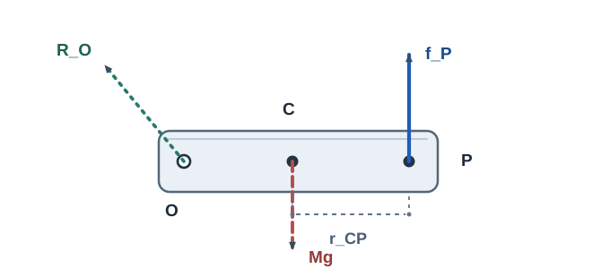

# RBD7 Newton–Euler方程式：外力と基準点

<!-- definition-example-audit: strict -->

剛体の質量分布と姿勢から慣性テンソルを計算できるようになりました。しかし、外から力を加えたときに必要なのは、単なる角加速度の公式ではありません。**力がどこに作用するか**、そして **どの点まわりの角運動量を使っているか**を決めなければ、並進と回転を同時に予測できません。

この章では、[MECH8 のEuler方程式](../../MECH/MECH8/index.md#thm-mech8-euler-equations)を新しい基本法則として作り直すのではなく、実際の外力から右辺を組み立て、任意の移動基準点で生じる補正項まで確認します。外力が時間や姿勢に依存する場合にも初期値問題を構成できることが目標です。

## 1. 外力を「大きさ」だけでなく作用点から読む

慣性系（空間系）を $s$、剛体に固定した系を $b$ とします。質量 $M>0$、重心 $C$ の位置を $c(t)$、姿勢を $R(t)\in SO(3)$ とします。物体基準の重心からの位置を $u_b$ とすれば、物質点の空間位置は

$$
x(t,u_b)=c(t)+R(t)u_b,\qquad
\int u_b\,dm=0.
$$

$R$ は物体系の列ベクトルを空間系へ写す能動回転です。[RBD3 の剛体点の速度場](../RBD3/index.md#prop-rbd3-point-velocity)から、$u_s=Ru_b$ とおいて

$$
v_P=\dot c+\omega_s\times u_s,\qquad
\omega_s=R\omega_b,\qquad
\dot R=R\widehat{\omega}_b.
$$

外力は、各作用点 $P_a$ での力 $f_{a,s}$ と、作用点によらない自由偶力（純粋なトルク） $m_{a,s}$ に分けて表します。分布力がある場合は以下の和を質量または適切な面・体積積分へ置き換えます。内力の合力・合トルクは消える理想剛体モデルを仮定します（内部の作用反作用が同一直線上にある条件が必要です）。

[MECH4 のトルク](../../MECH/MECH4/index.md#def-mech4-torque)と[MECH7 の重心](../../MECH/MECH7/index.md#def-mech7-center-of-mass)を組み合わせ、外力系の情報を二つにまとめます。

<!-- formal-statement-start -->
### 定義（外力系の合力と重心まわりの合トルク）

質量一定の剛体に、空間系で作用点 $P_a$、力 $f_{a,s}$（$a=1,\dots,n$）、自由偶力 $m_{k,s}$（$k=1,\dots,q$）が働くとする。重心位置を $c$、各作用点位置を $x_a$ とするとき、外力の合力 $F_s$ と重心まわりの合トルク $\tau_{C,s}$ を

$$
F_s:=\sum_{a=1}^n f_{a,s},\qquad
\tau_{C,s}:=\sum_{a=1}^n(x_a-c)\times f_{a,s}
+\sum_{k=1}^q m_{k,s}
$$

とする。自由偶力は合力に寄与しない。
<!-- formal-statement-end -->

<!-- definition-example-start: def-rbd7-resultant-torque -->
### 直接例：同じ力を右端に加えるか、重心に加えるか

**定義の確認**：作用点 $P$ と重心 $C$ を同じ空間系で指定し、力の和と腕の外積を別々に求めます。ある瞬間に $C=(0,0,0)$、$P=(a,0,0)$（$a>0$）、外力 $f=(0,F,0)$（$F>0$）とし、自由偶力はないとします。定義の第一式は $F_s=(0,F,0)$。第二式は

$$
\tau_{C,s}=(a,0,0)\times(0,F,0)=(0,0,aF).
$$

同じ $f$ を重心そのものに加えれば合力は変わらず、腕 $x_P-c$ が零になるためトルクだけが零です。**並進に効く合力と回転に効くトルクは独立に計算する**必要があります。
<!-- definition-example-end -->

図の $O$ は支点の例、$C$ は重心、$P$ は偏心外力の作用点です。上向きの $f_P$ は $P$ に、下向きの重力 $Mg$ は $C$ に、支点の反力 $\mathcal R_O$ は $O$ に付いています。したがって、重心まわりには $P-C$ と $O-C$ の**異なる**腕が必要です。図は平面模式図で、未知の反力の矢印方向は仮置きです。矢印の長さも力の数値比を示しません。

[図を別タブで拡大する](assets/force-points.svg)

## 2. 重心のNewton方程式と外力付きEuler方程式

重心の並進については[MECH7 の重心運動の定理](../../MECH/MECH7/index.md#thm-mech7-center-of-mass-motion)、各質点の角運動量については[MECH4 の収支式](../../MECH/MECH4/index.md#thm-mech4-angular-momentum-balance)を使います。重心基準の慣性テンソル $J_b$ は物体系で一定ですが、空間系の $J_s=RJ_bR^{\mathsf T}$ は一般に時間依存します。ここを取り違えず、角運動量を一度物体系へ移してから微分します。

<!-- formal-statement-start -->
### 定理（外力付きNewton–Euler方程式）

質量 $M>0$ が一定で二次質量モーメントが有限の三次元剛体を、慣性系で $C^2$ 級の位置・姿勢として記述する。内部作用の合力と重心まわりの合トルクは零で、外力系の $F_s,\tau_{C,s}$ は[本章の定義](#def-rbd7-resultant-torque)のとおりとする。重心まわりの物体系慣性テンソルを時間一定の $J_b$、角速度を $\omega_b$ とする。このとき

$$
\boxed{M\ddot c=F_s,}
$$

$$
\boxed{J_b\dot\omega_b+
\omega_b\times(J_b\omega_b)=\tau_{C,b},
\qquad \tau_{C,b}=R^{\mathsf T}\tau_{C,s}.}
$$

同値な空間系の角運動量収支は、$H_C=J_s\omega_s$ として

$$
\boxed{\left(\frac{dH_C}{dt}\right)_s=\tau_{C,s}.}
$$
<!-- formal-statement-end -->

### 証明の見取り図

各粒子の力を合計すると内力が消え、合力が重心の加速度を決めます。回転では重心相対速度と角運動量を使うと、移動する重心の速度に由来する不要な項が相殺されます。最後に[MECH8 の回転基底の微分公式](../../MECH/MECH8/index.md#prop-mech8-rotating-basis-derivative)を $H_C$ に適用します。

<!-- proof-start -->
### 証明

離散質点系で示します。連続質量分布の場合は同じ有限な積分で置き換えます。$u_i=x_i-c$ とすると $\sum_i m_i u_i=0$ であり、$M=\sum_i m_i$ は一定です。Newtonの運動方程式を全粒子について足すと

$$
\sum_i m_i\ddot x_i=\sum_i f_{i,\mathrm{ext}}+
\sum_i f_{i,\mathrm{int}}.
$$

内部作用の合力は仮定から零で、左辺は

$$
\sum_i m_i\ddot x_i
=M\ddot c+\frac{d^2}{dt^2}\sum_i m_i u_i=M\ddot c.
$$

よって $M\ddot c=F_s$ です。

重心まわりの角運動量を、各点の**重心に相対的な速度**で

$$
H_C:=\sum_i u_i\times m_i(\dot x_i-\dot c)
=\sum_i u_i\times m_i\dot u_i
$$

とします。各項を時間で微分すると

$$
\begin{aligned}
\frac{dH_C}{dt}
&=\sum_i\left(\dot u_i\times m_i\dot u_i
+u_i\times m_i\ddot u_i\right)\\
&=\sum_i u_i\times m_i(\ddot x_i-\ddot c)\\
&=\sum_i u_i\times m_i\ddot x_i
-\left(\sum_i m_i u_i\right)\times\ddot c\\
&=\sum_i u_i\times m_i\ddot x_i.
\end{aligned}
$$

第一項の $\dot u_i\times\dot u_i$ は各点で零、最終行の重心項も零です。内力の重心まわりの合トルクは仮定から零なので、Newtonの各式を代入すると

$$
\left(\frac{dH_C}{dt}\right)_s
=\sum_i u_i\times f_{i,\mathrm{ext}}
+\sum_k m_{k,s}=\tau_{C,s}.
$$

一方、[MECH8 の慣性テンソルと角運動量の関係](../../MECH/MECH8/index.md#thm-mech8-inertia-relations)より $H_C=R J_b\omega_b$ です。ここで $L_b=J_b\omega_b$ とおき、[回転基底の微分公式](../../MECH/MECH8/index.md#prop-mech8-rotating-basis-derivative)を **$A=H_C=RL_b$** に適用します。

$$
\begin{aligned}
\left(\frac{dH_C}{dt}\right)_s
&=R\left(\dot L_b+\omega_b\times L_b\right)\\
&=R\left(J_b\dot\omega_b+
\omega_b\times(J_b\omega_b)\right).
\end{aligned}
$$

$J_b$ が物体系で時間一定であることを二行目で使いました。$\tau_{C,s}$ に等置して左から $R^{\mathsf T}$ を掛けると主張を得ます。
<!-- proof-end -->

主軸基底で $J_b=\operatorname{diag}(I_1,I_2,I_3)$ とすれば、このベクトル式の三成分は[MECH8 のEuler方程式](../../MECH/MECH8/index.md#thm-mech8-euler-equations)と一致します。たとえば第一成分は

$$
I_1\dot\omega_1+(I_3-I_2)\omega_2\omega_3=\tau_{C,b,1}.
$$

単に $J_b\dot\omega_b=\tau_b$ としてはいけません。$\omega_b\times(J_b\omega_b)$ は物体系が回っているために生じる項で、$J_b$ が一定でも一般に非零です。

### 偏心外力を初期条件へ代入する

$R(0)=I_3$、$\omega_b(0)=0$、$J_b=\operatorname{diag}(I_x,I_y,I_z)$（$I_j>0$）とし、重心から $P$ への腕を $(a,0,0)$、$P$ での力を $(0,F,0)$ とします。この瞬間には

$$
\ddot c(0)=(0,F/M,0),\qquad
\dot\omega_b(0)=(0,0,aF/I_z).
$$

角速度が零なのでEuler方程式の交差項が零になります。物体全体を同じ方向へ押す効果と、向きを変える効果が同時に発生しています。

## 3. 基準点を変えると何が変わるか

基準点 $O$ を移動させると、位置ベクトルだけでなく「何を速度として角運動量へ入れるか」も問題になります。まず $o(t)$ を任意の $C^2$ 級の基準点軌道とし、$d=c-o$ と書きます。

ここで区別する量は二つです。**慣性速度を使う角運動量** $H_O^{\mathrm{in}}$ は、観測原点だけを $O$ に移す量です。**$O$ との相対速度を使う角運動量** $H_O^{\mathrm{rel}}$ は、速度の測り方まで変えます。一般には同じではありません。

<!-- formal-statement-start -->
### 定義（移動基準点に対する二種類の角運動量）

一定質量 $M>0$ の質点系・剛体に対し、慣性系位置 $x_i(t)$、基準点位置 $o(t)$ を使い、次の二つを定める。

$$
H_O^{\mathrm{in}}:=\sum_i(x_i-o)\times m_i\dot x_i,
$$

$$
H_O^{\mathrm{rel}}:=\sum_i(x_i-o)\times m_i(\dot x_i-\dot o).
$$

両者は $H_O^{\mathrm{rel}}=H_O^{\mathrm{in}}-M(c-o)\times\dot o$ で関係する。連続質量分布では和を質量積分へ置き換える。
<!-- formal-statement-end -->

<!-- definition-example-start: def-rbd7-origin-momenta -->
### 直接例：自由並進する剛体を斜めに動く原点から見る

**定義の確認**：基準点を動かすと、同じ剛体でも二種類の速度に基づく角運動量は異なることを両定義へ直接代入します。剛体が回転せず $c(t)=(vt,0,0)$、$\dot c=(v,0,0)$、原点が $o(t)=(0,ut,0)$ と等速度で動き、$u,v$ は定数とします。重心相対の角運動量は $H_C=0$ です。定義へ各粒子を代入し重心条件を使うと

$$
H_O^{\mathrm{in}}=(vt,-ut,0)\times(Mv,0,0)
=(0,0,Muvt),
$$

$$
H_O^{\mathrm{rel}}=(vt,-ut,0)\times(Mv,-Mu,0)
=(0,0,0).
$$

たとえ作用する外力が零でも、原点が動いていれば慣性速度版の角運動量は時間変化し得ます。二つの定義を両方計算したので、差が単なる記号の違いではないことが確認できます。
<!-- definition-example-end -->

<!-- formal-statement-start -->
### 定理（移動基準点の角運動量収支）

一定質量の質点系または理想剛体に対し、$c(t)$ を重心、$o(t)$ を任意の $C^2$ 級基準点軌道とする。外力の合力を $F_s$、$O$ まわりの外力合トルクを

$$
\tau_{O,s}:=\sum_a(x_a-o)\times f_{a,s}
+\sum_km_{k,s}
$$

とし、内力の合力・合トルクが零と仮定する。全運動量を $p=M\dot c$、$d=c-o$ と書けば、

$$
\boxed{\frac{dH_O^{\mathrm{in}}}{dt}
=\tau_{O,s}-\dot o\times p,}
$$

$$
\boxed{\frac{dH_O^{\mathrm{rel}}}{dt}
=\tau_{O,s}-Md\times\ddot o.}
$$

さらに $H_C$ を重心相対の角運動量とすると

$$
H_O^{\mathrm{in}}=H_C+d\times M\dot c,\qquad
H_O^{\mathrm{rel}}=H_C+d\times M(\dot c-\dot o)
$$

である。$O$ が空間固定なら $\dot o=\ddot o=0$、両者は一致して $\dot H_O=\tau_O$ となる。$O=C$ なら $d=0$ により $\dot H_C=\tau_C$ となる。
<!-- formal-statement-end -->

### 証明の見取り図

$H_O^{\mathrm{in}}$ を微分すると、原点の速度と全運動量からなる $-\dot o\times p$ の項が残ります。相対速度を使う場合にはその項が打ち消される代わりに、原点の**加速度**と重心までの腕による項が残ります。

<!-- proof-start -->
### 証明

各質点の慣性速度を $v_i=\dot x_i$ とします。積の微分により

$$
\begin{aligned}
\frac{dH_O^{\mathrm{in}}}{dt}
&=\sum_i(v_i-\dot o)\times m_i v_i
 +\sum_i(x_i-o)\times m_i\dot v_i\\
&=-\dot o\times\sum_i m_i v_i+\tau_{O,s}\\
&=\tau_{O,s}-\dot o\times p.
\end{aligned}
$$

一行目の $v_i\times v_i=0$ を使い、内力トルクは仮定から消えています。

[定義](#def-rbd7-origin-momenta)から $H_O^{\mathrm{rel}}=H_O^{\mathrm{in}}-Md\times\dot o$ なので、

$$
\begin{aligned}
\frac{dH_O^{\mathrm{rel}}}{dt}
&=\tau_O-\dot o\times M\dot c
 -M(\dot c-\dot o)\times\dot o
 -Md\times\ddot o\\
&=\tau_O-Md\times\ddot o.
\end{aligned}
$$

二行目では外積の反対称性 $\dot c\times\dot o=-\dot o\times\dot c$ と $\dot o\times\dot o=0$ を使いました。

最後に $x_i-o=(x_i-c)+d$、$v_i=\dot u_i+\dot c$ をそれぞれの定義に代入します。$\sum_i m_i u_i=0$ と $\sum_i m_i\dot u_i=0$ により交差項が消え、

$$
H_O^{\mathrm{in}}=H_C+d\times M\dot c,\qquad
H_O^{\mathrm{rel}}=H_C+d\times M(\dot c-\dot o)
$$

を得ます。固定点と重心の場合は定理の条件をそれぞれ代入すればよいです。
<!-- proof-end -->

### どの点なら $J_O\omega$ と書けるか

[平行軸のテンソル公式](../RBD6/index.md#thm-rbd6-parallel-axis-tensor)は点 $O$ に関する慣性テンソルの値を与えますが、それだけで $H_O^{\mathrm{in}}=J_O\omega$ とはなりません。$O$ が**剛体に固定された物質点**であれば剛体速度場から $v_i-\dot o=\omega_s\times(x_i-o)$ であり、[慣性テンソルの定義](../../MECH/MECH8/index.md#def-mech8-inertia-tensor)を代入して

$$
H_O^{\mathrm{rel}}=J_{O,s}\omega_s
$$

が得られます。ただし $O$ が加速して動くなら、その微分は定理の加速度補正を必ず伴います。$O$ が**空間固定かつ剛体の固定点**である場合に限り、相対速度と慣性速度が一致して

$$
H_O=J_{O,s}\omega_s,\qquad \dot H_O=\tau_O
$$

をそのまま組み合わせられます。空間固定でも物体の点でない任意の原点なら、一般に $H_O^{\mathrm{in}}=H_C+d\times M\dot c$ です。

たとえば前節の自由並進の例では $\omega=0$ でも $H_O^{\mathrm{in}}\ne0$ となります。「角運動量はいつでも $J_O\omega$」という誤用は、**並進の寄与を落とす**ことで起きます。

## 4. 支点反力：トルクを取る点と力を釣り合わせる点

平面内の剛体に、空間固定の支点 $O$ があり、重心はその右 $d>0$、$c-o=(d,0,0)$ とします。重力 $-Mg\,e_y$ が重心に働き、支点には未知の反力 $\mathcal R_O$ が働きます。$g>0$、重心まわりの $z$ 軸慣性モーメントを $I_C>0$ とし、剛体が水平・初期角速度零の瞬間を考えます。

支点の反力は**その支点まわりの**トルクを作らないので、前節の固定点の収支から

$$
\tau_{O,z}=(d,0,0)\times(0,-Mg,0)\bigm|_z=-Mgd.
$$

[平行軸のテンソル公式](../RBD6/index.md#thm-rbd6-parallel-axis-tensor)によって $I_O=I_C+Md^2$ です。初期角速度零なら回転項が零で、

$$
\alpha_z=\dot\omega_z=-\frac{Mgd}{I_C+Md^2}.
$$

一方、反力は零とは限りません。支点固定で重心の加速度は、[RBD3 の回転系加速度の公式](../RBD3/index.md#thm-rbd3-rotating-acceleration)を固定された剛体点へ適用して

$$
\ddot c=\dot\omega_s\times(c-o)
+\omega_s\times[\omega_s\times(c-o)]
=(0,d\alpha_z,0)
$$

となります（最後の等号は $\omega_s=0$ の瞬間）。並進式より

$$
\mathcal R_O+(0,-Mg,0)=(0,Md\alpha_z,0),
$$

$$
\boxed{\mathcal R_{O,x}=0,\qquad
\mathcal R_{O,y}=Mg+Md\alpha_z
=\frac{MgI_C}{I_C+Md^2}.}
$$

支点が回転の中心でも、反力を「消す」のは**その点まわりのトルク式からだけ**です。合力のNewton式から反力を消してはいけません。

## 5. 力がする仕事率と初期値問題

外力が単に物体を加速するだけでなく、どの程度の速さでエネルギーを渡すかも、作用点で決まります。純粋な偶力 $m_k$ は角速度との内積で仕事率を与えるものとします。

<!-- formal-statement-start -->
### 命題（剛体外力の仕事率と運動エネルギー収支）

[Newton–Euler方程式](#thm-rbd7-newton-euler)の仮定の下で、外力 $f_a$ が剛体点 $P_a$ に作用し、自由偶力が $m_k$ であるとする。運動エネルギーを

$$
K=\frac12 M|\dot c|^2+\frac12\omega_b^{\mathsf T}J_b\omega_b
$$

とすると、外力系の瞬間仕事率は

$$
\boxed{\mathcal P_{\mathrm{ext}}
=\sum_a f_{a,s}\cdot v_{P_a}
+\sum_k m_{k,s}\cdot\omega_s
=F_s\cdot\dot c+\tau_{C,s}\cdot\omega_s
=\frac{dK}{dt}.}
$$

拘束反力も外力の一部として算入する。空間固定支点の反力は、作用点速度が零なので仕事率が零である。
<!-- formal-statement-end -->

### 証明の見取り図

[RBD3 の点速度](../RBD3/index.md#prop-rbd3-point-velocity)を各作用点へ代入し、スカラー三重積でトルクへまとめます。運動エネルギーの微分にはEuler方程式を内積で使い、交差項が消えることを確認します。

<!-- proof-start -->
### 証明

作用点 $P_a$ の速度を $v_{P_a}=\dot c+\omega_s\times(x_a-c)$ と書けば、

$$
\begin{aligned}
\sum_a f_{a,s}\cdot v_{P_a}
&=\sum_a f_{a,s}\cdot\dot c
+\sum_a f_{a,s}\cdot[\omega_s\times(x_a-c)]\\
&=F_s\cdot\dot c
+\omega_s\cdot\sum_a[(x_a-c)\times f_{a,s}],
\end{aligned}
$$

です。自由偶力の $\sum_km_{k,s}\cdot\omega_s$ を足すと $\mathcal P_{\mathrm{ext}}=F_s\cdot\dot c+\tau_{C,s}\cdot\omega_s$ になります。

[MECH8 の運動エネルギー分解](../../MECH/MECH8/index.md#prop-mech8-kinetic-decomposition)と、物体系での $J_b$ の時間一定性から、

$$
\begin{aligned}
\frac{dK}{dt}
&=M\dot c\cdot\ddot c+\omega_b\cdot J_b\dot\omega_b\\
&=\dot c\cdot F_s+
\omega_b\cdot[\tau_{C,b}-\omega_b\times(J_b\omega_b)]\\
&=\dot c\cdot F_s+\omega_b\cdot\tau_{C,b}.
\end{aligned}
$$

最後の交差項は $\omega_b\cdot(\omega_b\times L_b)=0$。さらに $\omega_s=R\omega_b$、$\tau_{C,b}=R^{\mathsf T}\tau_{C,s}$ なので $\omega_b\cdot\tau_{C,b}=\omega_s\cdot\tau_{C,s}$ です。
<!-- proof-end -->

### 作用点を動かすと仕事率も変わる

$u_s=(a,0,0)$ に $f=(0,F,0)$ を加え、$\dot c=(0,V,0)$、$\omega_s=(0,0,\Omega)$ とします。作用点速度は

$$
v_P=(0,V,0)+(0,0,\Omega)\times(a,0,0)
=(0,V+a\Omega,0).
$$

ゆえに $\mathcal P_{\mathrm{ext}}=F(V+a\Omega)$。重心に同じ力を加える場合は $\tau_C=0$ となり、$FV$ だけです。同じ合力でも、作用点が変わると回転へ渡す仕事率が変わります。

### どのように初期値から軌道を求めるか

外力モデルを $F_s(t,c,v,R,\omega_b)$、合トルクモデルを $\tau_{C,s}(t,c,v,R,\omega_b)$ として与えます（作用点が物体に固定されている場合は $x_a=c+Ru_{a,b}$ から腕を計算します）。ここでは外部の拘束が未モデル化の反力を生まない自由剛体を考えます。

[慣性テンソルの正定値性](../RBD6/index.md#prop-rbd6-positivity)から、質量が一本の直線に集中せず $J_b$ が正定値なら $J_b^{-1}$ が存在します。姿勢更新には[RBD3 の角速度対応](../RBD3/index.md#prop-rbd3-angular-conjugacy)を使います。

<!-- formal-statement-start -->
### 命題（外力付き剛体運動の一階初期値系）

上記の力モデルと、正定値な一定の $J_b$ をもつ自由剛体について、状態 $(c,v,R,\omega_b)$、初期値 $(c_0,v_0,R_0,\omega_{b,0})$（$R_0\in SO(3)$）を指定すると、Newton–Euler方程式は次の一階方程式として書ける。

$$
\boxed{
\begin{aligned}
\dot c&=v,\\
\dot v&=M^{-1}F_s,\\
\dot R&=R\widehat{\omega}_b,\\
\dot\omega_b&=J_b^{-1}\left[
R^{\mathsf T}\tau_{C,s}-\omega_b\times(J_b\omega_b)\right].
\end{aligned}}
$$

作用点を含む力モデルは状態と時刻から定まり、$SO(3)$ 上の姿勢条件と初期値を満たすものとする。拘束を加える場合は反力・拘束方程式も別途指定する。
<!-- formal-statement-end -->

### 証明の見取り図

並進式を速度 $v$ で一階化し、正定値 $J_b$ を逆行列で解きます。姿勢の式は運動学そのもので、外力に関係なく必要です。

<!-- proof-start -->
### 証明

[外力付きNewton–Euler方程式](#thm-rbd7-newton-euler)に $v=\dot c$ を代入すると $\dot c=v$、$\dot v=M^{-1}F_s$ です。さらに

$$
J_b\dot\omega_b=R^{\mathsf T}\tau_{C,s}-\omega_b\times(J_b\omega_b)
$$

の両辺に $J_b^{-1}$ を左から掛けます。最後に[RBD3 の角速度対応](../RBD3/index.md#prop-rbd3-angular-conjugacy)から $\dot R=R\widehat\omega_b$ を併記して四式を得ます。なお $\widehat\omega_b$ は反対称なので

$$
\frac{d}{dt}(R^{\mathsf T}R)
=\widehat\omega_b^{\mathsf T}R^{\mathsf T}R
+R^{\mathsf T}R\widehat\omega_b=0
$$

が $R^{\mathsf T}R=I_3$ で成り立ち、連続時間では $R_0\in SO(3)$ の直交性が保たれます。行列式も連続性と非零性から符号が変わらず、初期値の $+1$ を保ちます。
<!-- proof-end -->

外力が与えられただけでなく**作用点・姿勢・速度依存性**まで定めて初めて、この方程式の右辺を計算できます。数値積分で姿勢を保つ方法と誤差評価はRBD16で学びます。

---

# 演習

## Level A

### 問題 A1：合力と偏心トルク

$R=I_3$、$\omega_b=0$ の瞬間に、$P-C=(a,0,0)$、$a>0$、外力 $f=(F,2F,0)$、$F>0$ が働く。他の外力・自由偶力はない。$M>0$、$J_b=\operatorname{diag}(I_x,I_y,I_z)$（すべて正）として、合力、重心トルク、重心加速度、角加速度を求めよ。

- Level: A

<!-- solution-start -->
### 詳細解答

[外力系の合力と重心まわりの合トルク](#def-rbd7-resultant-torque)から $F_s=(F,2F,0)$、

$$
\tau_C=(a,0,0)\times(F,2F,0)=(0,0,2aF).
$$

[Newton–Euler方程式](#thm-rbd7-newton-euler)の並進式に代入すると $\ddot c=(F/M,2F/M,0)$。初期角速度が零なので交差項は零であり、

$$
J_b\dot\omega_b=(0,0,2aF)
\quad\Longrightarrow\quad
\boxed{\dot\omega_b=(0,0,2aF/I_z)}.
$$

水平方向の力 $F$ は並進へ寄与しますが、腕と平行なのでトルクには寄与しません。
<!-- solution-end -->

### 問題 A2：物体点から空間トルクへ

$R=R_z(\pi/2)$、$\omega_b=0$、物体系の作用点 $u_b=(a,0,0)$、空間系の外力 $f_s=(F,0,0)$ とする（$a,F>0$）。$\tau_{C,s}$ と $\tau_{C,b}$ を求め、$J_b=\operatorname{diag}(I_1,I_2,I_3)$ の場合の $\dot\omega_b$ を求めよ。

- Level: A

<!-- solution-start -->
### 詳細解答

回転行列は $R=\begin{pmatrix}0&-1&0\\1&0&0\\0&0&1\end{pmatrix}$ なので、

$$
u_s=Ru_b=(0,a,0).
$$

[トルクの定義](#def-rbd7-resultant-torque)より

$$
\tau_{C,s}=u_s\times f_s=(0,0,-aF).
$$

$R^{\mathsf T}$ は $z$ 成分を変えず、$\tau_{C,b}=R^{\mathsf T}\tau_{C,s}=(0,0,-aF)$。初期 $\omega_b=0$ だから[Newton–Euler方程式](#thm-rbd7-newton-euler)で $J_b\dot\omega_b=\tau_{C,b}$、すなわち

$$
\boxed{\dot\omega_b=(0,0,-aF/I_3)}.
$$

物体の腕を空間の力と直接外積するのは座標系の混同です。
<!-- solution-end -->

### 問題 A3：角速度成分が一定でもトルクが要る

ある瞬間の $J_b=\operatorname{diag}(2I,3I,4I)$、$\omega_b=(\Omega,\Omega,0)$、$\dot\omega_b=0$ とする（$I>0,\Omega\ne0$）。必要な $\tau_{C,b}$ を求めよ。

- Level: A

<!-- solution-start -->
### 詳細解答

$J_b\omega_b=(2I\Omega,3I\Omega,0)$ です。外積の第3成分は

$$
(\omega_b\times J_b\omega_b)_3
=\Omega(3I\Omega)-\Omega(2I\Omega)=I\Omega^2.
$$

第1、第2成分はともに零。[Newton–Euler方程式](#thm-rbd7-newton-euler)で $J_b\dot\omega_b=0$ だから

$$
\boxed{\tau_{C,b}=(0,0,I\Omega^2)}.
$$

物体系の角速度成分が一定でも、空間の角運動量ベクトルの向きを変えるトルクが必要になる例です。
<!-- solution-end -->

### 問題 A4：力の作用点と仕事率

$u_s=(a,0,0)$、$f_s=(0,F,0)$、$\dot c=(0,V,0)$、$\omega_s=(0,0,\Omega)$ とする。作用点速度と外力仕事率を求め、同じ力を重心に加えた場合と比較せよ。

- Level: A

<!-- solution-start -->
### 詳細解答

[剛体点の速度場](../RBD3/index.md#prop-rbd3-point-velocity)から

$$
v_P=(0,V,0)+(0,0,\Omega)\times(a,0,0)
=(0,V+a\Omega,0).
$$

作用点での仕事率は $f_s\cdot v_P=F(V+a\Omega)$。[仕事率の命題](#prop-rbd7-power)でも合力項が $FV$、トルク項が $(aF)\Omega$ で一致します。重心に加えれば $u_s=0$ なので仕事率は $FV$。差は $aF\Omega$ です。
<!-- solution-end -->

### 問題 A5：等速度で移動する原点

無外力で回転せず進む剛体の重心が $c(t)=(vt,0,0)$、基準点が $o(t)=(0,ut,0)$（$u,v>0$）である。$H_O^{\mathrm{in}}$、その時間微分、$\tau_O$ と移動原点の補正項を求めよ。

- Level: A

<!-- solution-start -->
### 詳細解答

重心相対角運動量は零で、$d=(vt,-ut,0)$、$p=(Mv,0,0)$ です。[移動点の収支定理](#thm-rbd7-moving-origin)の分解式から

$$
H_O^{\mathrm{in}}=d\times p=(0,0,Muvt),
\qquad \frac{dH_O^{\mathrm{in}}}{dt}=(0,0,Muv).
$$

外力がないので $\tau_O=0$。一方 $\dot o=(0,u,0)$ だから

$$
-\dot o\times p=-(0,u,0)\times(Mv,0,0)=(0,0,Muv).
$$

収支式の両辺は一致します。$\dot H_O=\tau_O$ と書くと誤って零と予測することになります。
<!-- solution-end -->

## Level B

### 問題 B1：固定支点と反力

固定点 $O$ から重心 $C$ まで水平右向きに距離 $d>0$ の剛体を考える。重力 $-Mg\,e_y$、質量 $M>0$、重心まわりの軸慣性 $I_C>0$、初期角速度零とする。支点まわりの初期角加速度と、支点反力の二成分を求めよ。

- Level: B

<!-- solution-start -->
### 詳細解答

[平行軸のテンソル公式](../RBD6/index.md#thm-rbd6-parallel-axis-tensor)より $I_O=I_C+Md^2$。[固定点の角運動量収支](#thm-rbd7-moving-origin)で支点反力のトルクは零、重力トルクは $-Mgd$ なので

$$
(I_C+Md^2)\alpha_z=-Mgd
\quad\Longrightarrow\quad
\alpha_z=-\frac{Mgd}{I_C+Md^2}.
$$

支点は空間固定、初期角速度は零です。[剛体点の加速度](../RBD3/index.md#thm-rbd3-rotating-acceleration)を $C$ に適用すると $\ddot c=\alpha\times(d,0,0)=(0,d\alpha_z,0)$。[Newton式](#thm-rbd7-newton-euler)から

$$
\mathcal R_{O,x}=0,\qquad
\mathcal R_{O,y}-Mg=Md\alpha_z.
$$

したがって

$$
\boxed{\mathcal R_{O,y}
=Mg\left(1-\frac{Md^2}{I_C+Md^2}\right)
=\frac{MgI_C}{I_C+Md^2}.}
$$

反力が零でないことは、支点トルクが零であることと矛盾しません。
<!-- solution-end -->

### 問題 B2：加速原点と相対角運動量

重心 $c=(d,0,0)$（$d>0$）で静止し、回転もしない無外力の剛体を考える。基準点を $o(t)=(0,\tfrac12at^2,0)$、$a>0$ とする。$H_O^{\mathrm{rel}}(t)$ とその微分を直接求め、移動原点の角運動量収支と一致することを示せ。

- Level: B

<!-- solution-start -->
### 詳細解答

$d_O=c-o=(d,-at^2/2,0)$、$\dot c=0$、$\dot o=(0,at,0)$ です。[定義](#def-rbd7-origin-momenta)の分解を使うと $H_C=0$ より

$$
H_O^{\mathrm{rel}}
=d_O\times M(\dot c-\dot o)
=(d,-at^2/2,0)\times(0,-Mat,0)
=(0,0,-Mdat).
$$

よって $\frac{dH_O^{\mathrm{rel}}}{dt}=(0,0,-Mda)$。外力が零だから $\tau_O=0$ であり、基準点加速度 $\ddot o=(0,a,0)$ について

$$
-Md_O\times\ddot o
=-M(d,-at^2/2,0)\times(0,a,0)
=(0,0,-Mda).
$$

[移動点の収支定理](#thm-rbd7-moving-origin)の両辺は一致します。**相対速度を使っても、加速する原点の補正は消えません**。
<!-- solution-end -->

### 問題 B3：物体系の初期角加速度

$J_b=\operatorname{diag}(2I,3I,4I)$、$\omega_b=(\Omega,\Omega,0)$、$\tau_{C,b}=(T,0,0)$（$I>0$）とする。Newton–Euler方程式から $\dot\omega_b$ を求め、交差項を省略した答えとの差を説明せよ。

- Level: B

<!-- solution-start -->
### 詳細解答

$J_b\omega_b=(2I\Omega,3I\Omega,0)$ なので

$$
\omega_b\times(J_b\omega_b)=(0,0,I\Omega^2).
$$

[物体系のEuler式](#thm-rbd7-newton-euler)で

$$
J_b\dot\omega_b
=(T,0,0)-(0,0,I\Omega^2)
=(T,0,-I\Omega^2).
$$

対角行列の逆作用を一成分ずつ計算すると

$$
\boxed{\dot\omega_b
=\left(\frac{T}{2I},0,-\frac{\Omega^2}{4}\right).}
$$

誤って $J_b\dot\omega_b=\tau_b$ とすると第3成分を零としてしまい、回転基底の変化が落ちます。
<!-- solution-end -->

### 問題 B4：二つの作用点と自由偶力

ある瞬間に空間系で $u_1=(a,0,0)$、$u_2=(0,b,0)$、$\dot c=(U,V,0)$、$\omega_s=(0,0,\Omega)$ とする。外力 $f_1=(0,F,0)$、$f_2=(G,0,0)$、自由偶力 $m=(0,0,T)$ が同時に働く。合力、重心合トルク、各作用点と偶力の仕事率を求め、総仕事率が $F_s\cdot\dot c+\tau_C\cdot\omega_s$ と一致することを検算せよ。

- Level: B

<!-- solution-start -->
### 詳細解答

[外力系の合力と重心まわりの合トルク](#def-rbd7-resultant-torque)から

$$
F_s=(G,F,0),\qquad
\tau_{C,s}=(0,0,aF-bG+T).
$$

[点速度の公式](../RBD3/index.md#prop-rbd3-point-velocity)を二つの腕へ適用すると

$$
v_1=(U,V,0)+(0,a\Omega,0)=(U,V+a\Omega,0),
$$

$$
v_2=(U,V,0)+(-b\Omega,0,0)=(U-b\Omega,V,0).
$$

従って各仕事率は $f_1\cdot v_1=F(V+a\Omega)$、$f_2\cdot v_2=G(U-b\Omega)$、偶力は $T\Omega$。合計は

$$
\mathcal P=GU+FV+(aF-bG+T)\Omega.
$$

一方、[仕事率の命題](#prop-rbd7-power)の右辺は

$$
(G,F,0)\cdot(U,V,0)
+(0,0,aF-bG+T)\cdot(0,0,\Omega)
$$

で、同じ値になります。純粋な偶力は合力を変えず、仕事率だけを $T\Omega$ 増減します。
<!-- solution-end -->

## Level C

### 問題 C1：回転した剛体への推力と移動する機体標識点

三次元剛体の質量を $M>0$、物体系慣性テンソルを $J_b=\operatorname{diag}(A,B,C)$（$A,B,C>0$）とする。ある時刻 $t_0$ に $R=R_z(\pi/2)$、$\omega_b=(0,0,\Omega)$、$\dot c=(V,0,0)$ である。物体固定点 $P$ の重心相対位置は $u_{P,b}=(a,0,0)$ で、空間系の外力 $f_s=(F,0,0)$（$a,F>0$）が $P$ に作用する。他の外力と偶力はない。

さらに別の物体固定標識点 $O$ を、$c-o=R(d,0,0)$（$d>0$）で指定する。この $O$ は**空間固定ではない**。

1. $P$ の空間位置の腕、$\tau_{C,s}$、$\tau_{C,b}$、$\ddot c$、$\dot\omega_b$ を求めよ。
2. $P$ の速度と力の仕事率を求め、運動エネルギーの時間微分と照合せよ。
3. $O$ まわりの外力トルク $\tau_{O,s}$、$O$ の空間加速度 $\ddot o$ を求め、$\dot H_O^{\mathrm{rel}}=\tau_O-M(c-o)\times\ddot o$ の $z$ 成分を検算せよ。$O$ まわりの慣性の $z$ 成分には $C+Md^2$ を用いてよい。

- Level: C

<!-- solution-start -->
### 詳細解答

**1. 外力から並進・回転加速度まで。** まず $R_z(\pi/2)$ を作用させると

$$
u_{P,s}=R(a,0,0)=(0,a,0),
\qquad d_s=c-o=R(d,0,0)=(0,d,0).
$$

[外力系の合力と重心まわりの合トルク](#def-rbd7-resultant-torque)から、$P$ まわりではなく**重心まわり**に

$$
\tau_{C,s}=u_{P,s}\times f_s
=(0,a,0)\times(F,0,0)=(0,0,-aF).
$$

$z$ 成分は $R$ で変わらないため $\tau_{C,b}=R^{\mathsf T}\tau_{C,s}=(0,0,-aF)$。角速度は物体 $z$ 主軸方向で $J_b\omega_b=(0,0,C\Omega)$、従って $\omega_b\times J_b\omega_b=0$。[Newton–Euler方程式](#thm-rbd7-newton-euler)より

$$
\boxed{\ddot c=(F/M,0,0)},\qquad
\boxed{\dot\omega_b=(0,0,\alpha)},\quad
\alpha:=-aF/C.
$$

**2. 作用点速度とエネルギー。** 空間系の角速度は $\omega_s=R\omega_b=(0,0,\Omega)$。したがって[点速度](../RBD3/index.md#prop-rbd3-point-velocity)は

$$
v_P=(V,0,0)+(0,0,\Omega)\times(0,a,0)
=(V-a\Omega,0,0).
$$

直接の力の仕事率は $f_s\cdot v_P=F(V-a\Omega)$。[仕事率の命題](#prop-rbd7-power)の右辺も

$$
F_s\cdot\dot c+\tau_{C,b}\cdot\omega_b
=FV-aF\Omega
$$

です。$K=\frac12M|\dot c|^2+\frac12\omega_b^{\mathsf T}J_b\omega_b$ を微分しても、この瞬間に

$$
\dot K=M V(F/M)+C\Omega\alpha
=FV-aF\Omega.
$$

**3. 動く標識点の収支。** $P-O=u_{P,s}+d_s=(0,a+d,0)$ なので

$$
\tau_{O,s}=(0,a+d,0)\times(F,0,0)
=(0,0,-(a+d)F).
$$

$O$ は物体固定点で $o=c-Rb$、$b=(d,0,0)$ です。[剛体点の加速度式](../RBD3/index.md#thm-rbd3-rotating-acceleration)を $Rb=d_s$ に適用すると、

$$
\begin{aligned}
\ddot o
&=\ddot c-\dot\omega_s\times d_s
-\omega_s\times(\omega_s\times d_s)\\
&=(F/M,0,0)-(-d\alpha,0,0)-(0,-d\Omega^2,0)\\
&=(F/M+d\alpha,\ d\Omega^2,\ 0).
\end{aligned}
$$

従って[移動基準点の収支](#thm-rbd7-moving-origin)の右辺の $z$ 成分は

$$
\begin{aligned}
\tau_{O,z}-M(d_s\times\ddot o)_z
&=-(a+d)F+Md(F/M+d\alpha)\\
&=-aF+Md^2\alpha\\
&=(C+Md^2)\alpha.
\end{aligned}
$$

最後の等号に $C\alpha=-aF$ を使いました。左辺は、$O$ が剛体固定点であるため $H_O^{\mathrm{rel}}=J_{O,s}\omega_s$。ここでは $z$ は $J_{O,s}$ の主軸であり、[平行軸のテンソル公式](../RBD6/index.md#thm-rbd6-parallel-axis-tensor)により $(J_{O,s})_{zz}=C+Md^2$ です。従って微分した $z$ 成分は $(C+Md^2)\alpha$ と一致します（$R$ は $z$ 軸回転、$z$ と他軸の慣性積は零）。

もし $O$ を空間固定と誤認して補正を落とせば、$-(a+d)F=(C+Md^2)\alpha$ という一般には偽の関係になります。機体標識点が剛体上に固定されることと、空間に固定されることは異なります。
<!-- solution-end -->

---

## 学びの確認

力の合計だけで並進は決まりますが、回転を決めるには**すべての力の作用点**と**トルクを取る基準点**が必要です。重心基準なら[Newton–Euler方程式](#thm-rbd7-newton-euler)、移動点基準なら[補正付き収支](#thm-rbd7-moving-origin)を使います。作用点の速度を使った[仕事率](#prop-rbd7-power)は、計算した加速度が力学的に整合するかを検査する別の手段です。

次のRBD8では、外トルクを零にした対称剛体のEuler方程式を具体的に解き、一定の空間角運動量から物体の姿勢を再構成します。
