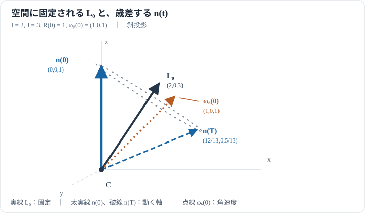

# RBD8 無トルク対称剛体と姿勢の再構成

<!-- definition-example-audit: strict -->

[RBD7のNewton–Euler方程式](../RBD7/index.md#thm-rbd7-newton-euler)は外力と外トルクから並進・回転を決めます。今回は重心まわりの**外トルクが零**である自由回転を考えます。空間系の角運動量は一定ですが、物体に描いた軸は回り続けることがあります。**固定された角運動量と動く物体軸を両立させ、最初の姿勢から任意時刻の姿勢を再現する**ことが目標です。

質量分布に対称性があれば、[MECH8のEuler方程式](../../MECH/MECH8/index.md#thm-mech8-euler-equations)を積分するだけでなく、[RBD3の姿勢と角速度の関係](../RBD3/index.md#prop-rbd3-angular-conjugacy)も明示的に積分できます。計算に使うのは物体固定の正向き主軸基底 $(e_1,e_2,e_3)$、空間系へ移す能動回転 $R(t)\in SO(3)$、物体系角速度 $\omega_b=(\omega_1,\omega_2,\omega_3)$ です。外トルク以外に重心の並進があっても、重心まわりの回転方程式は同じです。

## 1. 対称軸が一本だけ特別な物体

[MECH8の主軸・主慣性モーメントの定義](../../MECH/MECH8/index.md#def-mech8-principal-axis)では、慣性テンソルを対角表示する直交方向を主軸と呼びます。[RBD6の主慣性値の縮退](../RBD6/index.md#def-rbd6-principal-degeneracy)により、第一・第二主軸の慣性モーメントが等しい場合、残る第三主軸を力学的な対称軸として選べます。ここでは正の慣性モーメントを仮定します。回転対称性をもつ物体の代表例は円板や軸対称の円柱ですが、必要なのは力学的な主慣性値の条件です。

<!-- formal-statement-start -->
### 定義（力学的対称剛体と無トルク回転）

重心まわりの物体系慣性テンソルが正向き直交主軸基底で

$$
J_b=\operatorname{diag}(I,I,J),\qquad I>0,\quad J>0,\quad I\ne J
$$

となる三次元剛体を**力学的対称剛体**と呼び、$e_3$ を**物体対称軸**と呼ぶ。重心まわりの外トルク $\tau_{C,s}$ が全時刻で零なら、回転を**無トルク**と呼ぶ。空間系の対称軸は $n(t):=R(t)e_3$、空間角運動量は $L_s(t):=R(t)J_b\omega_b(t)$ である。
<!-- formal-statement-end -->

<!-- definition-example-start: def-rbd8-symmetric-body -->
### 直接例：薄い一様円板

**定義の確認**：二つの等しい主慣性値、第三主慣性値との相違、正定値性を具体的に計算し、無トルク条件は独立に調べます。

半径 $a>0$、質量 $M>0$ の一様な薄円板を考えます。円板の面内に正向き直交軸 $e_1,e_2$ をとり、面に垂直な方向を $e_3$ とします。[RBD6の円板の慣性テンソル](../RBD6/index.md#prop-rbd6-uniform-disc)は、重心を原点とするこの基底で対角行列になり、対角成分はそれぞれの軸の主慣性モーメントです。したがって

$$
J_b=\operatorname{diag}\left(\frac14Ma^2,\frac14Ma^2,\frac12Ma^2\right)
=\operatorname{diag}(I,I,J),\qquad
I=\frac14Ma^2,\quad J=\frac12Ma^2=2I.
$$

$M,a>0$ なので $I>0,J>0,I\ne J$ です。さらに任意の非零ベクトル $v=(v_1,v_2,v_3)^{\mathsf T}$ で

$$
v^{\mathsf T}J_bv=I(v_1^2+v_2^2)+Jv_3^2>0
$$

となり、[RBD6の慣性テンソルの正定値性](../RBD6/index.md#prop-rbd6-positivity)とも整合します。対角化された基底の第三軸が物体対称軸です。自由空間中で外トルクを加えない理想模型なら $\tau_{C,s}=0$ となり、無トルク条件も満たします。**形が対称**であることと**外トルクが零**であることは別条件です。支点や重力がトルクを与える状況では円板でも無トルクとは限りません。
<!-- definition-example-end -->

[RBD6の主慣性値の三角不等式](../RBD6/index.md#prop-rbd6-inertia-triangle)も確認しましょう。実際の質量分布から得られる $I,I,J$ は $J\le 2I$ を満たします。等号は質量が対称軸に垂直な平面へ集中する薄円板などの理想模型で成立します。この条件はEuler方程式を形式的に解くためだけなら不要ですが、具体的な物体の初期条件を選ぶ際には必要です。

ここからは $I,J$ を時間一定とし、初期姿勢 $R_0\in SO(3)$、初期角速度 $\omega_b(0)=(a,b,w)$ を与えます。$a,b,w$ は実数です。円板か細長い物体かによる符号の違いも、この三数と $I,J$ だけで追えます。

## 2. 物体系では横角速度が等速で回る

[外力付きNewton–Euler方程式](../RBD7/index.md#thm-rbd7-newton-euler)の回転式で、空間の零トルクを物体系へ移しても $\tau_{C,b}=R^{\mathsf T}0=0$ です。対角行列 $J_b=\operatorname{diag}(I,I,J)$ を使えば

$$
\omega_b\times(J_b\omega_b)
=\bigl((J-I)\omega_2\omega_3,\ (I-J)\omega_3\omega_1,\ 0\bigr).
$$

したがって $J_b\dot\omega_b+\omega_b\times(J_b\omega_b)=0$ の各成分は次のとおりです。上点は時刻 $t$ に関する常微分、例えば $\dot\omega_1=d\omega_1/dt$ を表します。

$$
\begin{aligned}
I\dot\omega_1+(J-I)\omega_2\omega_3&=0,\\
I\dot\omega_2+(I-J)\omega_3\omega_1&=0,\\
J\dot\omega_3&=0.
\end{aligned}
$$

第三式により $\omega_3=w$ は一定です。横成分 $(\omega_1,\omega_2)$ は長さを変えず、物体基底の中で向きだけ変わります。ここで**横角速度**とは対称軸に垂直な成分 $(\omega_1,\omega_2,0)$ のことで、その大きさを $\rho=\sqrt{a^2+b^2}$ と書きます。

<!-- formal-statement-start -->
### 定理（無トルク対称剛体のEuler方程式の明示解）

$J_b=\operatorname{diag}(I,I,J)$、$I,J>0$、$I\ne J$ とし、重心まわりの外トルクは零とする。初期角速度を $\omega_b(0)=(a,b,w)\in\mathbb R^3$ とする。このとき

$$
\alpha:=\frac{J-I}{I}w
$$

とおけば、全時刻 $t\in\mathbb R$ について一意な解は

$$
\boxed{
\begin{aligned}
\omega_1(t)&=a\cos(\alpha t)-b\sin(\alpha t),\\
\omega_2(t)&=a\sin(\alpha t)+b\cos(\alpha t),\\
\omega_3(t)&=w.
\end{aligned}}
$$

と表せる。特に $\omega_1(t)^2+\omega_2(t)^2=a^2+b^2$ は一定である。
<!-- formal-statement-end -->

### 証明の見取り図

第三式で軸方向の角速度を固定し、残る二式を定係数の連立微分方程式として解きます。回転の向きは $\alpha$ の符号で決まり、$J>I$ と $J<I$ では逆転します。

<!-- proof-start -->
### 証明

第三式は $J>0$ より $\dot\omega_3=0$ だから $\omega_3(t)=w$ です。第一・第二式を $I>0$ で割ると

$$
\dot\omega_1=-\alpha\omega_2,\qquad
\dot\omega_2=\alpha\omega_1.
$$

複素数 $z(t)=\omega_1(t)+i\omega_2(t)$ を導入して二式を足すと

$$
\begin{aligned}
\dot z&=-\alpha\omega_2+i\alpha\omega_1\\
&=i\alpha(\omega_1+i\omega_2)=i\alpha z.
\end{aligned}
$$

両辺に $e^{-i\alpha t}$ を掛けて積の微分をとれば

$$
\frac{d}{dt}\bigl(e^{-i\alpha t}z(t)\bigr)
=e^{-i\alpha t}(\dot z-i\alpha z)=0.
$$

したがって $z(t)=(a+ib)e^{i\alpha t}$。実部・虚部を展開すると定理の三成分を得ます。絶対値について $|z(t)|^2=|a+ib|^2|e^{i\alpha t}|^2=a^2+b^2$ です。係数一定の線形初期値系なので、この解は初期値を満たす唯一の解です。
<!-- proof-end -->

**符号の確認**：$a>0,b=0,w>0$ の場合、最初の横角速度の変化は $\dot\omega_2(0)=\alpha a$。$J>I$ の円板なら $+e_2$ 方向へ、$J<I$ の細長い軸対称物体なら $-e_2$ 方向へ動きます。$w=0$ または $a=b=0$ なら横成分の変化は零ですが、空間に対する物体姿勢が一定とは限りません。

## 3. 固定された角運動量と動く対称軸

角運動量の物体系成分は $L_b=J_b\omega_b$ です。空間では角運動量が固定される理由を、[RBD7の空間系角運動量収支](../RBD7/index.md#thm-rbd7-newton-euler)に $\tau_{C,s}=0$ を代入して確認できます。一方、$L_b=R^{\mathsf T}L_s$ は動く基底で表した成分なので一定ではありません。

<!-- formal-statement-start -->
### 命題（自由回転の角運動量・エネルギーと円錐角）

重心まわりに外トルクを受けず、物体系で $J_b=\operatorname{diag}(I,I,J)$、$I,J>0$、$I\ne J$ となる三次元剛体を考える。初期角速度を $\omega_b(0)=(a,b,w)\in\mathbb R^3$、初期姿勢を $R(0)=R_0\in SO(3)$ とする。このとき

$$
L_s(t)=L_0:=R_0(Ia,Ib,Jw)^{\mathsf T}
$$

は一定であり、回転エネルギー $E$ と角運動量の長さ $\ell$ は

$$
\boxed{
E=\frac12\bigl(I(a^2+b^2)+Jw^2\bigr),\qquad
\ell=\sqrt{I^2(a^2+b^2)+J^2w^2}.}
$$

$\ell>0$ なら空間の単位角運動量軸 $k=L_0/\ell$ と物体対称軸 $n(t)=R(t)e_3$ のなす角 $\theta\in[0,\pi]$ は一定で、

$$
\boxed{\cos\theta=\frac{Jw}{\ell},\qquad
\sin\theta=\frac{I\sqrt{a^2+b^2}}{\ell}.}
$$
<!-- formal-statement-end -->

### 証明の見取り図

角運動量の空間系での時間微分は外トルクです。エネルギーはEuler方程式と内積をとるか、明示解へ代入します。物体の軸と角運動量の内積は、空間へ同じ回転で移す前の物体系で計算できます。

<!-- proof-start -->
### 証明

[RBD7のNewton–Euler方程式](../RBD7/index.md#thm-rbd7-newton-euler)より、空間系で $\dot L_s=\tau_{C,s}=0$ です。初期値 $L_s(0)=R_0 J_b\omega_b(0)$ を代入すると $L_s=L_0$。$R_0$ は直交回転なので

$$
\ell^2=|L_0|^2=|J_b\omega_b(0)|^2
=I^2a^2+I^2b^2+J^2w^2.
$$

[MECH8の回転エネルギーの式](../../MECH/MECH8/index.md#prop-mech8-kinetic-decomposition)で重心まわりの回転部分をとれば

$$
\begin{aligned}
E(t)
&=\frac12\omega_b(t)\cdot J_b\omega_b(t)\\
&=\frac12\{I[\omega_1(t)^2+\omega_2(t)^2]+Jw^2\}\\
&=\frac12[I(a^2+b^2)+Jw^2].
\end{aligned}
$$

最後に $n=Re_3$、$L_s=RL_b$ なので直交性を使って

$$
\begin{aligned}
n\cdot L_s&=(Re_3)\cdot(RJ_b\omega_b)\\
&=e_3\cdot J_b\omega_b=Jw.
\end{aligned}
$$

$n$ と $k=L_s/\ell$ は単位ベクトルだから $\cos\theta=Jw/\ell$。また $\ell^2-J^2w^2=I^2(a^2+b^2)$ と $\sin\theta\ge0$ から第二式を得ます。
<!-- proof-end -->

物体軸 $n$ はこの一定角度を保ったまま、空間に固定された $L_0$ を中心に円錐を描けます。ただし、**角運動量が一定だから角速度も一定**とは言えません。$J\ne I$ かつ $w\rho\ne0$ なら一般に $\omega_s$ と $L_s$ は平行ではないからです。どの速さで円錐を回り、どこまで物体自身がねじれるかを次に求めます。

## 4. 姿勢を回転の積として再構成する

角速度だけを解いても物体上の印の向きは分かりません。[RBD2のRodrigues回転](../RBD2/index.md#thm-rbd2-rodrigues)を使えば、単位軸 $u$ のまわりに角度 $\beta$ だけ回す能動回転を

$$
Q(u,\beta):=\exp(\beta\widehat u),\qquad
\widehat u\,v=u\times v
$$

と表せます。$Q$ は $u$ を固定し、$u$ に垂直な平面を右手則に従って回します。ここで $Q(u,0)=I_3$、$Q(u,\beta)^{\mathsf T}=Q(u,-\beta)$ です。

<!-- formal-statement-start -->
### 定理（無トルク対称剛体の姿勢の再構成）

重心まわりに外トルクを受けない三次元剛体について、物体系慣性テンソルを $J_b=\operatorname{diag}(I,I,J)$、$I,J>0$、$I\ne J$ とする。初期姿勢 $R(0)=R_0\in SO(3)$、初期角速度 $\omega_b(0)=(a,b,w)\in\mathbb R^3$ を与え、$L_0:=R_0(Ia,Ib,Jw)^{\mathsf T}$、$\ell:=|L_0|>0$ とする。固定単位軸 $k=L_0/\ell$、空間での歳差角速度の大きさ $\nu=\ell/I>0$、物体系横角速度の回転率 $\alpha=(J-I)w/I$ を定める。このとき、[物体系角速度の明示解](#thm-rbd8-euler-solution)に対する姿勢方程式 $\dot R=R\widehat{\omega}_b$ の解は

$$
\boxed{R(t)=Q(k,\nu t)\,R_0\,Q(e_3,-\alpha t),\qquad t\in\mathbb R.}
$$

特に空間の対称軸は

$$
\boxed{n(t)=Q(k,\nu t)\,n(0)}
$$

となり、$k$ の周りに一定の角速度ベクトル $\nu k=L_0/I$ で回る。$\ell=0$ の場合は $\omega_b=0$、$R(t)=R_0$ である。
<!-- formal-statement-end -->

### 証明の見取り図

左側の $Q(k,\nu t)$ は**空間に固定された角運動量軸まわりの回転**、右側の $Q(e_3,-\alpha t)$ は**物体対称軸に関する補正回転**です。左の一回転だけでは横成分の体軸表示を再現できません。積を微分し、右から $R^{\mathsf T}$ でなく**左から $R^{\mathsf T}$** を掛けて物体系角速度へ戻すのが核心です。

<!-- proof-start -->
### 証明

$A(t)=Q(k,\nu t)$、$B(t)=Q(e_3,-\alpha t)$ とおくと、$R=A R_0 B$ は三つの $SO(3)$ 行列の積だから $R(t)\in SO(3)$、また $R(0)=R_0$ です。[RBD2の回転の指数表示](../RBD2/index.md#prop-rbd2-exponential)で $A=\exp(\nu t\widehat k)$、$B=\exp(-\alpha t\widehat{e_3})$ と書けます。各生成行列は時間に依存しないため、指数級数を項別に微分すると

$$
\frac{dA}{dt}=\nu\widehat k\,A,\qquad
\frac{dB}{dt}=-\alpha B\,\widehat{e_3}
$$

を得ます（右側のハット行列と $B$ は同じ行列の冪級数なので交換します）。さらに[RBD3の回転とハット行列の共役関係](../RBD3/index.md#prop-rbd3-angular-conjugacy)を用いて

積の微分を行い、左から $R^{\mathsf T}$ を掛けると

$$
\begin{aligned}
R^{\mathsf T}\dot R
&=R^{\mathsf T}(\nu\widehat k R-\alpha R\widehat{e_3})\\
&=\widehat{\nu R^{\mathsf T}k}-\alpha\widehat{e_3}\\
&=\widehat{\frac1I R^{\mathsf T}L_0-\alpha e_3}.
\end{aligned}
$$

ここで $L_{b,0}:=R_0^{\mathsf T}L_0=(Ia,Ib,Jw)$ とします。$A(t)$ は $L_0$ を固定し、$B(t)^{\mathsf T}=Q(e_3,\alpha t)$ だから

$$
\begin{aligned}
R^{\mathsf T}L_0
&=B^{\mathsf T}R_0^{\mathsf T}A^{\mathsf T}L_0\\
&=Q(e_3,\alpha t)L_{b,0}\\
&=(I\omega_1(t),I\omega_2(t),Jw),
\end{aligned}
$$

最後の等号には[本章のEuler方程式の明示解](#thm-rbd8-euler-solution)を使いました。よって

$$
\frac1I R^{\mathsf T}L_0-\alpha e_3
=\left(\omega_1(t),\omega_2(t),\frac{J}{I}w-\frac{J-I}{I}w\right)
=\omega_b(t).
$$

したがって $R^{\mathsf T}\dot R=\widehat{\omega}_b$、左から $R$ を掛けて $\dot R=R\widehat{\omega}_b$ が従います。右辺が連続な既知の角速度を用いた線形行列初期値問題なので、初期姿勢に対する解は一意です。

対称軸について、$B(t)e_3=e_3$ から

$$
R(t)e_3=A(t)R_0 B(t)e_3=A(t)n(0).
$$

さらに $\ell=0$ なら $I,J>0$ より $a=b=w=0$。Euler方程式は $\omega_b(t)=0$ を与え、姿勢方程式は $\dot R=0$ となります。
<!-- proof-end -->

**角速度ベクトルの見方**も確認しておきます。[RBD3の空間・物体角速度の対応](../RBD3/index.md#prop-rbd3-angular-conjugacy)より $\omega_s=R\omega_b$ です。証明中の $\omega_b=R^{\mathsf T}L_0/I-\alpha e_3$ に左から $R$ を掛け、$RR^{\mathsf T}=I_3$ と $Re_3=n$ を使えば

$$
\boxed{\omega_s(t)=\frac{L_0}{I}-\alpha n(t).}
$$

よって

$$
\dot n=\omega_s\times n
=\frac{L_0}{I}\times n-\alpha(n\times n)
=\frac{L_0}{I}\times n.
$$

右辺の第二項が消えるので、対称軸は $L_0$ の周りで歳差します。$L_0$ 自身は空間に静止し、$\omega_s$ の先端は一般に動きます。「物体系での横成分の回転率 $\alpha$」と「空間での軸の歳差率 $\nu$」を取り違えないでください。

### 数値を代入して初期速度を検算する

$I=2,J=3$、$R_0=I_3$、$\omega_b(0)=(1,0,1)$ なら

$$
L_0=(2,0,3),\quad \ell=\sqrt{13},\quad
\alpha=\frac12,\quad \nu=\frac{\sqrt{13}}2.
$$

再構成式を $t=0$ で微分すると

$$
\begin{aligned}
\dot R(0)
&=\widehat{L_0/I}\,R_0-\alpha R_0\widehat{e_3}\\
&=\widehat{(1,0,3/2)}-\widehat{(0,0,1/2)}
=\widehat{(1,0,1)}.
\end{aligned}
$$

すなわち指定した初期角速度を正しく再現します。エネルギーと角運動量の長さは $E=5/2$、$\ell=\sqrt{13}$、対称軸との角度は $\cos\theta=3/\sqrt{13}$ です。

### 解析解に従う姿勢の操作教材

下図は空間で**固定された角運動量 $L_0$（実線）**、**回る対称軸 $n(t)$（太い実線）**、**空間角速度 $\omega_s(t)$（破線）**を、同じ原点から描く模式的な射影図です。矢印は方向を示し、長さは量の比を表しません。軸の先端が描く円弧は、保存する角度 $\theta$ を示します。

[解析解による姿勢・角運動量プレイヤー（再生／停止／コマ送り／パラメータ変更）](https://insuns21.github.io/toukei-kentei_grade1_preparation/textbook/volumes/dream_thater/物理系/RBD/RBD8/assets/torque-free-symmetric-top.html)

操作教材は外部ライブラリを使わない独立HTMLです。初期条件を変えたときも $R(t)$ は上の積の式で計算し、$L_s(t)=R(t)J_b\omega_b(t)$ の一定性、$R^{\mathsf T}R=I_3$、エネルギーを画面上で監査します。JavaScriptが使えなくても、[静止した配置の参照図](assets/torque-free-cone.svg)とこの節の式だけで位置関係を読み取れます。

[図の原寸表示](assets/torque-free-cone.svg)

## 5. Euler角から読む「歳差」と「自転」

[RBD4の $z$–$y$–$z$ Euler角の定義](../RBD4/index.md#def-rbd4-zyz-euler)では、空間の $z$ 軸を $k=L_0/\ell$ として選ぶと（$\ell>0$）、

$$
R=R_z(\phi)R_y(\theta)R_z(\psi)
$$

と表せます。この表示の $\theta$ は一定で、$0<\theta<\pi$ なら角の時間変化を一意に局所的に選んで

$$
\boxed{\dot\phi=\nu=\frac{\ell}{I},\qquad
\dot\theta=0,\qquad
\dot\psi=-\alpha=\frac{I-J}{I}w.}
$$

とできます。これは[本章の再構成定理](#thm-rbd8-attitude-reconstruction)の左の回転を空間 $z$ 軸まわり、右の回転を体軸 $e_3$ まわりとして読み替えたものです。定数角 $\phi(0),\psi(0)$ は初期姿勢に合わせます。

[既習のEuler角と角速度の対応](../RBD4/index.md#prop-rbd4-angular-velocity)により、体軸成分は

$$
\omega_3=\dot\psi+\dot\phi\cos\theta
=-\alpha+\frac{\ell}{I}\frac{Jw}{\ell}=w.
$$

したがって $\dot\psi$ が負でも、物体角速度の軸方向成分 $\omega_3=w$ は正になり得ます。**Euler角の自転角速度 $\dot\psi$ と、剛体の対称軸方向の角速度成分 $w$ は同一ではありません。**

$\rho=0$ のときは $|\cos\theta|=1$ で、Euler角は座標特異です。対称軸は空間に固定され、実際の姿勢はその軸の周りを角速度 $w$ で回ります。このときも[姿勢の再構成定理](#thm-rbd8-attitude-reconstruction)の行列の積による表示は有効ですが、$\dot\phi$ と $\dot\psi$ を個別の観測可能な回転率と見なしてはいけません。$\ell=0$ なら回転せず、歳差軸 $k$ 自体を定義しません。

## 6. モデルの境界と次の問い

- **円板型** $J>I$ では、$w>0$ なら物体系で $\alpha>0$、Euler角の $\dot\psi<0$ です。物体の印の回転方向を、歳差方向と同一視しません。
- **細長い軸対称体型** $J<I$ では、$w>0$ なら $\alpha<0$ となり、横角速度の物体系内の回転方向が反転します。正の $I,J$ を持つ有限半径の物体を想定します。
- **球対称極限** $J=I$ では今回の「異なる二つの主慣性値」という定義から外れますが、式を極限へ延長すると $\alpha=0$ です。$\omega_s=L_0/I$ は一定で、姿勢は固定軸まわりの単一の回転になります。
- **外トルクが零という仮定を外す**と $\dot L_s=\tau_{C,s}$ であり、$k$ は固定されません。円錐の頂点だけを動かして本章の再構成式を使い続けることはできません。

本章で扱うのは重心まわりの対称な自由剛体です。三つの主慣性値が異なる場合、横角速度は単一の周波数で回らず、中間軸の安定性が問題になります。これは次のRBD9で調べます。

---

# 演習

## Level A

### 問題 A1：横角速度の回転方向

$I=2,J=3$、$\omega_b(0)=(2,0,1)$ とする。$\alpha$、$\omega_b(t)$、$\dot\omega_2(0)$ を求め、$t=\pi$ における横成分を答えよ。

- Level: A

<!-- solution-start -->
### 詳細解答

[明示解の定理](#thm-rbd8-euler-solution)で

$$
\alpha=\frac{3-2}{2}\cdot1=\frac12.
$$

したがって

$$
\omega_b(t)=(2\cos(t/2),\,2\sin(t/2),\,1).
$$

第二成分の微分は $\dot\omega_2(t)=\cos(t/2)$ なので $\dot\omega_2(0)=1>0$。$t=\pi$ では $\omega_1=0$、$\omega_2=2$ です。
<!-- solution-end -->

### 問題 A2：一定のエネルギー・角運動量と対称軸の角

$I=2,J=3$、$R_0=I_3$、$\omega_b(0)=(1,0,1)$ とする。$E$、$L_0$、$\ell$、$\cos\theta$、$\sin\theta$ を求めよ。

- Level: A

<!-- solution-start -->
### 詳細解答

[エネルギーと角運動量の命題](#prop-rbd8-conserved-quantities)で $a=1,b=0,w=1$ を代入します。

$$
E=\frac12(2\cdot1+3\cdot1)=\frac52,\qquad
L_0=R_0(2,0,3)=(2,0,3).
$$

ゆえに $\ell=\sqrt{2^2+3^2}=\sqrt{13}$。角度は

$$
\cos\theta=\frac{3}{\sqrt{13}},\qquad
\sin\theta=\frac{2}{\sqrt{13}}.
$$

両者の二乗和は $9/13+4/13=1$ です。
<!-- solution-end -->

### 問題 A3：自転角と軸方向角速度

$I=1,J=2$、$\omega_b(0)=(1,0,2)$ で $\ell>0$ とする。$\nu$、$\dot\psi$、$\cos\theta$ を求め、$\dot\psi+\nu\cos\theta=\omega_3$ を確認せよ。

- Level: A

<!-- solution-start -->
### 詳細解答

$\ell=\sqrt{1^2+4^2}=\sqrt{17}$、$\nu=\ell/I=\sqrt{17}$ です。

$$
\alpha=\frac{2-1}{1}\cdot2=2,\qquad
\dot\psi=-2,\qquad \cos\theta=\frac{2\cdot2}{\sqrt{17}}=\frac4{\sqrt{17}}.
$$

よって

$$
\dot\psi+\nu\cos\theta=-2+\sqrt{17}\frac4{\sqrt{17}}=2=\omega_3.
$$

Euler角の自転率は負ですが、軸方向の角速度成分は正です。
<!-- solution-end -->

### 問題 A4：円板と細長い物体の符号

どちらも $w>0$、$a>0$、$b=0$ とする。円板型 $I=1,J=2$ と細長い型 $I=2,J=1$ について、それぞれ $\alpha$ と $\dot\omega_2(0)$ の符号を調べよ。

- Level: A

<!-- solution-start -->
### 詳細解答

第一の物体では $\alpha=(2-1)w/1=w>0$、第二では $\alpha=(1-2)w/2=-w/2<0$ です。

[明示解の導出](#thm-rbd8-euler-solution)から $\dot\omega_2=\alpha\omega_1$。初期値は $\omega_1(0)=a>0$ なので、円板型で $\dot\omega_2(0)=wa>0$、細長い型で $\dot\omega_2(0)=-wa/2<0$ です。外トルクの有無ではなく $J-I$ の符号が差を生みます。
<!-- solution-end -->

### 問題 A5：軸方向だけ回す初期値

$I,J>0$、$I\ne J$、$\omega_b(0)=(0,0,w)$、$w\ne0$ とする。$n(t)$ と実際の姿勢を答えよ。また $\dot\phi$ と $\dot\psi$ を別々に測定可能か判定せよ。

- Level: A

<!-- solution-start -->
### 詳細解答

[Euler方程式の明示解](#thm-rbd8-euler-solution)で $a=b=0$ なので、$\omega_b(t)=(0,0,w)$。姿勢方程式は $\dot R=R\,w\widehat{e_3}$ だから

$$
R(t)=R_0Q(e_3,wt),\qquad
n(t)=R_0Q(e_3,wt)e_3=R_0e_3.
$$

軸は空間に固定されます。$\ell=J|w|$、$\theta=0$ または $\pi$ となるため、[RBD4の座標特異性](../RBD4/index.md#prop-rbd4-coordinate-singularity)から $\phi$ と $\psi$ は個別に一意ではありません。測定できるのは合成された姿勢の回転であり、$\dot\phi,\dot\psi$ の個別値ではありません。
<!-- solution-end -->

## Level B

### 問題 B1：任意初期姿勢での固定角運動量

$I,J>0$、$I\ne J$、$\ell>0$ とし、$R(t)=Q(k,\ell t/I)R_0Q(e_3,-\alpha t)$ とおく。$L_b(t)=Q(e_3,\alpha t)L_{b,0}$ として $R(t)L_b(t)=L_0$ を示し、$R(0)$ と $\omega_b(0)$ を検算せよ。

- Level: B

<!-- solution-start -->
### 詳細解答

$L_{b,0}=R_0^{\mathsf T}L_0$、$k=L_0/\ell$ です。回転の逆元 $Q(e_3,-\alpha t)Q(e_3,\alpha t)=I_3$ を使うと

$$
\begin{aligned}
R(t)L_b(t)
&=Q(k,\ell t/I)R_0Q(e_3,-\alpha t)Q(e_3,\alpha t)L_{b,0}\\
&=Q(k,\ell t/I)R_0L_{b,0}\\
&=Q(k,\ell t/I)L_0=L_0.
\end{aligned}
$$

最後は回転軸 $k$ が $L_0$ と平行なことによります。$t=0$ では二つの $Q$ は恒等行列なので $R(0)=R_0$ です。積を微分して

$$
R_0^{\mathsf T}\dot R(0)
=\widehat{R_0^{\mathsf T}L_0/I}-\alpha\widehat{e_3}
=\widehat{(a,b,Jw/I-\alpha)}
=\widehat{(a,b,w)}.
$$

[RBD3の空間角速度と物体角速度](../RBD3/index.md#def-rbd3-angular-velocity)により初期角速度が再現されました。
<!-- solution-end -->

### 問題 B2：円錐の速さを角運動量から再導出

$\ell>0$、$\rho>0$ の対称剛体について、$L_s=I\omega_s+(J-I)wn$ から $\dot n=(L_s/I)\times n$ を導き、$|n|$ と $n\cdot L_s$ が時間一定であることを微分で確かめよ。

- Level: B

<!-- solution-start -->
### 詳細解答

物体系で $J_b\omega_b=I\omega_b+(J-I)w e_3$ です。$R$ を掛ければ $L_s=I\omega_s+(J-I)w n$。$I>0$ より

$$
\omega_s=\frac{L_s}{I}-\frac{J-I}{I}w n
=\frac{L_s}{I}-\alpha n.
$$

[RBD3の輸送から得られる速度式](../RBD3/index.md#prop-rbd3-point-velocity)を固定された物体軸に用いると $\dot n=\omega_s\times n$ なので

$$
\dot n=(L_s/I)\times n-\alpha(n\times n)=(L_s/I)\times n.
$$

従って

$$
\frac d{dt}|n|^2=2n\cdot[(L_s/I)\times n]=0,
$$

また $\dot L_s=0$ から

$$
\frac d{dt}(n\cdot L_s)=[(L_s/I)\times n]\cdot L_s+n\cdot\dot L_s=0.
$$

よって一定の角度を保ち、$|L_s|/I$ の速さで空間の固定軸を回ります。
<!-- solution-end -->

### 問題 B3：球対称極限と回転しない場合

$I>0$ を固定して $J\to I$ とする。初期角速度・初期姿勢は固定し、$|\omega_b(0)|>0$ とする。再構成公式の極限を求め、$J=I$ でのEuler方程式を直接解いて一致を確かめよ。さらに $\omega_b(0)=0$ の場合を別に述べよ。

- Level: B

<!-- solution-start -->
### 詳細解答

$\alpha=(J-I)w/I\to0$、$L_0=R_0(Ia,Ib,Jw)\to I R_0\omega_b(0)$ です。従って

$$
k\to \frac{R_0\omega_b(0)}{|\omega_b(0)|},\qquad
\nu=\frac{|L_0|}{I}\to|\omega_b(0)|.
$$

右の補正回転は $Q(e_3,-\alpha t)\to I_3$ なので、各固定 $t$ で

$$
R(t)\longrightarrow Q\!\left(
\frac{R_0\omega_b(0)}{|\omega_b(0)|},\,|\omega_b(0)|t\right)R_0.
$$

一方 $J_b=I I_3$ をEuler方程式へ代入すると $I\dot\omega_b+\omega_b\times(I\omega_b)=I\dot\omega_b=0$。$\omega_b(t)=\omega_b(0)$、$R(t)=R_0Q(\omega_b(0)/|\omega_b(0)|,|\omega_b(0)|t)$ です。ここでは[RBD2の回転の指数表示](../RBD2/index.md#prop-rbd2-exponential)と[RBD3のハット行列の共役関係](../RBD3/index.md#prop-rbd3-angular-conjugacy)を適用します。$R_0\in SO(3)$ なので

$$
R_0Q(u,\beta)R_0^{\mathsf T}
=\exp(\beta R_0\widehat uR_0^{\mathsf T})
=\exp(\beta\widehat{R_0u})
=Q(R_0u,\beta).
$$

右から $R_0$ を掛ければ $R_0Q(u,\beta)=Q(R_0u,\beta)R_0$ となり、極限と一致します。

$\omega_b(0)=0$ なら、全時刻で $\omega_b=0$、$R=R_0$ です。$k=L_0/|L_0|$ を定義して極限をとる必要はありません。
<!-- solution-end -->

### 問題 B4：角速度と角運動量はいつ平行か

$I,J>0$、$I\ne J$、$\omega_b=(x,y,w)$、$\rho=\sqrt{x^2+y^2}$ とする。$\omega_b\times(J_b\omega_b)$ を計算し、$\omega_s$ と $L_s$ が平行である条件を求めよ。$w\rho\ne0$ のときの説明も加えよ。

- Level: B

<!-- solution-start -->
### 詳細解答

$J_b\omega_b=(Ix,Iy,Jw)$ をベクトル積へ代入すると

$$
\begin{aligned}
\omega_b\times(J_b\omega_b)
&=(yJw-wIy,\ wIx-xJw,\ xIy-yIx)\\
&=((J-I)yw,\ (I-J)xw,\ 0).
\end{aligned}
$$

回転 $R$ はベクトル積と平行性を保存するので、$\omega_s$ と $L_s$ が平行であることは上のベクトル積が零であることと同値です。$J-I\ne0$ だから $wy=0$ と $wx=0$、すなわち **$w=0$ または $\rho=0$** です。$w\rho\ne0$ ならベクトル積は非零で、空間で $L_s$ が一定でも $\omega_s$ の向きは回ります。
<!-- solution-end -->

## Level C

### 問題 C1：角速度・角運動量・エネルギー・姿勢を一貫して求める

重心まわりに無トルクの対称剛体を $I=2,J=3$、$R_0=I_3$、$\omega_b(0)=(1,0,1)$ とする。次を一つの運動として計算せよ。

1. $\omega_b(t)$、$E$、$L_0$、$\ell$ と対称軸の傾き $\theta$。
2. $\alpha,\nu$ と姿勢行列 $R(t)$（二つの軸回転の積でよい）。
3. 時刻 $T=2\pi/\sqrt{13}$ の対称軸 $n(T)$ と物体系横角速度。
4. $\dot R(0)=R_0\widehat{\omega_b(0)}$、$R(T)L_b(T)=L_0$ が成立すること。$L_0$ と $\omega_s(0)$ が平行かどうか。

- Level: C

<!-- solution-start -->
### 詳細解答

まず[明示解](#thm-rbd8-euler-solution)で

$$
\alpha=\frac{3-2}{2}\cdot1=\frac12,\qquad
\omega_b(t)=(\cos(t/2),\sin(t/2),1).
$$

[エネルギーと角運動量の命題](#prop-rbd8-conserved-quantities)へ代入すると

$$
E=\frac12(2+3)=\frac52,\quad L_0=(2,0,3),\quad
\ell=\sqrt{13},\quad
\cos\theta=\frac3{\sqrt{13}},\quad
\sin\theta=\frac2{\sqrt{13}}.
$$

$k=(2,0,3)/\sqrt{13}$、$\nu=\sqrt{13}/2$ なので、[再構成定理](#thm-rbd8-attitude-reconstruction)から

$$
R(t)=Q\!\left(\frac{(2,0,3)}{\sqrt{13}},\frac{\sqrt{13}}2t\right)
Q(e_3,-t/2).
$$

$T=2\pi/\sqrt{13}$ では $\nu T=\pi$、$\alpha T=\pi/\sqrt{13}$ です。右の $Q(e_3,-\alpha T)$ は $e_3$ を動かさないので

$$
n(T)=Q(k,\pi)e_3.
$$

[RBD2のRodrigues公式](../RBD2/index.md#thm-rbd2-rodrigues)で $Q(k,\pi)v=2(k\cdot v)k-v$ を使うと

$$
\begin{aligned}
n(T)
&=2\frac3{\sqrt{13}}\frac{(2,0,3)}{\sqrt{13}}-(0,0,1)\\
&=\left(\frac{12}{13},0,\frac{18}{13}-1\right)
=\boxed{\left(\frac{12}{13},0,\frac5{13}\right)}.
\end{aligned}
$$

横角速度は $\omega_1(T)=\cos(\pi/\sqrt{13})$、$\omega_2(T)=\sin(\pi/\sqrt{13})$ です。初期姿勢の微分は

$$
\dot R(0)=\widehat{(1,0,3/2)}
-\widehat{(0,0,1/2)}=\widehat{(1,0,1)}
=R_0\widehat{\omega_b(0)}.
$$

さらに $L_b(T)=Q(e_3,\alpha T)(2,0,3)$ であるため

$$
\begin{aligned}
R(T)L_b(T)
&=Q(k,\pi)\,Q(e_3,-\alpha T)Q(e_3,\alpha T)(2,0,3)\\
&=Q(k,\pi)(2,0,3)=(2,0,3)=L_0.
\end{aligned}
$$

最後に $\omega_s(0)=R_0\omega_b(0)=(1,0,1)$、$L_0=(2,0,3)$。ベクトル積は

$$
\omega_s(0)\times L_0=(0,-1,0)\ne0
$$

なので平行ではありません。角運動量の保存と角速度の向きの保存を混同しないことが、この問題の中心です。
<!-- solution-end -->
