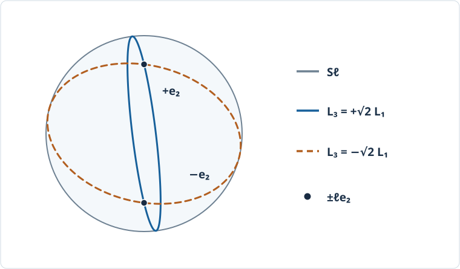

# RBD9 非対称剛体・中間軸の不安定性

<!-- definition-example-audit: strict -->

[RBD8の無トルク対称剛体](../RBD8/index.md#thm-rbd8-euler-solution)では、二つの主慣性モーメントが等しいため、横角速度を一つの周波数で積分できました。しかし三つの主慣性モーメントが異なる本のような物体を空中で回すと、選んだ回転軸によっては、ごく小さな傾きが大きな姿勢変化につながります。

本講の問いは「**同じ無トルクの法則に従う三本の主軸が、なぜ異なる安定性を示すのか**」です。まず[RBD7の外力付きNewton–Euler方程式](../RBD7/index.md#thm-rbd7-newton-euler)から摂動方程式を導き、次にエネルギーと角運動量を使って線形近似を越えた結論を確かめます。最後に角運動量球面で回転の切替わりを読みます。位置の並進は重心まわりの回転に影響しないので扱いません。

## 1. 三つの主軸を区別する

[RBD6の主軸と正定値慣性テンソル](../RBD6/index.md#def-rbd6-principal-degeneracy)を用い、重心を通る正向き直交主軸基底 $e_1,e_2,e_3$ を物体へ固定します。$I_i$ はこの基底の第 $i$ 軸の主慣性モーメントです。一般の角速度では角運動量と角速度は平行でない一方、単一の主軸に沿えば平行です。この単純な回転が摂動を比較する基準になります。

<!-- formal-statement-start -->
### 定義（三軸非対称剛体と主軸回転）

三次元剛体の重心まわりの物体系慣性テンソルを、時間に依存しない正向き直交主軸基底で

$$
J_b=\operatorname{diag}(I_1,I_2,I_3),\qquad 0<I_1<I_2<I_3
$$

と表せるとき、ここでは**三軸非対称剛体**とする。外トルク $\tau_{C,s}=0$ の下、$i\in\{1,2,3\}$ と $\Omega\ne0$ に対して

$$
\omega_b(t)=\Omega e_i
$$

が一定である運動を、第 $i$ **主軸回転**とする。$e_2$ を**中間軸**、$e_1$ を最小慣性軸、$e_3$ を最大慣性軸とする。
<!-- formal-statement-end -->

<!-- definition-example-start: def-rbd9-triaxial-principal-spin -->
### 直接例：均質な直方体で条件を確認する

**定義の確認**：主軸基底で慣性テンソルが対角となる理由を確認し、三つの値の正値性・狭義の順序と、独立の無トルク条件を調べます。

質量 $M=12$、物体主軸に平行な辺の長さを $a=\sqrt{5/2}$、$b=\sqrt{3/2}$、$c=\sqrt{1/2}$ とする（一貫した長さ・質量単位を用いる）。[RBD6の直方体の質量積分](../RBD6/index.md#prop-rbd6-rectangular-block)で、辺に平行な基底における慣性テンソルは対角行列となります。例えば第1軸の慣性モーメントは、体積上の $y^2+z^2$ の積分で

$$
I_1=\frac{M}{12}(b^2+c^2)=2.
$$

同じ計算で

$$
I_2=\frac{M}{12}(a^2+c^2)=3,\qquad
I_3=\frac{M}{12}(a^2+b^2)=4.
$$

したがって $0<2<3<4$ が全て確認でき、三軸非対称です。実物の慣性値には[RBD6の主慣性値の三角不等式](../RBD6/index.md#prop-rbd6-inertia-triangle)もあり、実際に $4\le2+3$ です。外トルクが零という条件は形とは独立で、理想的な自由空間でのみ追加で仮定します。$\omega_b=(0,1,0)$ を代入したときEuler方程式の各右辺が零であることは、次節で直接確認します。
<!-- definition-example-end -->

## 2. Euler方程式と三本の定常回転

[RBD7の回転方程式](../RBD7/index.md#thm-rbd7-newton-euler)に $\tau_{C,b}=0$ と上の対角行列を入れると

$$
\begin{aligned}
I_1\dot\omega_1&=(I_2-I_3)\omega_2\omega_3,\\
I_2\dot\omega_2&=(I_3-I_1)\omega_3\omega_1,\\
I_3\dot\omega_3&=(I_1-I_2)\omega_1\omega_2.
\end{aligned}

$$

例えば $\omega_b=\Omega e_2$ では $\omega_1=\omega_3=0$ なので右辺は三式とも零です。他の主軸回転も同じ理由で定常です。これは**三つとも解である**というだけで、傾きに対する安定性を保証しません。

主軸回転に小さな初期誤差を加えたとき、誤差が線形化方程式の範囲で抑えられるかをまず調べます。「線形化」は平衡解の周りで誤差の二次以上の積を捨てる操作で、元の非線形運動を置き換えるものではありません。

<!-- formal-statement-start -->
### 定義（主軸回転の線形安定性）

主軸回転 $\omega_b=\Omega e_i$ に対して $\omega_b=\Omega e_i+\delta$ と書き、Euler方程式の $\delta$ に関する一次項だけを残した線形常微分方程式を考える。その全ての解が $t\ge0$ で有界なら**線形安定**、初期値をいくら小さくしても時間とともに指数的に増大する解があれば**線形不安定**とする。線形安定は元の非線形方程式に対する安定性と同義ではない。
<!-- formal-statement-end -->

<!-- definition-example-start: def-rbd9-linear-stability -->
### 直接例：中間軸の横二成分

**定義の確認**：Euler方程式を一次に線形化した上で、いくら小さい初期値からでも指数成長する解が存在するかを実際に判定します。

$\omega_b=(x,\Omega+z,y)$ とおき、$x,y,z$ を小量とします。第1式の積は $(\Omega+z)y=\Omega y+zy$、第3式の積は $x(\Omega+z)=\Omega x+xz$ です。$zy,xz$ を捨て、第2式の右辺 $xy$ も二次なので捨てると

$$
\dot x=\frac{I_2-I_3}{I_1}\Omega y,\qquad
\dot y=\frac{I_1-I_2}{I_3}\Omega x,\qquad \dot z=0.
$$

二つの係数は $\Omega>0$ ならともに負です。$I=(2,3,4)$、$\Omega=1$ では $\dot x=-y/2$、$\dot y=-x/4$。初期値 $x(0)=\varepsilon>0,y(0)=-\varepsilon/\sqrt2,z(0)=0$ は

$$
x(t)=\varepsilon\exp(t/\sqrt8),\qquad
y(t)=-\frac{\varepsilon}{\sqrt2}\exp(t/\sqrt8)
$$

を満たすため、任意に小さい $\varepsilon$ でも非有界となり、定義に従い線形不安定です。これは実際の角速度が無限大へ成長するという意味ではありません。非線形運動の角速度は、後に証明するエネルギーと角運動量の一定性によって有界です。
<!-- definition-example-end -->

<!-- formal-statement-start -->
### 定理（三主軸回転の線形安定性分類）

$0<I_1<I_2<I_3$、外トルク零、$\Omega\in\mathbb R\setminus\{0\}$ とする。第1、第2、第3主軸回転 $\omega_b=\Omega e_i$ の線形化は、軸方向に零固有値を持ち、横二成分にはそれぞれ次の固有値を持つ。

$$
\begin{array}{c|c}
i & \text{横方向の固有値}\\ \hline
1 & \pm\mathrm i|\Omega|\sqrt{\dfrac{(I_3-I_1)(I_2-I_1)}{I_2I_3}}\\[2mm]
2 & \pm|\Omega|\sqrt{\dfrac{(I_3-I_2)(I_2-I_1)}{I_1I_3}}\\[2mm]
3 & \pm\mathrm i|\Omega|\sqrt{\dfrac{(I_3-I_2)(I_3-I_1)}{I_1I_2}}
\end{array}
$$

従って最小軸・最大軸は線形安定、中間軸は線形不安定である。いずれも漸近安定とは主張しない。
<!-- formal-statement-end -->

### 証明の見取り図

一つの主軸の角速度を $\Omega$ に固定し、他の二成分だけが一次の結合を作ることを各軸で確かめます。二度微分したとき、結合係数の積が負なら振動、正なら指数増大です。$\Omega$ 自身への一次の摂動は定数のままです。

<!-- proof-start -->
### 証明

第1軸では $\omega_b=(\Omega+z,x,y)$ とし、二次の $zx,zy,xy$ を捨てて

$$
\dot x=\frac{I_3-I_1}{I_2}\Omega y,\quad
\dot y=\frac{I_1-I_2}{I_3}\Omega x,\quad \dot z=0.
$$

従って

$$
\ddot x=-\Omega^2\frac{(I_3-I_1)(I_2-I_1)}{I_2I_3}x.
$$

係数の括弧は正なので、$\nu_1>0$ を定理の虚部の大きさとして $x=A\cos(\nu_1t)+B\sin(\nu_1t)$。さらに第一式から $y=\dot x I_2/[(I_3-I_1)\Omega]$ と復元でき、$y$ も有界です。

第2軸では直前の直接例と同じ展開により

$$
\ddot x=\Omega^2\frac{(I_3-I_2)(I_2-I_1)}{I_1I_3}x.
$$

$\gamma>0$ を正の平方根とすると $x=Ae^{\gamma t}+Be^{-\gamma t}$、また $y=I_1\dot x/[(I_2-I_3)\Omega]$ です。$A\ne0$ なら横方向に指数増大し、$A$ を任意に小さく選べます。

第3軸では $\omega_b=(x,y,\Omega+z)$ とすると

$$
\dot x=\frac{I_2-I_3}{I_1}\Omega y,\quad
\dot y=\frac{I_3-I_1}{I_2}\Omega x,\quad \dot z=0,
$$

したがって

$$
\ddot x=-\Omega^2\frac{(I_3-I_2)(I_3-I_1)}{I_1I_2}x.
$$

第1軸と同様に $x,y$ は有界な正弦・余弦の組合せです。いずれも $z$ は定数であるため、三成分全体について定理の分類が成り立ちます。$\Omega$ の符号は結合の向きを変えますが、積は $\Omega^2$ で決まります。
<!-- proof-end -->

直方体の値 $I=(2,3,4)$、$|\Omega|=1$ では、順に

$$
\nu_1=\frac1{\sqrt6},\qquad
\gamma_2=\frac1{\sqrt8},\qquad
\nu_3=\frac1{\sqrt3}.
$$

中間軸の微小な傾きは最初は指数的に増幅されます。テニスラケットなどの「中間軸まわりの反転」を理解する入り口ですが、**線形化だけで何回・何度反転するかは予言できません**。その後の大きな変化は非線形運動です。

## 3. 保存量で非線形運動を制限する

線形安定性と真の安定性を結ぶには、捨てた二次項を含む元のEuler方程式を調べなければなりません。[RBD8の保存量の証明](../RBD8/index.md#prop-rbd8-conserved-quantities)と同じく、無トルクなら空間の角運動量が固定され、回転運動エネルギーも一定です。ここでは一般の三軸の場合を成分で確認します。

物体系角運動量を $L=(L_1,L_2,L_3)=J_b\omega_b$、その長さを $\ell=|L|$ とします。$L$ は物体系で変化しても、空間角運動量 $R L$ は一定です。

<!-- formal-statement-start -->
### 命題（三軸自由回転の二保存量）

三軸非対称剛体の重心まわりの外トルクが零なら、全ての解について

$$
2E=\sum_{i=1}^3I_i\omega_i^2
=\sum_{i=1}^3\frac{L_i^2}{I_i},\qquad
\ell^2=\sum_{i=1}^3L_i^2
$$

は時間一定である。$\ell>0$ の軌道は物体系角運動量空間の半径 $\ell$ の球面上と、エネルギー二次曲面との交線に限られる。
<!-- formal-statement-end -->

### 証明の見取り図

Euler方程式を $\omega_i$ 倍して足すと、三つの相互作用項は正確に相殺します。角運動量の長さについては $L$ の時間微分が $-\omega_b\times L$ であることを使います。

<!-- proof-start -->
### 証明

[RBD7のEuler方程式](../RBD7/index.md#thm-rbd7-newton-euler)より

$$
\dot L=-\omega_b\times L,\qquad
\dot E=\sum_iI_i\omega_i\dot\omega_i
=\omega_b\cdot\dot L.
$$

よって

$$
\dot E=-\omega_b\cdot(\omega_b\times L)=0,\qquad
\frac{d}{dt}\ell^2=2L\cdot\dot L=-2L\cdot(\omega_b\times L)=0.
$$

$L_i=I_i\omega_i$ と各 $I_i>0$ を使うと、表示の二つの二次式が従います。$2E=\sum L_i^2/I_i$ は正定値で、$\ell^2$ も一定だから全ての $\omega_i$ は有界です。方程式の右辺は多項式で局所的にLipschitz連続なので、有限時刻に解が発散せず、全時刻へ延長できます。
<!-- proof-end -->

### 最大軸・最小軸では非線形でも安定

主軸回転 $\Omega e_i$ の近くから出発した運動が、**全ての未来時刻で**その回転の小さい近傍にとどまるとき、元の方程式についてLyapunov安定といいます。ここでは安定性を角速度空間の距離で測ります。$R(t)$ の向きまで一定の姿勢へ近づくという主張ではありません。

<!-- formal-statement-start -->
### 定理（両端主軸回転の非線形安定性）

$0<I_1<I_2<I_3$ で無トルクのEuler方程式を考える。各 $\Omega\ne0$ について、$\omega_b=\Omega e_1$ および $\omega_b=\Omega e_3$ は、角速度空間の平衡解としてLyapunov安定である。
<!-- formal-statement-end -->

### 証明の見取り図

単に虚固有値を見て結論するのではなく、[本章の二保存量](#prop-rbd9-free-invariants)を組み合わせると**横方向の二乗和を下から抑える**正の式が得られます。軸方向のずれは角運動量の長さと初期の符号で制御します。

<!-- proof-start -->
### 証明

最小軸 $i=1$ では

$$
F_1:=\ell^2-2I_1E
=I_2(I_2-I_1)\omega_2^2+I_3(I_3-I_1)\omega_3^2.
$$

右辺の係数は正で、$F_1$ は保存されます。従って $c_1:=\min\{I_2(I_2-I_1),I_3(I_3-I_1)\}>0$ と置くと

$$
\omega_2(t)^2+\omega_3(t)^2\le \frac{F_1(0)}{c_1}.
$$

初期条件を $\Omega e_1$ に近づければ $F_1(0)\to0$ です。さらに $\ell^2=I_1^2\omega_1^2+I_2^2\omega_2^2+I_3^2\omega_3^2$ より

$$
\omega_1(t)^2=\frac{\ell(0)^2-I_2^2\omega_2(t)^2-I_3^2\omega_3(t)^2}{I_1^2}
$$

なので、右辺は全時刻にわたり $\Omega^2$ に一様に近づきます。初期の $\omega_1$ が $\Omega$ と同符号で、右辺を例えば $\Omega^2/2$ より大きく保つほど初期値が近ければ、連続性から途中で $\omega_1=0$ を通れず、その符号は変わりません。従って $\omega_1(t)$ 自体が $\Omega$ に一様に近く、Lyapunov安定です。

最大軸 $i=3$ については

$$
F_3:=2I_3E-\ell^2
=I_1(I_3-I_1)\omega_1^2+I_2(I_3-I_2)\omega_2^2.
$$

$c_3:=\min\{I_1(I_3-I_1),I_2(I_3-I_2)\}>0$ とすれば、同様に横成分の二乗和が $F_3(0)/c_3$ 以下です。$\ell^2$ の式で $\omega_3(t)^2$ を固定し、初期符号が変わらないことを使えば $\omega_b(t)$ は $\Omega e_3$ の任意に小さい近傍にとどまります。
<!-- proof-end -->

保存量があるため、安定軸へ摩擦のように吸い寄せられて静止するわけではありません。安定は「ずれを増幅し続けない」であり「誤差が消える」ではありません。

## 4. 角運動量球面の分離曲線と中間軸の非線形不安定性

エネルギーを一定としたとき、角運動量 $L$ の軌道は[保存量の命題](#prop-rbd9-free-invariants)の球面と二次曲面の交線です。二つの安定軸を囲む軌道群の境界で、中間軸の定常回転に対応する点を通る交線が生まれます。この境界を**分離曲線**として定義します。

<!-- formal-statement-start -->
### 定義（自由剛体の角運動量球面と分離曲線）

$\ell>0$ を固定する。$L=(I_1\omega_1,I_2\omega_2,I_3\omega_3)$ の属する集合

$$
S_\ell=\{L\in\mathbb R^3:L_1^2+L_2^2+L_3^2=\ell^2\}
$$

を**角運動量球面**とする。その上で、中間軸の定常回転に対応する点 $L=\pm\ell e_2$ と同じエネルギー

$$
E_{\mathrm{sep}}=\frac{\ell^2}{2I_2}
$$

を持つ軌道の集合を、**分離曲線**と呼ぶ。
<!-- formal-statement-end -->

<!-- definition-example-start: def-rbd9-separatrix -->
### 直接例：球面と分離曲線を実際に求める

**定義の確認**：角運動量の長さ、基準となる中間軸回転のエネルギー、および両方を満たす交線の式を一つずつ求めます。

$I=(2,3,4)$、$\ell=3$ なら $S_\ell$ は $L_1^2+L_2^2+L_3^2=9$ です。中間軸の点 $(0,\pm3,0)$ のエネルギーは $\frac12\cdot9/3=3/2$。分離エネルギーを与える式に代入すると

$$
\frac{L_1^2}{2}+\frac{L_2^2}{3}+\frac{L_3^2}{4}
=\frac{L_1^2+L_2^2+L_3^2}{3},
$$

従って

$$
\left(\frac12-\frac13\right)L_1^2
=\left(\frac13-\frac14\right)L_3^2,
\qquad L_3=\pm\sqrt2 L_1.
$$

球面上の二つの平面断面となり、どちらも中間軸の二つの定常回転の点を通ります。これで定義の**球面条件・エネルギー条件・平衡点条件**を直接確認できました。
<!-- definition-example-end -->

球面上で $E<E_{\mathrm{sep}}$ の軌道は最大慣性軸 $\pm e_3$ の周囲、$E>E_{\mathrm{sep}}$ の軌道は最小慣性軸 $\pm e_1$ の周囲に位置します。例えばエネルギー式へ $L=\pm\ell e_3$ を入れると $E=\ell^2/(2I_3)<E_{\mathrm{sep}}$ であり、$\pm\ell e_1$ では $E=\ell^2/(2I_1)>E_{\mathrm{sep}}$ です。球面と二次曲面の交線は、非臨界エネルギーではそれぞれの軸周りの閉曲線に分かれます。

[図を原寸で表示](assets/intermediate-axis-separatrix.svg)

図は球面上の領域の**模式図**で、座標を正射影した正確な数値軌道ではありません。二つの分離円が $\pm e_2$ で交差し、その両側に最大軸側と最小軸側の領域があることを示します。実際の円弧は上の二つの平面 $L_3=\pm\sqrt2 L_1$ と球面の交わりで確定します。

<!-- formal-statement-start -->
### 定理（中間軸回転の非線形不安定性）

$0<I_1<I_2<I_3$ の無トルクEuler方程式で、任意の $\Omega\ne0$ に対する中間軸平衡解 $\omega_b=\Omega e_2$ はLyapunov不安定である。すなわち、ある固定の正の距離を離れる軌道を、平衡解から任意に近い初期値で作れる。
<!-- formal-statement-end -->

### 証明の見取り図

線形化で指数増大する方向に対応する**厳密な分離曲線上の初期値**を作ります。その上ではEuler方程式が元の非線形のままで成長を生むので、微小近似の有効期限を気にせず不安定性を証明できます。

<!-- proof-start -->
### 証明

$\Omega>0$ を先に考え、$\ell=I_2\Omega>0$ とします。[本章の二保存量](#prop-rbd9-free-invariants)を $L$ で表すと、Euler方程式は

$$
\dot L_1=\left(\frac1{I_3}-\frac1{I_2}\right)L_2L_3,\quad
\dot L_2=\left(\frac1{I_1}-\frac1{I_3}\right)L_3L_1,\quad
\dot L_3=\left(\frac1{I_2}-\frac1{I_1}\right)L_1L_2.
$$

正の定数を

$$
a=\frac1{I_1}-\frac1{I_2}>0,\qquad
b=\frac1{I_2}-\frac1{I_3}>0,\qquad
c=\sqrt{a/b}>0
$$

と置きます。$E=\ell^2/(2I_2)$ の条件から $aL_1^2-bL_3^2=0$、すなわち $L_3=\pm cL_1$ です。

任意に小さい $\varepsilon>0$ で

$$
L(0)=\left(\varepsilon,\sqrt{\ell^2-(1+c^2)\varepsilon^2},-c\varepsilon\right)
$$

を選びます。$(1+c^2)\varepsilon^2<\ell^2$ とします。球面上かつ分離エネルギー上なので、保存量から軌道はその交わりに残ります。$L_1>0,L_2>0,L_3<0$ の近傍では連続性によってこの枝 $L_3=-cL_1$ を外れず、

$$
\dot L_1=(-b)L_2(-cL_1)=bcL_2L_1.
$$

例えば $0<L_1<d$ で $d<\ell/\sqrt{2(1+c^2)}$ としておけば、$L_2=\sqrt{\ell^2-(1+c^2)L_1^2}>\ell/\sqrt2$ です。従ってこの領域にいる限り

$$
\dot L_1\ge\frac{bc\ell}{\sqrt2}L_1>0,
\qquad
L_1(t)\ge \varepsilon\exp(bc\ell t/\sqrt2).
$$

つまり有限時刻で $L_1=d$ に達します。初期値は $\varepsilon\to0$ で $(0,\ell,0)$ に近づくのに、到達時点では定常解からの角運動量空間の距離が少なくとも $d$ です。$L_i=I_i\omega_i$ の可逆な対角変換により、角速度空間でも固定の正の距離だけ離れます。$\Omega<0$ は時間反転と $\omega_b\mapsto-\omega_b$ の対称性、または $L_2$ と $L_3$ の符号を同時調整する同じ構成で示せます。
<!-- proof-end -->

**なぜ永遠に指数増大しないのか。** 分離曲線は角運動量球面上にあるため全成分は有界です。平衡点から離れた後、軌道は球面上を進み、別の中間軸の定常回転へ近づく枝を持ちます。指数増大は近傍から離れる局所的な仕組みであり、エネルギーの発散ではありません。「反転」は物体に付けた印の向きの変化で、常に正確に180度の反転を一律の周期で繰り返すという法則ではありません。

## 5. 計算で主軸回転を比較する

[角速度と姿勢の関係](../RBD3/index.md#prop-rbd3-angular-conjugacy)を使えば、物体系のEuler方程式だけでなく

$$
\dot R=R\widehat{\omega}_b,\qquad R(0)=R_0\in SO(3)
$$

も同時に積分できます。下の独立した操作教材は、$\omega_b$ と単位四元数で表した姿勢を**同一のRunge–Kutta第4次更新**で進め、各段階で正規化します。無トルクの二つの保存量 $E$ と $\ell$ を数値監査し、刻み幅半減の比較も行います。表示中の物体の向きはODEの解から計算し、見た目のための独立した反転アニメーションは用いません。

[三本の主軸と摂動を切り替えるEuler方程式プレイヤー](https://insuns21.github.io/toukei-kentei_grade1_preparation/textbook/volumes/dream_thater/物理系/RBD/RBD9/assets/intermediate-axis-player.html)

外部HTMLを使わなくても、図と式、演習だけで本講の結論を再構成できます。数値実験では、比較対象を同じ初期角速度に揃え、時間刻みを半減させたときの保存量誤差と姿勢の差も確認してください。厳密な分離曲線上の軌道は、中間軸のすぐ近くで長く滞留するため、数値的にも誤差に敏感です。

### 対称極限と前提の境界

$I_2\to I_1$ または $I_2\to I_3$ とすると、中間軸の増大率 $\gamma_2$ は零へ近づきます。**等号に達すると三軸非対称という仮定が失われ**、上で使った $a,b,c$ の正値性や、二つの異なる分離領域という仕組みが壊れます。等しい主慣性値を持つ場合には[RBD8の対称剛体の明示解](../RBD8/index.md#thm-rbd8-euler-solution)へ戻ります。

外トルクが加われば $\dot L_s=\tau_{C,s}$ となり、固定した角運動量球面を描く証明は成立しません。また剛体の回転と、柔らかい物体の変形・空気抵抗による減衰は別問題です。次のRBD10では、同じ二保存量が空間系の不変平面と回転する慣性楕円体の接触をどう生むかを調べます。

---

# 演習

## Level A

### 問題 A1：Euler方程式の符号

$I=(2,3,4)$、$\omega_b=(1,2,3)$ で無トルクとする。三成分の角加速度を計算せよ。

- Level: A

<!-- solution-start -->
### 詳細解答

[本章のEuler成分式](#thm-rbd9-linear-classification)の導出に戻り、各差を別々に代入します。

$$
\dot\omega_1=\frac{3-4}{2}(2)(3)=-3,\quad
\dot\omega_2=\frac{4-2}{3}(3)(1)=2,\quad
\dot\omega_3=\frac{2-3}{4}(1)(2)=-\frac12.
$$

第2式だけ正で、符号は三つの慣性値の差と対応します。
<!-- solution-end -->

### 問題 A2：三軸の成長率・振動数

$I=(2,3,4)$、$|\Omega|=1$ について、各主軸回転の横方向固有値を求めよ。

- Level: A

<!-- solution-start -->
### 詳細解答

[線形分類定理](#thm-rbd9-linear-classification)に差 $I_3-I_1=2$、$I_3-I_2=1$、$I_2-I_1=1$ を代入します。第1軸で $\nu_1^2=2\cdot1/(3\cdot4)=1/6$、第2軸で $\gamma_2^2=1\cdot1/(2\cdot4)=1/8$、第3軸で $\nu_3^2=1\cdot2/(2\cdot3)=1/3$。従って固有値はそれぞれ $\pm \mathrm i/\sqrt6$、$\pm1/\sqrt8$、$\pm\mathrm i/\sqrt3$ です。軸方向にはそれぞれ零固有値もあります。
<!-- solution-end -->

### 問題 A3：同じ長さで三主軸を比較

$I=(2,3,4)$、$\ell=6$ のとき、三主軸だけに角運動量がある場合のエネルギーを比較し、分離エネルギーを求めよ。

- Level: A

<!-- solution-start -->
### 詳細解答

[二保存量の命題](#prop-rbd9-free-invariants)の $E=\ell^2/(2I_i)$ に代入すると、順に $E_1=36/4=9$、$E_2=36/6=6$、$E_3=36/8=9/2$。$E_3<E_2<E_1$ です。[分離曲線の定義](#def-rbd9-separatrix)より $E_{\mathrm{sep}}=6$ です。
<!-- solution-end -->

### 問題 A4：具体物体の三角不等式

一様直方体の主慣性値 $I=(2,3,4)$ に対し、三角不等式と正定値性を確認せよ。また $I=(1,2,5)$ が非負質量の実物体の主慣性値になれない理由を述べよ。

- Level: A

<!-- solution-start -->
### 詳細解答

$2,3,4$ は全て正です。最大値 $4$ が残りの和 $2+3=5$ 以下なので、他の二つの三角不等式も正の値から従います。一方 $I=(1,2,5)$ は $I_3=5>I_1+I_2=3$。[RBD6の主慣性値の三角不等式](../RBD6/index.md#prop-rbd6-inertia-triangle)に反します。Euler方程式に正数として代入することはできても、通常の正の質量分布から得られる剛体としては実現しません。
<!-- solution-end -->

### 問題 A5：対称極限

$\gamma_2=|\Omega|\sqrt{(I_3-I_2)(I_2-I_1)/(I_1I_3)}$ で $I_2\to I_3$ とする。極限と、定理の仮定のどこが壊れるかを説明せよ。

- Level: A

<!-- solution-start -->
### 詳細解答

分子の因子 $I_3-I_2\to0$、分母は正に保たれるため $\gamma_2\to0$ です。しかし極限点では $I_2=I_3$ となり、[三軸非対称剛体の定義](#def-rbd9-triaxial-principal-spin)にある狭義の大小関係が成立しません。二つの主軸は縮退して固有ベクトルの選び方が一意でなくなるため、「唯一の中間軸が不安定」という結論を極限へそのまま持ち込むことはできません。
<!-- solution-end -->

## Level B

### 問題 B1：保存量で最大主軸の横ずれを評価

$I=(2,3,4)$、無トルクのEuler解について $F_3=8E-\ell^2$ を角速度で書き、$\omega_1^2+\omega_2^2$ の上界を与えよ。

- Level: B

<!-- solution-start -->
### 詳細解答

[両端軸安定性定理の証明](#thm-rbd9-extreme-axis-stability)の式で $I_3=4$ を代入すると

$$
F_3=I_1(I_3-I_1)\omega_1^2+I_2(I_3-I_2)\omega_2^2
=4\omega_1^2+3\omega_2^2.
$$

各係数が少なくとも $3$ なので $3(\omega_1^2+\omega_2^2)\le F_3(0)$。従って

$$
\omega_1(t)^2+\omega_2(t)^2\le\frac{8E(0)-\ell(0)^2}{3}.
$$

保存量だけから、初期横ずれが小さければその後も小さいことを定量化できました。
<!-- solution-end -->

### 問題 B2：分離曲線の二平面

一般の $0<I_1<I_2<I_3$ と $\ell>0$ について、$E=E_{\mathrm{sep}}$ と $|L|=\ell$ を組み合わせ、分離曲線を含む二つの平面を求めよ。

- Level: B

<!-- solution-start -->
### 詳細解答

[分離曲線の定義](#def-rbd9-separatrix)に[二保存量の命題](#prop-rbd9-free-invariants)を代入すると

$$
\frac{L_1^2}{I_1}+\frac{L_2^2}{I_2}+\frac{L_3^2}{I_3}
=\frac{L_1^2+L_2^2+L_3^2}{I_2}.
$$

$L_2^2/I_2$ を消して整理すると

$$
\left(\frac1{I_1}-\frac1{I_2}\right)L_1^2
=\left(\frac1{I_2}-\frac1{I_3}\right)L_3^2.
$$

係数はともに正なので、$c=\sqrt{(1/I_1-1/I_2)/(1/I_2-1/I_3)}$ として $L_3=\pm cL_1$。両平面の球面との交わりは $L_1=L_3=0$、$L_2=\pm\ell$ で共通の二点を持ちます。
<!-- solution-end -->

### 問題 B3：中間軸の指数解を再構成

$I=(2,3,4)$、$\Omega=1$ の中間軸回転を線形化し、$\delta\omega_1(0)=\varepsilon>0$、$\delta\omega_3(0)=-\varepsilon/\sqrt2$、$\delta\omega_2(0)=0$ の解を求めよ。$\varepsilon$ が小さいことと永遠に線形近似が使えることを区別せよ。

- Level: B

<!-- solution-start -->
### 詳細解答

[線形分類定理の導出](#thm-rbd9-linear-classification)から $x=\delta\omega_1,y=\delta\omega_3$ は $\dot x=-y/2$、$\dot y=-x/4$。従って $\ddot x=x/8$ です。一般解は $x=Ae^{t/\sqrt8}+Be^{-t/\sqrt8}$。初期条件 $x(0)=\varepsilon$ と $\dot x(0)=-y(0)/2=\varepsilon/(2\sqrt2)=\varepsilon/\sqrt8$ より $A=\varepsilon,B=0$ です。

$$
x(t)=\varepsilon e^{t/\sqrt8},\qquad
y(t)=-2\dot x(t)=-\frac{\varepsilon}{\sqrt2}e^{t/\sqrt8}.
$$

初期 $\varepsilon$ を小さくすれば近似の開始時の誤差は小さいですが、横成分が $O(1)$ になる時刻 $t\sim\sqrt8\log(1/\varepsilon)$ 以後は捨てた二次項を無視できません。元の解は[保存量の命題](#prop-rbd9-free-invariants)から有界です。
<!-- solution-end -->

### 問題 B4：中間軸が安定と誤認される理由

$\omega_b=\Omega e_2$ そのものが永続的な解であることを確認し、それだけでは安定性が従わないことを、具体的な初期摂動と保存量を使って説明せよ。

- Level: B

<!-- solution-start -->
### 詳細解答

三つのEuler成分式では、$\omega_1=\omega_3=0$ なら右辺は零なので $\dot\omega_2=0$ です。しかし平衡解の存在は摂動後の軌道を制約しません。[中間軸の非線形不安定性定理](#thm-rbd9-intermediate-nonlinear-instability)で $\ell=I_2\Omega$、$\Omega>0$ とすれば、$L_1(0)=\varepsilon,L_3(0)=-c\varepsilon,L_2(0)=\sqrt{\ell^2-(1+c^2)\varepsilon^2}$ は定常解へ近づく初期値です。これは正確に $E=\ell^2/(2I_2)$ を満たし、分離曲線上で $\dot L_1=bcL_2L_1>0$ なので固定の距離まで離れます。保存量は発散ではなく分離曲線への拘束を与えており、「ずっと回っている」と「近くの運動もずっと近い」は別です。
<!-- solution-end -->

## Level C

### 問題 C1：直方体の三主軸分類と非線形の離脱

$J_b=\operatorname{diag}(2,3,4)$、外トルク零、$\ell=3$ とする。

1. $|\Omega|=1$ の三主軸回転の横固有値と安定性を求めよ。
2. $E_{\mathrm{sep}}$ と分離曲線の平面を求めよ。
3. $0<\varepsilon<1$ に対し $L(0)=(\varepsilon,\sqrt{9-3\varepsilon^2},-\sqrt2\varepsilon)$ が球面と分離曲線に乗ることを示せ。
4. この初期値に沿って $L_1$ が当初増大する理由を、線形化なしで式にし、最小・最大軸の挙動との差を説明せよ。

- Level: C

<!-- solution-start -->
### 詳細解答

まず[三主軸回転の線形安定性分類](#thm-rbd9-linear-classification)を使い、第1軸の二乗振動数は $(4-2)(3-2)/(3\cdot4)=1/6$、第2軸の二乗増大率は $(4-3)(3-2)/(2\cdot4)=1/8$、第3軸の二乗振動数は $(4-3)(4-2)/(2\cdot3)=1/3$ です。固有値は第1軸で $\pm\mathrm i/\sqrt6$、第2軸で $\pm1/\sqrt8$、第3軸で $\pm\mathrm i/\sqrt3$。第1・3軸は線形安定、第2軸は線形不安定です。第1・3軸にはさらに[非線形安定性定理](#thm-rbd9-extreme-axis-stability)が使えます。

[分離曲線の定義](#def-rbd9-separatrix)から $E_{\mathrm{sep}}=9/(2\cdot3)=3/2$、平面は $L_3=\pm\sqrt2L_1$ です。与えた初期値のノルムは

$$
|L(0)|^2=\varepsilon^2+(9-3\varepsilon^2)+2\varepsilon^2=9.
$$

また

$$
\begin{aligned}
2E(0)&=\frac{\varepsilon^2}{2}
+\frac{9-3\varepsilon^2}{3}
+\frac{2\varepsilon^2}{4}\\
&=3+\left(\frac12-1+\frac12\right)\varepsilon^2=3.
\end{aligned}
$$

よって厳密に球面上、かつ分離エネルギー上です。ここで $L_2(0)>0$、$L_1(0)>0$、$L_3(0)=-\sqrt2 L_1(0)$ です。[非線形不安定性の証明](#thm-rbd9-intermediate-nonlinear-instability)と同じ不変な枝で

$$
\dot L_1=\left(\frac14-\frac13\right)L_2L_3
=\frac{\sqrt2}{12}L_2L_1>0.
$$

$L_1$ が小さい間は $L_2=\sqrt{9-3L_1^2}$ が $3$ に近いので、局所増大率は $\sqrt2\cdot3/12=1/\sqrt8$ であり線形化とも整合します。$L_1$ は固定の小さい値に到達するまで増大するので、中間軸は非線形でも不安定です。一方第1・3軸では $F_1$ または $F_3$ が正の横二次形式となり、横ずれを全時刻で制限します。両結論は保存量と矛盾しません。
<!-- solution-end -->
