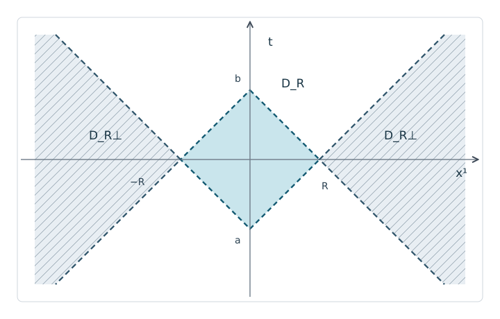

# AQFT1 Minkowskiの領域と因果補集合

量子場の観測を「ある領域の中だけで行う」と言うとき、その領域をどのように切り出すのでしょうか。時空の点の因果関係は、[Minkowski計量](../../../物理系/SREL/SREL2/index.md#def-srel2-minkowski-metric)と[光円錐](../../../物理系/SREL/SREL2/index.md#def-srel2-light-cone)で既に記述できます。しかし次講で可観測量を領域へ割り当てるには、**点同士**でなく**領域同士**が空間的に分離しているか、という判定が必要です。

本講では時空の領域を具体的な不等式で指定し、それに対する**因果補集合**を計算します。後の局所代数の可換性は、この幾何学的な判定を入力にします。作用素環や量子状態を先に仮定する必要はありません。

単位は $c=1$、時間向きは $t$ の増加方向、時空は

$$
M=\mathbb R^{1,3}=\{(t,\boldsymbol x):t\in\mathbb R,\ \boldsymbol x\in\mathbb R^3\},
\qquad
g=-dt^2+(dx^1)^2+(dx^2)^2+(dx^3)^2
$$

と固定します。$\boldsymbol x=(x^1,x^2,x^3)$、$|\boldsymbol x|=\sqrt{(x^1)^2+(x^2)^2+(x^3)^2}$ とします。計量の符号は $(-,+,+,+)$ です。

## 1. 点から点への光信号を座標で判定する

二事象 $p=(t,\boldsymbol x)$、$q=(s,\boldsymbol y)$ の差に対して

$$
g(q-p,q-p)=-(s-t)^2+|\boldsymbol y-\boldsymbol x|^2
$$

です。[時間的・光的・空間的分離の定義](../../../物理系/SREL/SREL2/index.md#def-srel2-causal-types)により、この値が正なら**空間的分離**、零なら光的分離（ただし同一点は零間隔の退化例）、負なら時間的分離です。例えば $p=(0,\boldsymbol0)$ と $q=(1,(2,0,0))$ は $-1+4=3>0$ なので空間的ですが、$q=(2,(1,0,0))$ なら $-4+1=-3<0$ なので時間的です。

<!-- formal-statement-start -->
> **命題（Minkowskiの点間因果判定）**  
> $p=(t,\boldsymbol x),q=(s,\boldsymbol y)\in M$ とする。$p,q$ が空間的に分離しているための必要十分条件は
>
$
> |\boldsymbol y-\boldsymbol x|>|s-t|
$
>
> である。$q\in J^+(p)$ の必要十分条件は $s-t\ge|\boldsymbol y-\boldsymbol x|$ である。
<!-- formal-statement-end -->

### 証明の見取り図

前半は計量の式の両辺の平方根を取るだけです。後半では、因果曲線が満たす速さの上界と、条件を満たすときに結べる直線を両方向に確認します。

<!-- proof-start -->
### 証明

距離と時間差はともに非負なので

$$
-(s-t)^2+|\boldsymbol y-\boldsymbol x|^2>0
\iff |\boldsymbol y-\boldsymbol x|^2>(s-t)^2
\iff |\boldsymbol y-\boldsymbol x|>|s-t|.
$$

また、[Minkowskiの因果的未来の座標表示](../../../幾何系/LORG/LORG6/index.md#thm-lorg6-minkowski-futures)を $p$ に適用すると、$q\in J^+(p)$ は $s-t\ge|\boldsymbol y-\boldsymbol x|$ に同値です。この結果の核心を確認すると、未来向き因果曲線 $\gamma(u)=(t(u),\boldsymbol x(u))$ では $|\dot{\boldsymbol x}(u)|\le\dot t(u)$ だから、積分して

$$
|\boldsymbol y-\boldsymbol x|
=\left|\int\dot{\boldsymbol x}\,du\right|
\le\int|\dot{\boldsymbol x}|\,du
\le\int\dot t\,du=s-t.
$$

逆に $s>t$ で不等式が成り立つなら、両端を結ぶ直線の空間速度は $|\boldsymbol y-\boldsymbol x|/(s-t)\le1$ であり未来向き因果的です。$s=t$ のとき不等式から $\boldsymbol y=\boldsymbol x$ となり、同一点は反射的な因果到達として扱います。$\square$
<!-- proof-end -->

この命題は **点についての判定**です。以降は「ある集合のすべての点と空間的か」という量化を追加します。

## 2. 空間的に分離した領域と因果補集合

集合 $S\subset M$ に対し、まず

$$
C_{\mathrm{sp}}(S)=
\{p\in M:\text{すべての }q\in S\text{ に対し }g(p-q,p-q)>0\}
$$

を考えます。「すべての $q$」が重要です。1点とだけ空間的に分離していても、別の点とは光で結べるかもしれません。

ただし、$S$ が開領域であっても $C_{\mathrm{sp}}(S)$ は境界を含むことがあります。局所観測のための領域を開集合として扱う本講では、開集合の**内部** $\operatorname{int}$ を取ります。

<!-- formal-statement-start -->
> **定義（開いた因果補集合）**  
> $S\subset M$ の**因果補集合**を
>
$
> S^\perp:=\operatorname{int} C_{\mathrm{sp}}(S)
$
>
> と定める。すなわち、$S^\perp$ は $S$ の全点と空間的に分離している点全体のうち、開いた近傍までその性質を保つ点の集合である。この定義では $S^\perp$ は必ず開集合となる。
<!-- formal-statement-end -->

<!-- definition-example-start: def-aqft1-causal-complement -->
### 直接例：通常の補集合と違う

**定義の確認**。
$S=\{(t,\boldsymbol x): |t|+|\boldsymbol x|<1\}$ とし、$p=(3,\boldsymbol0)$ を取ります。$p\notin S$ ですから通常の集合補集合 $M\setminus S$ には入ります。しかし $q=(0,\boldsymbol0)\in S$ と $p$ の差は

$$
g(p-q,p-q)=-3^2+0=-9<0.
$$

よって $p\notin C_{\mathrm{sp}}(S)$、従って $p\notin S^\perp$ です。**領域の外にあること**と**その領域に因果的な影響を与えられないこと**は別です。

後で計算するように、$p=(0,(2,0,0))$ は同じ $S$ の因果補集合に入ります。実際、任意の $q=(s,\boldsymbol y)\in S$ に対して

$$
|(2,0,0)-\boldsymbol y|
\ge2-|\boldsymbol y|>1+|s|>|s|.
$$

不等式は少し動かしても保たれるため、$p$ の近傍も $C_{\mathrm{sp}}(S)$ に入ります。
<!-- definition-example-end -->

二つの**開領域** $O_1,O_2$ の間で全ての点対が空間的に分離することを「二領域が空間的に分離する」と呼び、次の定義にまとめます。

<!-- formal-statement-start -->
> **定義（領域の空間的分離）**  
> 開集合 $O_1,O_2\subset M$ が空間的に分離しているとは、任意の $p\in O_1$ と $q\in O_2$ に対し $g(p-q,p-q)>0$ が成立することをいう。
<!-- formal-statement-end -->

<!-- definition-example-start: def-aqft1-separated-regions -->
### 直接例：二つの小領域

**定義の確認**。
$O_1=\{(t,\boldsymbol x):|t|+|\boldsymbol x|<\frac14\}$、$O_2=\{(s,\boldsymbol y):|s|+|\boldsymbol y-(1,0,0)|<\frac14\}$ とします。任意の点対について

$$
|\boldsymbol y-\boldsymbol x|
\ge1-|\boldsymbol x|-|\boldsymbol y-(1,0,0)|
>1-\frac14-\frac14=\frac12,
$$

一方で $|s-t|\le|s|+|t|<\frac12$ です。従ってすべての点対が空間的で、二領域は定義を満たします。
<!-- definition-example-end -->

<!-- formal-statement-start -->
> **命題（因果補集合と包含順序）**  
> 任意の集合 $S,T\subset M$ について、$S\subset T$ なら $T^\perp\subset S^\perp$ である。また開領域 $O_1,O_2$ について、二領域の空間的分離は $O_1\subset O_2^\perp$ と同値であり、その条件は $O_2\subset O_1^\perp$ とも同値である。
<!-- formal-statement-end -->

### 証明の見取り図

条件を要求する相手の集合が大きいほど、すべての点から空間的である条件は厳しくなります。また点対の空間的分離は対称であり、$O_1$ が開いていることが $\operatorname{int}$ へ移る根拠になります。

<!-- proof-start -->
### 証明

$S\subset T$ とします。$p\in C_{\mathrm{sp}}(T)$ ならすべての $q\in T$ に対し空間的なので、特にすべての $q\in S$ に対しても空間的です。よって

$$
C_{\mathrm{sp}}(T)\subset C_{\mathrm{sp}}(S)
\quad\Longrightarrow\quad
\operatorname{int}C_{\mathrm{sp}}(T)\subset\operatorname{int}C_{\mathrm{sp}}(S).
$$

次に二領域が空間的に分離しているとします。すべての $p\in O_1$ は $C_{\mathrm{sp}}(O_2)$ に含まれるので、$O_1\subset C_{\mathrm{sp}}(O_2)$ です。$O_1$ 自身が開集合だから $O_1\subset\operatorname{int}C_{\mathrm{sp}}(O_2)=O_2^\perp$ となります。逆に $O_1\subset O_2^\perp$ なら定義から全点対の空間的分離が従います。$g(p-q,p-q)=g(q-p,q-p)$ により $O_1,O_2$ を入れ替えた条件も同値です。$\square$
<!-- proof-end -->

ここで**開集合という仮定を落とすと証明が壊れます**。$O_1$ を1点集合にすると「$O_1\subset C_{\mathrm{sp}}(O_2)$」から「$O_1\subset\operatorname{int}C_{\mathrm{sp}}(O_2)$」とは一般には言えません。開いた領域族を使う理由の一つです。

## 3. double cone：有限時間・有限空間の観測領域

二点 $a=(-R,\boldsymbol0)$、$b=(R,\boldsymbol0)$（$R>0$）を選び、$a$ の未来で $b$ の過去にある点の共通部分を取ります。この二つの時間的端点で挟んだ形を調べます。時間的未来・過去 $I^\pm$ は[既習の定義](../../../幾何系/LORG/LORG6/index.md#def-lorg6-chronological-causal-future)を使います。

<!-- formal-statement-start -->
> **定義（標準double cone）**  
> $R>0$ に対し
>
$
> D_R:=I^+\bigl((-R,\boldsymbol0)\bigr)\cap
> I^-\bigl((R,\boldsymbol0)\bigr)
$
>
> と定める。中心 $(t_0,\boldsymbol a)$ に移した領域を $D_R(t_0,\boldsymbol a)=(t_0,\boldsymbol a)+D_R$ と書く。
<!-- formal-statement-end -->

[点間の時間的到達条件](../../../幾何系/LORG/LORG6/index.md#thm-lorg6-minkowski-futures)をそれぞれの端点に適用すると

$$
t+R>|\boldsymbol x|,\qquad R-t>|\boldsymbol x|
\quad\Longleftrightarrow\quad
|t|+|\boldsymbol x|<R.
$$

この表示は**定義から導いた座標による判定式**であり、Euclid球と同一視しているわけではありません。

<!-- definition-example-start: def-aqft1-double-cone -->
### 直接例：$D_2$ の断面

**定義の確認**。
$D_2=\{(t,\boldsymbol x):|t|+|\boldsymbol x|<2\}$ です。$t=0$ では半径2の開球、$t=1$ では半径1の開球となり、$|t|\ge2$ では空です。例えば $p=(1,(1/2,0,0))$ は $1+1/2<2$ なので内部、$q=(1,(1,0,0))$ は和が2なので境界上であって内部には含まれません。二つの端点の**時間的**未来・過去を取ったので不等号は厳密です。
<!-- definition-example-end -->

上の図は $x^2=x^3=0$ の **1+1次元断面**です。中央の菱形が $D_R$、その外側に開く左右の領域が $D_R^\perp$ の断面です。菱形の単なる外側全体が因果補集合ではないことに注意してください。

<!-- formal-statement-start -->
> **定理（double coneの因果補集合）**  
> $M=\mathbb R^{1,3}$、$R>0$ とし、$D_R=\{(t,\boldsymbol x):|t|+|\boldsymbol x|<R\}$ とする。第2節の[因果補集合](#def-aqft1-causal-complement)について
>
$
> D_R^\perp=\{(t,\boldsymbol x):|\boldsymbol x|>R+|t|\}.
$
>
> 一方で $C_{\mathrm{sp}}(D_R)=\{(t,\boldsymbol x):|\boldsymbol x|\ge R+|t|\}$ であり、両者は境界の扱いが異なる。
<!-- formal-statement-end -->

### 証明の見取り図

右辺の厳密不等式を満たす点は三角不等式で $D_R$ の全点から空間的です。逆に $|\boldsymbol x|<R+|t|$ の点はdouble coneの過去端または未来端のすぐ内側の点と因果的に結べます。等号の境界では各内部点からは空間的でも、開近傍を保てないので最後に除かれます。

<!-- proof-start -->
### 証明

$p=(T,\boldsymbol X)$、$r=|\boldsymbol X|$ とします。$r\ge R+|T|$ のとき、任意の $q=(s,\boldsymbol y)\in D_R$ に対して $|s|+|\boldsymbol y|<R$ だから

$$
\begin{aligned}
|\boldsymbol X-\boldsymbol y|
&\ge r-|\boldsymbol y|\\
&\ge R+|T|-|\boldsymbol y|\\
&>|T|+|s|
\ge|T-s|.
\end{aligned}
$$

従って $p\in C_{\mathrm{sp}}(D_R)$ です。

逆に $r<R+|T|$ とします。$T\ge0$ なら $T+R>r$ なので、$0<\varepsilon<R$ を十分小さく選び $T+R-\varepsilon>r$ とできます。点

$$
q=(-R+\varepsilon,\boldsymbol0)\in D_R
$$

は $p$ の過去にあり、$T-(-R+\varepsilon)=T+R-\varepsilon>r$ により両点は時間的に分離します。$T<0$ なら $q=(R-\varepsilon,\boldsymbol0)\in D_R$ を同様に選び、$R-\varepsilon-T>r$ により $p$ と $q$ は時間的に分離します。どちらも $p\notin C_{\mathrm{sp}}(D_R)$ です。ゆえに

$$
C_{\mathrm{sp}}(D_R)=\{(T,\boldsymbol X):r\ge R+|T|\}.
$$

連続関数 $r-R-|T|$ が正である集合は開集合です。他方、等号の各点のどの近傍にも $r<R+|T|$ の点が存在します（$r\ge R>0$ なので半径を僅かに減らせばよい）。したがってこの集合の内部は厳密不等号の領域であり、定理の式が従います。$\square$
<!-- proof-end -->

**境界をめぐる落とし穴。** $p=(0,(R,0,0))$ は *各々の* $q\in D_R$ と空間的に分離していますが、$p$ は $D_R^\perp$ には入りません。開領域としての因果補集合を使う場合は、最後の $\operatorname{int}$ が必要です。

## 4. wedge：無限に延びる領域とその向かい側

次に $x^1$ 方向だけに着目します。$x^2,x^3$ には制約を課しません。光速で動く二本の直線 $x^1=\pm t$ に挟まれた**右側**を右wedge、その左側に対応する領域を左wedgeと呼びます。

<!-- formal-statement-start -->
> **定義（右・左Rindler wedge）**  
> 4次元Minkowski時空の開領域
>
$
> W_R=\{(t,x^1,x^2,x^3):x^1>|t|\},\qquad
> W_L=\{(t,x^1,x^2,x^3):-x^1>|t|\}
$
>
> を、それぞれ標準右wedge、標準左wedgeという。両領域とも $x^2,x^3$ は任意である。
<!-- formal-statement-end -->

<!-- definition-example-start: def-aqft1-wedges -->
### 直接例：横方向の位置と境界

**定義の確認**。
$p=(2,3,100,0)$ は $3>|2|$ なので $W_R$ に入ります。横方向の値100はこの判定に影響しません。一方 $(2,2,0,0)$ は光的境界上、$(0,-3,0,0)$ は $W_L$ 内部です。$W_R$ と $W_L$ は共通点を持ちませんが、「共通点がない」ことだけから空間的分離を結論してはいけません。次に点対を判定します。
<!-- definition-example-end -->

<!-- formal-statement-start -->
> **定理（右wedgeと左wedgeの因果補集合）**  
> 先ほどの[開いた因果補集合](#def-aqft1-causal-complement)の定義から
>
$
> W_R^\perp=W_L,\qquad W_L^\perp=W_R.
$
<!-- formal-statement-end -->

### 証明の見取り図

右wedgeの点と左wedgeの点は、空間座標 $x^1$ の差が時間差より必ず大きくなります。逆向きの包含では、左wedgeの外の点を右wedgeの中の点へ因果的に結べることを場合分けで確かめます。境界は開いた補集合には入れません。

<!-- proof-start -->
### 証明

$p=(T,X,\boldsymbol z)\in W_L$、$q=(s,y,\boldsymbol w)\in W_R$ とします。ここで $\boldsymbol z,\boldsymbol w\in\mathbb R^2$ です。$-X>|T|$、$y>|s|$ だから

$$
|\boldsymbol x_p-\boldsymbol x_q|
=\sqrt{(y-X)^2+|\boldsymbol z-\boldsymbol w|^2}
\ge y-X>|s|+|T|\ge|s-T|.
$$

従って二領域は空間的に分離し、[開領域の分離判定](#prop-aqft1-complement-order)から $W_L\subset W_R^\perp$ となります。

逆包含を確かめます。$W_R$ は時間反転 $t\mapsto-t$ で不変なので、$T\ge0$ としてよいです。$\boldsymbol w=\boldsymbol z$ を固定します。

- $-T<X<0$ の場合、$0<y<T+X$ を選び $q=(0,y,\boldsymbol z)\in W_R$ とします。このとき $|X-y|=y-X<T$ なので $q$ と $p$ は時間的に分離します。
- $0\le X<T$ の場合、$y>0$ を $|X-y|<T$ となるよう選べます（$X>0$ なら $y=X$、$X=0$ なら $0<y<T$）。同じ $q=(0,y,\boldsymbol z)\in W_R$ と $p$ は時間的に分離します。
- $X>T$ の場合、$p\in W_R$ であり、$q=p$ を選べば空間的に分離しません。
- $X=T$ で $T>0$ の場合、$0<\varepsilon<T$ として $q=(T-\varepsilon,T-\varepsilon/2,\boldsymbol z)\in W_R$ を選びます。差は時間 $\varepsilon$、空間 $\varepsilon/2$ なので時間的です。
- $X=T=0$ の場合、$q=(\varepsilon,2\varepsilon,\boldsymbol z)\in W_R$ は $p$ とは空間的ですが、$p$ が $W_R^\perp$ に入らないことは別に確かめます。実際 $p$ は $W_L$ の境界で、任意の近傍に $X>0$ の点があり、それらは $W_R$ にも含まれるので、$p$ は $\operatorname{int}C_{\mathrm{sp}}(W_R)$ に入れません。
- $X=-T$（$T>0$）でも $p$ は $W_L$ の境界です。任意の近傍に $X>-T$ の点があり、上記の時間的分離の反例を持つため、$p$ は因果補集合の内部に入れません。

以上、$p\notin W_L$ なら $p\notin W_R^\perp$ です。逆側は $x^1\mapsto-x^1$ によって同じ証明が成り立ちます。$\square$
<!-- proof-end -->

この結果は「右wedgeに対応する**反対側の開いたwedge**」が因果補集合だという意味です。後にモジュラー流とLorentz boostを結びつける際にも、右・左と境界を混同しないことが重要になります。

## 5. 二つのdouble coneを配置する

領域 $D_R(0,\boldsymbol a)$ と $D_S(0,\boldsymbol b)$ を同じ中心時刻で配置し、中心間距離を $d=|\boldsymbol a-\boldsymbol b|$ とします。空間的分離を中心点だけで判定するのではなく、**どの内部点を選んでも**空間的である条件を出せます。

<!-- formal-statement-start -->
> **定理（同時刻中心の二つのdouble cone）**  
> $R,S>0$、$\boldsymbol a,\boldsymbol b\in\mathbb R^3$ とする。開領域 $D_R(0,\boldsymbol a)$ と $D_S(0,\boldsymbol b)$ が空間的に分離しているための必要十分条件は
>
$
> |\boldsymbol a-\boldsymbol b|\ge R+S
$
>
> である。等号の場合も、開領域の内部点対はすべて厳密に空間的である。
<!-- formal-statement-end -->

### 証明の見取り図

三角不等式と領域の厳密不等号を結びつけます。逆は時刻 $0$ の二つの開球が重なることを使えば、非空間的な点対を作れます。

<!-- proof-start -->
### 証明

$D_R(0,\boldsymbol a)$ の点を $p=(t,\boldsymbol x)$、$D_S(0,\boldsymbol b)$ の点を $q=(s,\boldsymbol y)$ とします。条件から

$$
|t|+|\boldsymbol x-\boldsymbol a|<R,\qquad
|s|+|\boldsymbol y-\boldsymbol b|<S.
$$

$d\ge R+S$ なら

$$
\begin{aligned}
|\boldsymbol x-\boldsymbol y|
&\ge d-|\boldsymbol x-\boldsymbol a|-|\boldsymbol y-\boldsymbol b|\\
&\ge R+S-|\boldsymbol x-\boldsymbol a|-|\boldsymbol y-\boldsymbol b|\\
&>|t|+|s|\ge|t-s|.
\end{aligned}
$$

よって[点間因果判定](#prop-aqft1-point-test)より空間的分離です。

逆に $d<R+S$ なら、時刻0の開球 $B_R(\boldsymbol a)$ と $B_S(\boldsymbol b)$ は重なります。実際、$d>0$ なら中心を結ぶ線分上で $\boldsymbol z=\boldsymbol a+\lambda(\boldsymbol b-\boldsymbol a)$ を選び、$\lambda d<R$ かつ $(1-\lambda)d<S$ とします。$\lambda$ が存在するのは $1-S/d<R/d$ と同値な $d<R+S$ のためです。$d=0$ なら $\boldsymbol z=\boldsymbol a=\boldsymbol b$ を取ります。すると $p=q=(0,\boldsymbol z)$ が両領域に属し、この点対は空間的ではありません。従って必要条件も示されました。$\square$
<!-- proof-end -->

境界が接する $d=R+S$ のとき二つの**閉包**は接しますが、開いた内部領域は空間的に分離しています。開領域と閉包の条件を取り違えると、局所性を使える範囲を誤ります。

## 6. 座標変換しても因果補集合は保たれる

後の理論では、同じ形の領域を移動・回転・Lorentz変換したものも使います。ここで必要な**Poincaré変換**とは、$\Lambda$ をLorentz線形変換、$a$ を平行移動ベクトルとして、$F(p)=\Lambda p+a$ と表す時空の可逆アフィン写像です。[Lorentz不変性](../../../物理系/SREL/SREL2/index.md#thm-srel2-interval-invariance)によって $g(F(p)-F(q),F(p)-F(q))=g(p-q,p-q)$ が成立します。

<!-- formal-statement-start -->
> **命題（Poincaré変換と因果補集合）**  
> $F:M\to M$ がPoincaré変換で、$S\subset M$ が任意の集合なら
>
$
> F(S^\perp)=(F(S))^\perp
$
>
> が成り立つ。特に移動したdouble coneやwedgeの因果補集合は、標準領域の補集合を同じ変換で移したものになる。
<!-- formal-statement-end -->

### 証明の見取り図

空間的であるという不等式はLorentz変換で不変です。そのため全称条件で定まる集合が写像されます。最後に、連続な逆を持つ変換は内部を内部へ移すことを使います。

<!-- proof-start -->
### 証明

$z=F(p)$、$w=F(q)$ と書くと、$g(z-w,z-w)=g(p-q,p-q)$ です。従って $p$ が $S$ の全点と空間的に分離することと、$F(p)$ が $F(S)$ の全点と空間的に分離することは同値です。すなわち

$$
F(C_{\mathrm{sp}}(S))=C_{\mathrm{sp}}(F(S)).
$$

$F$ と $F^{-1}$ は連続なので $F$ は同相写像であり、任意の集合 $A$ に対して $F(\operatorname{int}A)=\operatorname{int}F(A)$ です。前式に適用すれば

$$
F(S^\perp)=F(\operatorname{int}C_{\mathrm{sp}}(S))
=\operatorname{int}C_{\mathrm{sp}}(F(S))=(F(S))^\perp.
$$

$\square$
<!-- proof-end -->

## 7. 演習

### Level A：点と領域の判定に慣れる

#### AQFT1-A01 四次元の点間判定
- Level: A

$p=(0,(0,0,0))$ とし、$q_1=(2,(3,0,0))$、$q_2=(3,(1,2,0))$、$q_3=(2,(2,0,0))$ について計量間隔を求め、空間的・時間的・光的を区別せよ。

<!-- solution-start -->
**詳細解答**。基準点が原点なので計量間隔は $-t^2+(x^1)^2+(x^2)^2+(x^3)^2$ です。個別に

$$
g(q_1,q_1)=-4+9=5,\quad
g(q_2,q_2)=-9+1+4=-4,\quad
g(q_3,q_3)=-4+4=0
$$

となります。従って順に空間的、時間的、光的です。$q_3\ne p$ なので光的であり、同一点の零間隔ではありません。
<!-- solution-end -->

#### AQFT1-A02 double coneの時刻断面
- Level: A

$D_3$ の $t=0,1,2,3$ における空間断面を求め、$(2,(1,0,0))$ が領域内にあるか判定せよ。

<!-- solution-start -->
**詳細解答**。$D_3$ の条件は $|t|+|\boldsymbol x|<3$ です。$t=0,1,2$ ではそれぞれ $|\boldsymbol x|<3,2,1$ の開球です。$t=3$ では $3+|\boldsymbol x|<3$ を満たす点はないので空集合です。指定点では $|2|+|(1,0,0)|=3$ だから境界上であり、領域内には入りません。
<!-- solution-end -->

#### AQFT1-A03 wedgeと横方向
- Level: A

$u=(1,(-2,50,0))$、$v=(1,(2,50,0))$、$w=(2,(2,0,0))$ の右・左wedgeへの所属を求めよ。

<!-- solution-start -->
**詳細解答**。[wedgeの定義](#def-aqft1-wedges)では $x^1$ と $t$ だけを比較します。$u$ は $-x^1=2>|t|=1$ なので左wedge、$v$ は $x^1=2>1$ なので右wedgeです。$w$ は $x^1=|t|=2$ なので双方の開wedgeの境界上で、どちらにも属しません。横方向の50は条件に入っていません。
<!-- solution-end -->

#### AQFT1-A04 通常の補集合ではない
- Level: A

$S=D_1$、$p=(2,\boldsymbol0)$ とする。$p\in M\setminus S$ か、$p\in S^\perp$ か、$q=(0,\boldsymbol0)$ を使って判定せよ。

<!-- solution-start -->
**詳細解答**。$|2|+|\boldsymbol0|=2>1$ なので $p\notin S$、従って $p\in M\setminus S$ です。一方で $q\in S$ かつ $g(p-q,p-q)=-4$ なので、$p$ は $S$ の全点から空間的という条件を満たしません。ゆえに $p\notin C_{\mathrm{sp}}(S)$、従って $p\notin S^\perp$ です。
<!-- solution-end -->

#### AQFT1-A05 double coneの包含
- Level: A

$0<r<R$ のとき $D_r\subset D_R$ を示せ。また $D_R^\perp\subset D_r^\perp$ を座標不等式から確認せよ。

<!-- solution-start -->
**詳細解答**。$p\in D_r$ なら $|t|+|\boldsymbol x|<r<R$ なので $p\in D_R$ です。補集合については

$$
p\in D_R^\perp
\Longrightarrow |\boldsymbol x|>R+|t|>r+|t|
\Longrightarrow p\in D_r^\perp.
$$

これは[包含に対する因果補集合の順序反転](#prop-aqft1-complement-order)の具体例です。
<!-- solution-end -->

### Level B：量化・境界・包含を証明する

#### AQFT1-B01 double coneの境界が残る理由
- Level: B

$D_R$ に対し $p=(0,(R,0,0))$ が $C_{\mathrm{sp}}(D_R)$ に入るが $D_R^\perp$ には入らないことを、内部点との不等式と近傍の反例の両方から示せ。

<!-- solution-start -->
**詳細解答**。任意の $q=(s,\boldsymbol y)\in D_R$ では $|s|+|\boldsymbol y|<R$ なので

$$
|(R,0,0)-\boldsymbol y|\ge R-|\boldsymbol y|>|s|.
$$

よって $p$ は各 $q$ と空間的で $C_{\mathrm{sp}}(D_R)$ に入ります。他方、$\varepsilon\in(0,R)$ とし $p_\varepsilon=(0,(R-\varepsilon,0,0))$ とすると、$p_\varepsilon\in D_R$ です。$p_\varepsilon$ は自分自身と空間的に分離せず、$C_{\mathrm{sp}}(D_R)$ に入りません。$p_\varepsilon\to p$ なので $p$ のどの近傍も $C_{\mathrm{sp}}(D_R)$ には含まれず、$p\notin\operatorname{int}C_{\mathrm{sp}}(D_R)=D_R^\perp$ です。
<!-- solution-end -->

#### AQFT1-B02 二つのdouble coneの距離閾値
- Level: B

$D_2(0,\boldsymbol0)$ と $D_1(0,(d,0,0))$ が空間的に分離する $d\ge0$ の範囲を求めよ。特に $d=3$ と $d=5/2$ を別々に検証せよ。

<!-- solution-start -->
**詳細解答**。[二つのdouble coneの定理](#thm-aqft1-double-cone-separation)の $R=2,S=1$ より条件は $d\ge3$ です。$d=3$ でも内部点では

$$
|\boldsymbol x-\boldsymbol y|
\ge3-|\boldsymbol x|-|\boldsymbol y-(3,0,0)|
>|t|+|s|\ge|t-s|
$$

なので空間的です。一方 $d=5/2$ では時刻0に $\boldsymbol z=(7/4,0,0)$ を取れば $|\boldsymbol z|=7/4<2$、$|\boldsymbol z-(5/2,0,0)|=3/4<1$ です。従って $(0,\boldsymbol z)$ が両領域に入るため、二領域は空間的に分離しません。
<!-- solution-end -->

#### AQFT1-B03 領域の順序反転と開集合
- Level: B

$S\subset T\subset M$ のとき $T^\perp\subset S^\perp$ を定義から証明せよ。また空間的に分離した開領域 $O_1,O_2$ について $O_1\subset O_2^\perp$ を示す際、開集合性を使う場所を明記せよ。

<!-- solution-start -->
**詳細解答**。$T$ の全点と空間的な点は、$S$ の全点とも空間的だから $C_{\mathrm{sp}}(T)\subset C_{\mathrm{sp}}(S)$ です。内部を取る操作は包含を保つため $T^\perp\subset S^\perp$ です。続いて、すべての $p\in O_1$ と $q\in O_2$ が空間的なら、量化の順番を固定して $O_1\subset C_{\mathrm{sp}}(O_2)$ が従います。ここで**$O_1$ は開集合**なので、$C_{\mathrm{sp}}(O_2)$ に含まれる開集合の一つであり、その最大の開部分集合 $\operatorname{int}C_{\mathrm{sp}}(O_2)$ に含まれます。これが $O_1\subset O_2^\perp$ です。
<!-- solution-end -->

#### AQFT1-B04 楔の横方向を変えた点対
- Level: B

$p=(2,(-3,0,0))$、$q=(s,(y,a,b))$ が $q\in W_R$ を満たすとする。任意の $a,b\in\mathbb R$ に対し $p,q$ が空間的に分離することを示し、$p$ を $(2,(-2,0,0))$ に変えたとき、開いた左wedgeへの所属を検討せよ。

<!-- solution-start -->
**詳細解答**。$q\in W_R$ なら $y>|s|$ です。$p$ の左wedge条件は $-(-3)=3>|2|=2$ なので満たされています。空間距離を評価すると

$$
|\boldsymbol x_p-\boldsymbol x_q|
=\sqrt{(y+3)^2+a^2+b^2}
\ge y+3>|s|+2\ge|s-2|.
$$

したがってすべての $a,b,s,y$ に対して空間的です。変更した点 $p'=(2,(-2,0,0))$ では $-x^1=2=|t|$ で、$W_L$ の**境界**にあります。$p'$ は $W_L$ には属さず、[右wedgeと左wedgeの因果補集合](#thm-aqft1-wedge-complement)より $W_R^\perp$ にも属しません。開いた補集合と点対ごとの厳密な分離を区別します。
<!-- solution-end -->

### Level C：領域・境界・共変性を統合する

#### AQFT1-C01 動かした領域と因果補集合
- Level: C

$R=1$、$S=2$、$\boldsymbol a=(4,0,0)$ とし、$O=D_R(0,\boldsymbol0)$、$P=D_S(0,\boldsymbol a)$ を考える。

1. $O$ と $P$ が空間的に分離することを証明せよ。
2. $O^\perp$ を求め、$P\subset O^\perp$ を直接示せ。
3. $O$ と $P$ の**中心だけ**を調べる方法が一般には不十分な理由を、$S=5$ に変えた反例で示せ。
4. 平行移動 $F(t,\boldsymbol x)=(t,\boldsymbol x+\boldsymbol a)$ に対し $F(O^\perp)=F(O)^\perp$ を具体式で確かめよ。

<!-- solution-start -->
**詳細解答**。

(1) 中心間距離は $d=4$、半径の和は $R+S=3$ なので $d\ge R+S$ です。[二つのdouble coneの定理](#thm-aqft1-double-cone-separation)の仮定を満たし、任意の $p=(t,\boldsymbol x)\in O$、$q=(s,\boldsymbol y)\in P$ について

$$
|\boldsymbol x-\boldsymbol y|
\ge4-|\boldsymbol x|-|\boldsymbol y-\boldsymbol a|
>4-(1-|t|)-(2-|s|)
=1+|t|+|s|>|t-s|
$$

となるので空間的です。

(2) [double cone補集合の式](#thm-aqft1-double-cone-complement)に $R=1$ を代入し

$$
O^\perp=\{(t,\boldsymbol x):|\boldsymbol x|>1+|t|\}.
$$

$q=(s,\boldsymbol y)\in P$ に対して $|s|+|\boldsymbol y-\boldsymbol a|<2$ です。従って

$$
|\boldsymbol y|
\ge|\boldsymbol a|-|\boldsymbol y-\boldsymbol a|
>4-(2-|s|)=2+|s|>1+|s|.
$$

よって $P\subset O^\perp$ です。

(3) $S=5$ とすると両中心の距離4は零ではなく、中心点同士は空間的ですが、半径の和は $1+5=6>4$ です。実際、$(0,\boldsymbol0)$ は $O$ に入り、$P=D_5(0,(4,0,0))$ にも $|0|+|(0,0,0)-(4,0,0)|=4<5$ によって入ります。従って全点対は空間的ではありません。中心だけの判定では、領域全体という量化が失われます。

(4) $O^\perp$ の式を写すと

$$
F(O^\perp)=\{(t,\boldsymbol z):|\boldsymbol z-\boldsymbol a|>1+|t|\}.
$$

一方 $F(O)=D_1(0,\boldsymbol a)$ に[標準double coneの補集合公式](#thm-aqft1-double-cone-complement)を平行移動して適用しても同じ式です。これは[共変性の命題](#prop-aqft1-poincare-complement)の座標での検算です。
<!-- solution-end -->

## 8. どこへ進むか

本講で分かったのは、(i) 点間の空間的分離を四次元の不等式で判定できること、(ii) 任意の領域の因果補集合を開集合として定義できること、(iii) double coneとwedgeについてその集合を**実際に計算できる**ことです。これらはすべて幾何学の結果であり、まだ量子論的な可換性を証明したわけではありません。

次の **AQFT2「Haag–Kastler net」** では、開領域 $O$ に観測量の代数 $\mathfrak A(O)$ を割り当て、包含 $O_1\subset O_2$ を代数の包含へ、空間的分離 $O_1\subset O_2^\perp$ を観測量の可換性へ翻訳します。