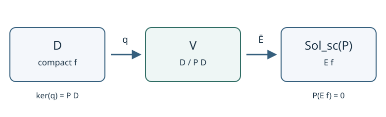

# AQFT4 Klein–GordonのGreen作用素と試験関数の商

[AQFT2の局所net](../AQFT2/index.md#def-aqft2-haag-kastler)は領域から観測量の代数への割当てを公理として扱い、[AQFT3の状態と真空](../AQFT3/index.md#def-aqft3-vacuum)はその上で期待値とエネルギーを考えました。しかし、まだ「どの量を領域 $O$ の観測量と呼ぶか」を実際の場の方程式から作っていません。

[QFT1で導入した実スカラー場](../../../物理系/QFT/QFT1/index.md#def-qft1-real-scalar)では、滑らかで狭い領域に台を持つ関数 $f$ を使い、場を空間時間にわたって平均した量を後で作ります。ところが、異なる $f$ が同じ物理的な自由度を表すことがあります。**方程式の像を零と見なす商空間**が必要です。本講では、[HPDEで既に証明したGreen作用素の理論](../../HPDE/HPDE22/index.md#thm-hpde22-surjectivity-exact)を四次元Minkowski時空へ具体化し、その商と局所領域への割当てを構成します。

本講ではまだ非有界な場の演算子を定義しません。次講ではこの実線形空間に交代形式を与え、その後でWeyl作用素へ移ります。

## 1. 支持を持つ試験関数と自由場方程式

[AQFT1のMinkowski時空](../AQFT1/index.md#prop-aqft1-point-test)と同じく
$$
M=\mathbb R^{1,3},\qquad
g=-dt^2+(dx^1)^2+(dx^2)^2+(dx^3)^2,\qquad c=1
$$
を使います。時間向きは $t$ の増加方向です。質量を $m\ge0$ に固定し、[実Klein–Gordon作用素の定義](../../HPDE/HPDE23/index.md#def-hpde23-real-kg)の実ポテンシャルを $V=m^2$ とします。したがって
$$
P=-\Box_g+m^2
=\partial_t^2-\sum_{j=1}^{3}\partial_{x^j}^2+m^2.
$$
この符号では $Pu=0$ は $\partial_t^2u-\Delta_{\boldsymbol x}u+m^2u=0$ です。$m=0$ も許します。$P$ は実線形で、係数は滑らか、主シンボルは $-g^{ab}\zeta_a\zeta_b$ なので、[HPDE5のnormally hyperbolic条件](../../HPDE/HPDE5/index.md#def-hpde5-normally-hyperbolic)を満たします。

この講義で使う試験関数は、場を領域内で平均する重みとして使う、滑らかでコンパクト支持を持つ実関数です。「コンパクト支持」とは関数が零でない点の閉包が時空のコンパクト集合になることです。滑らかでも無限遠まで非零である平面波は試験関数に含めません。試験関数は重みであり、一般にコンパクト支持ではない場の解そのものとは区別します。開集合 $O\subset M$ の中で観測を局所化するには、台が $O$ の内部に収まる関数を使います。

<!-- formal-statement-start -->
> **定義（実試験関数空間と局所試験関数）**  
> $M=\mathbb R^{1,3}$ 上の実数値滑らかなコンパクト支持関数の空間を $\mathcal D=C_c^\infty(M,\mathbb R)$ とする。開集合 $O\subset M$ に対し、
$$
\mathcal D(O)
:=\{f\in\mathcal D:\operatorname{supp}f\subset O\}
$$
> と定める。$\mathcal D(O)$ の関数は $M$ 上の零延長によって同じ $\mathcal D$ の元として扱う。空集合では $\mathcal D(\varnothing)=\{0\}$ とする。
<!-- formal-statement-end -->

<!-- definition-example-start: def-aqft4-test-spaces -->
### 直接例：小さな時空領域に閉じ込める

**定義の確認**。$O_R=\{(t,\boldsymbol x):|t|+|\boldsymbol x|<R\}$（$R>0$）を取り、$0<r<R/2$ とします。$h\in C_c^\infty((-r,r),\mathbb R)$、$q\in C_c^\infty(B_r(\boldsymbol0),\mathbb R)$ を非零に選びます。$f(t,\boldsymbol x)=h(t)q(\boldsymbol x)$ は滑らかで、
$$
\operatorname{supp}f
\subset[-r,r]\times\overline B_r(\boldsymbol0)
\subset O_R.
$$
よって $f\in\mathcal D(O_R)$ です。最初の閉直積はコンパクト、最後の包含は $2r<R$ によります。このように **台が開領域に含まれること** と、単に関数をその領域でだけ書いたことは違います。
<!-- definition-example-end -->

局所微分作用素は関数が零である開集合でその導関数も零にするため、
$$
\operatorname{supp}(P\varphi)\subseteq\operatorname{supp}\varphi,\qquad
P\mathcal D\subseteq\mathcal D,\qquad
P\mathcal D(O)\subseteq\mathcal D(O).
$$
例えば $\varphi=h(t)q(\boldsymbol x)$ なら
$$
P\varphi
=h''(t)q(\boldsymbol x)-h(t)\Delta_{\boldsymbol x}q(\boldsymbol x)
+m^2h(t)q(\boldsymbol x).
$$
この式の三項の台はどれも $\operatorname{supp}h\times\operatorname{supp}q$ の中です。逆に、滑らかな $u$ でも空間コンパクトでない場合、$Pu=0$ から直ちに試験関数の商の元になるとは言えません。

## 2. Green作用素の入力・出力と因果支持

観測を表す源 $f$ を入れた非斉次方程式 $Pu=f$ には、源より過去で零となる**遅延解**と、源より未来で零となる**先進解**があります。時間方向は通常の物理的な意味と同じです。

[HPDE18のGreen作用素の構成](../../HPDE/HPDE18/index.md#thm-hpde18-green-existence)を $E=M\times\mathbb R$、上の $P$、入力 $f\in\mathcal D$ に適用すると、実線形写像
$$
G_{\mathrm{ret}},G_{\mathrm{adv}}:\mathcal D\longrightarrow C^\infty(M,\mathbb R)
$$
があり、$K=\operatorname{supp}f$ として
$$
\begin{aligned}
PG_{\mathrm{ret}}f&=f,&
\operatorname{supp}(G_{\mathrm{ret}}f)&\subseteq J^+(K),\\
PG_{\mathrm{adv}}f&=f,&
\operatorname{supp}(G_{\mathrm{adv}}f)&\subseteq J^-(K).
\end{aligned}
$$
となります。因果的未来・過去 $J^\pm(K)$ は[AQFT1の点間因果判定](../AQFT1/index.md#prop-aqft1-point-test)を使い、源点 $(s,\boldsymbol y)$ に対して
$$
J^+(K)=\bigcup_{(s,\boldsymbol y)\in K}
\{(t,\boldsymbol x):t-s\ge|\boldsymbol x-\boldsymbol y|\}
$$
と具体表示できます。$J^-$ では $s-t\ge|\boldsymbol x-\boldsymbol y|$ です。零源では二つの解とも零です。

ここで重要な区別があります。出力は**滑らか**ですが、一般には時空コンパクトではありません。Green作用素の値に、入力と同じ $\mathcal D$ の条件を暗黙に付けないでください。

<!-- formal-statement-start -->
> **命題（Klein–GordonのGreen合成と支持）**  
> 四次元Minkowski時空上の $m\ge0$ に対する $P=-\Box_g+m^2$ と上記のGreen作用素について、任意の $f,\varphi\in\mathcal D$ に対し
$$
PG_{\mathrm{ret}}f=PG_{\mathrm{adv}}f=f,
\qquad
G_{\mathrm{ret}}P\varphi=G_{\mathrm{adv}}P\varphi=\varphi
$$
> が成り立つ。ただし二番目の二つの合成には $\varphi\in\mathcal D$ が必要である。前者のGreen解はそれぞれ $J^+(\operatorname{supp}f)$、$J^-(\operatorname{supp}f)$ に支持を持つ。
<!-- formal-statement-end -->

### 証明の見取り図

前半はGreen解の定義と支持の定理です。後半は $P\varphi$ を源にすると、もとの $\varphi$ 自身が遅延・先進のどちらの零Cauchyデータ条件も満たすことを使います。時空コンパクト性をここで利用します。

<!-- proof-start -->
### 証明

最初の恒等式と支持包含は、上の作用素が[HPDE18の構成](../../HPDE/HPDE18/index.md#thm-hpde18-green-existence)の仮定を満たすため成立します。後半を直接確かめます。$K=\operatorname{supp}\varphi$ はコンパクトです。$K=\varnothing$ なら $\varphi=0$ で結論は線形性から従います。

$K\ne\varnothing$ では、コンパクト性から $a<\min_{x\in K}t(x)$ を選べます。$\varphi$ はこの時刻より過去で零であり、$\partial_t\varphi$ もそこで零です。

局所性から $P\varphi\in\mathcal D$ です。従って $\varphi$ は源 $P\varphi$ の非斉次Cauchy問題で零初期データを持つ解です。[HPDE16の大域Cauchy一意性](../../HPDE/HPDE16/index.md#thm-hpde16-global-cauchy)と[HPDE18の遅延解の構成](../../HPDE/HPDE18/index.md#def-hpde18-green-operators)により
$$
G_{\mathrm{ret}}(P\varphi)=\varphi.
$$
同じ議論で $b>\max_{x\in K}t(x)$ の未来側零データ面を選べば $G_{\mathrm{adv}}(P\varphi)=\varphi$ です。この二つは[HPDE19の両側恒等式](../../HPDE/HPDE19/index.md#prop-hpde19-two-sided-identity)のMinkowskiでの適用にもなります。$\square$
<!-- proof-end -->

### 具体例：異なる源の差が消える

$0\ne\varphi=h(t)q(\boldsymbol x)\in\mathcal D(O_R)$ とし、前節の式で $f=P\varphi$ とします。$P\varphi=0$ なら上の恒等式から $\varphi=G_{\mathrm{ret}}0=0$ となって矛盾するので、$f$ は**零でない試験関数**です。それでも
$$
G_{\mathrm{ret}}f-G_{\mathrm{adv}}f
=\varphi-\varphi=0.
$$
この $f$ は、遅延解も先進解も存在するのに、その差としては零を表します。これが次節の商で消すべき源です。

## 3. 方程式の像を零にする商と、局所領域の部分空間

[HPDE21の因果伝播子](../../HPDE/HPDE21/index.md#def-hpde21-causal-propagator)は符号を固定して
$$
E:=G_{\mathrm{ret}}-G_{\mathrm{adv}}
$$
と定められました。$E$ の値は $PEf=f-f=0$ を満たす斉次解です。またその台は
$$
\operatorname{supp}(Ef)\subseteq J(K):=J^+(K)\cup J^-(K),
\qquad K=\operatorname{supp}f
$$
に含まれます。この条件を[HPDE20の空間コンパクト支持](../../HPDE/HPDE20/index.md#def-hpde20-support-classes)といい、対応する斉次解空間を[HPDE21の $\operatorname{Sol}_{\mathrm{sc}}(P)$](../../HPDE/HPDE21/index.md#def-hpde21-spatial-solution)と書きます。**空間コンパクトは時空コンパクトではありません。**

[HPDE22のコンパクト源の同値類](../../HPDE/HPDE22/index.md#def-hpde22-source-classes)を、今の実スカラー場に特化して使います。すなわち、$f,g\in\mathcal D$ の差が $P\varphi$（$\varphi\in\mathcal D$）であるとき $[f]=[g]$ とし、
$$
\mathcal V:=\mathcal D/P\mathcal D,\qquad
[f]=f+P\mathcal D
$$
と書きます。$P\mathcal D$ は線形部分空間ですから、[LA2の商空間の演算](../../../基礎科目/LA/LA2/index.md#def-la2-quotient)によって $[f]+[g]=[f+g]$、$\lambda[f]=[\lambda f]$ です。商は実線形であり、今の段階では内積もC*ノルムも指定していません。

**局所化に必要なのは、全域の商の中に見える部分空間です。** 領域 $O$ 内の源で表せる同値類だけを集めます。

<!-- formal-statement-start -->
> **定義（自由場の局所試験関数商）**  
> 四次元Minkowski時空と実Klein–Gordon作用素 $P=-\Box_g+m^2$（$m\ge0$）を固定し、$\mathcal V=\mathcal D/P\mathcal D$ とする。開集合 $O\subset M$ に対し
$$
\mathcal V(O):=\{[f]\in\mathcal V:f\in\mathcal D(O)\}
$$
> と定める。これは商写像 $q:\mathcal D\to\mathcal V$ による $\mathcal V(O)=q(\mathcal D(O))$ であり、$\mathcal V$ の実線形部分空間である。
<!-- formal-statement-end -->

<!-- definition-example-start: def-aqft4-local-quotient -->
### 直接例：同じ領域に「零の源」と「零でない源」がある

**定義の確認**。$O_R$ と $0\ne\varphi\in\mathcal D(O_R)$ は第1節の例のとおりです。$f=P\varphi\in\mathcal D(O_R)$ なので、$[f]=[0]$ は $\mathcal V(O_R)$ に含まれます。$f\ne0$ であることは前節で確認したため、**関数としての零と商での零は異なります**。

他方、$O_R$ の小さな積領域に非負で非零の $\eta(t)$、$h(\boldsymbol x)$ を支持させ、$g(t,\boldsymbol x)=\eta(t)h(\boldsymbol x)$ とします。$|mt|<\pi/2$ が $\operatorname{supp}\eta$ 上で成立するよう選びます（$m=0$ なら自動）。滑らかな斉次解 $u(t,\boldsymbol x)=\cos(mt)$ は $Pu=0$ を満たします。もし $g=P\psi$、$\psi\in\mathcal D$ なら、コンパクト支持のため境界項なしで二度部分積分でき、
$$
\int_M g\,u\,d^4x
=\int_M(P\psi)u\,d^4x
=\int_M\psi(Pu)\,d^4x=0
$$
となるはずです。しかし
$$
\int_M g\,u\,d^4x
=\left(\int_{\mathbb R}\eta(t)\cos(mt)\,dt\right)
 \left(\int_{\mathbb R^3}h(\boldsymbol x)\,d^3x\right)>0.
$$
矛盾します。よって $[g]\ne[0]$、しかも $[g]\in\mathcal V(O_R)$ です。局所空間が零だけでないことまで、全条件を実際に確認しました。
<!-- definition-example-end -->

この構成を図で読むと、「コンパクト源 → 方程式の像で割る → 斉次解に対応させる」という二つの写像の役割が見えます。図の矢印が同型となることは次節で証明します。

## 4. 核・全射性・逆写像をMinkowskiで検算する

この講の中心結果は「源を同一視したものが、空間コンパクトな解とちょうど一対一に対応する」です。[HPDE21の核の定理](../../HPDE/HPDE21/index.md#thm-hpde21-kernel-exact)と[HPDE22の全射性](../../HPDE/HPDE22/index.md#thm-hpde22-surjectivity-exact)は大域双曲時空で成立します。ここではMinkowskiの座標を使って、どこでコンパクト性が必要か、逆写像をどう計算するかまで追います。

<!-- formal-statement-start -->
> **定理（Minkowski自由Klein–Gordon場の源と解の対応）**  
> $M=\mathbb R^{1,3}$、$g=(-,+,+,+)$、$m\ge0$、$P=-\Box_g+m^2$、$\mathcal D=C_c^\infty(M,\mathbb R)$ とする。$E=G_{\mathrm{ret}}-G_{\mathrm{adv}}$ について
$$
\ker(E|_{\mathcal D})=P\mathcal D,\qquad
\operatorname{im}(E|_{\mathcal D})
=\operatorname{Sol}_{\mathrm{sc}}(P).
$$
> 従って次の写像は実線形同型である。
$$
\overline E:\mathcal V=\mathcal D/P\mathcal D
\longrightarrow\operatorname{Sol}_{\mathrm{sc}}(P),
\qquad [f]\longmapsto Ef.
$$
> 任意の $u\in\operatorname{Sol}_{\mathrm{sc}}(P)$ に対し、$\chi(t)$ を過去で $0$、未来で $1$ となる滑らかな時間カットオフとすれば、逆写像は
$$
\overline E^{-1}(u)=[P(\chi u)]
$$
> で与えられ、同値類は $\chi$ の選択によらない。
<!-- formal-statement-end -->

### 証明の見取り図

核については二つのGreen解が等しければ、その共通解の台が未来・過去の**交差**に入ることが鍵です。全射については解 $u$ を時間で切り、過去零の半解 $\chi u$ と未来零の半解 $(\chi-1)u$ を作ります。差は $u$ で、両方が同じコンパクト源から出ることを計算します。

<!-- proof-start -->
### 証明

**(i) 写像の作用域と核。** 任意の $f\in\mathcal D$ に対して $PEf=0$ です。さらに $K=\operatorname{supp}f$ がコンパクトだから、[因果的支持](../../HPDE/HPDE18/index.md#thm-hpde18-green-existence)から $\operatorname{supp}Ef\subseteq J(K)$ であり、$Ef\in\operatorname{Sol}_{\mathrm{sc}}(P)$ です。

$\varphi\in\mathcal D$ なら[Klein–GordonのGreen合成と支持](#prop-aqft4-green-identities)から
$$
E(P\varphi)
=G_{\mathrm{ret}}P\varphi-G_{\mathrm{adv}}P\varphi
=\varphi-\varphi=0.
$$
従って $P\mathcal D\subseteq\ker E$ です。逆に $Ef=0$ なら $v:=G_{\mathrm{ret}}f=G_{\mathrm{adv}}f$。$K=\operatorname{supp}f$ として
$$
\operatorname{supp}v\subseteq J^+(K)\cap J^-(K).
$$
$K\subset[a,b]\times\overline B_R(\boldsymbol0)$ と囲みます。交差に属する $(t,\boldsymbol x)$ には、$K$ 内の二点 $(s_+,\boldsymbol y_+)$、$(s_-,\boldsymbol y_-)$ が存在して
$$
t-s_+\ge|\boldsymbol x-\boldsymbol y_+|,
\qquad
s_--t\ge|\boldsymbol x-\boldsymbol y_-|
$$
です。よって $a\le t\le b$ であり、$|\boldsymbol x|\le R+b-a$ です。

$J^\pm(K)$ はMinkowskiのコンパクト集合の因果未来・過去として閉じています。実際、条件を与える $K$ 内の点列から収束部分列を取り、因果不等式を極限に移せます。従って交差は閉かつ有界でコンパクトです。

$\operatorname{supp}v$ はその閉部分集合だからコンパクトで、$v\in\mathcal D$ となります。$Pv=PG_{\mathrm{ret}}f=f$ より $f\in P\mathcal D$ です。これで核の等式が示されました。[HPDE21の核の証明](../../HPDE/HPDE21/index.md#thm-hpde21-kernel-exact)の平坦時空での具体化です。

**(ii) 全射。** 任意の $u\in\operatorname{Sol}_{\mathrm{sc}}(P)$ を取ります。あるコンパクト $K$ があって $\operatorname{supp}u\subseteq J(K)$ です。$a<b$ を取り、滑らかな $\chi:\mathbb R\to[0,1]$ を $t\le a$ で $0$、$t\ge b$ で $1$ とします。$Pu=0$ から積の微分を展開すると
$$
\begin{aligned}
f_\chi:=P(\chi u)
&=\partial_t^2(\chi u)-\Delta_{\boldsymbol x}(\chi u)+m^2\chi u\\
&=\chi''u+2\chi'\partial_tu+\chi Pu\\
&=\chi''u+2\chi'\partial_tu.
\end{aligned}
$$
$\chi'$、$\chi''$ の支持は $[a,b]$ に含まれるため
$$
\operatorname{supp}f_\chi
\subseteq J(K)\cap([a,b]\times\mathbb R^3).
$$
$K\subset[c,d]\times\overline B_R$ と囲めば、この交差では[AQFT1のMinkowskiの点間因果判定](../AQFT1/index.md#prop-aqft1-point-test)を源点と観測点に適用して $|\boldsymbol x|\le R+\max(|a-c|,|a-d|,|b-c|,|b-d|)$ です。$J(K)$ は閉なので交差は閉かつ有界、したがってコンパクトです。よって $f_\chi\in\mathcal D$。

$w_+=\chi u$、$w_-=(\chi-1)u$ とおきます。すると $Pw_+=Pw_-=f_\chi$ で、$w_+$ は $t\le a$ で零、$w_-$ は $t\ge b$ で零です。

各々の台は $J(K)$ に含まれます。[HPDE20の過去コンパクト・未来コンパクト条件](../../HPDE/HPDE20/index.md#def-hpde20-support-classes)も、次のように確かめられます。

任意のコンパクト $L$ について、$\operatorname{supp}w_+\cap J^-(L)$ は $a\le t\le\max t(L)$ の有界な時間帯と $J(K)$ に含まれます。この集合は閉かつ有界です。四次元のEuclid座標に対する[Heine–Borelの定理](../../../基礎科目/F0/F0-00C1/index.md#thm-f0-00c1-02)を適用すると、コンパクト性が従います。$w_-$ にも $J^+(L)$ を使って同様の条件を確認できます。

ここで[HPDE20の支持条件を指定したGreenの両側逆](../../HPDE/HPDE20/index.md#thm-hpde20-green-two-sided)を使うと
$$
G_{\mathrm{ret}}f_\chi=w_+,\qquad
G_{\mathrm{adv}}f_\chi=w_-.
$$
この式は、$G_{\mathrm{ret}}$ を任意の滑らかな $w_+$ へ直接適用した意味ではなく、コンパクト源 $f_\chi$ の遅延解の一意性を述べています。したがって
$$
Ef_\chi=w_+-w_-=\chi u-(\chi-1)u=u.
$$
全射性が得られます。

**(iii) 商とカットオフの独立性。** (i) より $[f]=[g]$ なら $E(f-g)=0$ で、$\overline E$ は代表元によらず定義できます。同じ (i) よりその核は零、(ii) より全射です。$\chi_1,\chi_2$ がそれぞれ過去零・未来一なら $f_{\chi_i}\in\mathcal D$、かつ両方とも $Ef_{\chi_i}=u$。従って
$$
E(f_{\chi_1}-f_{\chi_2})=0
\quad\Longrightarrow\quad
f_{\chi_1}-f_{\chi_2}\in P\mathcal D
\quad\Longrightarrow\quad [f_{\chi_1}]=[f_{\chi_2}].
$$
逆写像の式と選択非依存性が従います。$\square$
<!-- proof-end -->

**どこまで言えたか。** 右辺の解空間は任意の滑らかな解全体ではありません。例えば $u(t,\boldsymbol x)=\cos(mt)$ は非零の斉次解ですが、非コンパクトな空間全体に台を持ち、$\operatorname{Sol}_{\mathrm{sc}}(P)$ には入りません。$u$ に時間カットオフを掛けても空間方向の台は無限に広がり、$P(\chi u)$ は一般には $\mathcal D$ に属しません。全射の証明で空間コンパクト性が必要だった場所はまさにここです。

## 5. 局所化・包含・Poincaré変換

[局所試験関数商](#def-aqft4-local-quotient)は $\mathcal V$ の部分空間として定義しました。ここで紛らわしいのは、$\mathcal D(O)/P\mathcal D(O)$ と全域の商の中にある $\mathcal V(O)$ を、証明せず同一視することです。全域で零になる源には、$O$ の外まで台を持つ関数 $\varphi$ を使って $f=P\varphi$ と表されるものがあり得ます。

<!-- formal-statement-start -->
> **命題（局所像と核の正しい商）**  
> 四次元Minkowski時空、$P=-\Box_g+m^2$（$m\ge0$）および $\mathcal V(O)=q(\mathcal D(O))$ を固定する。任意の開集合 $O\subset M$ について自然な実線形同型
$$
\mathcal D(O)\big/\bigl(\mathcal D(O)\cap P\mathcal D\bigr)
\;\cong\;\mathcal V(O)
$$
> が成立する。また $O_1\subseteq O_2$ なら $\mathcal V(O_1)\subseteq\mathcal V(O_2)$ であり、$\mathcal V(\varnothing)=\{0\}$ である。
<!-- formal-statement-end -->

### 証明の見取り図

全域の商写像を $\mathcal D(O)$ に制限し、その核を**全域の** $P\mathcal D$ と交差させます。包含性には試験関数の台を使います。

<!-- proof-start -->
### 証明

$q_O:=q|_{\mathcal D(O)}$ の像は定義により $\mathcal V(O)$ です。一方
$$
\begin{aligned}
\ker q_O
&=\{f\in\mathcal D(O):[f]=[0]\}\\
&=\{f\in\mathcal D(O):f=P\varphi
  \text{ となる }\varphi\in\mathcal D\text{ がある}\}\\
&=\mathcal D(O)\cap P\mathcal D.
\end{aligned}
$$
[LA2の線形写像の第一同型定理](../../../基礎科目/LA/LA2/index.md#thm-la2-first-isomorphism)の適用対象は $q_O$ で、結論は表示した同型です（参照先の名称・anchor を学習者は確認できます）。$O_1\subseteq O_2$ なら $\mathcal D(O_1)\subseteq\mathcal D(O_2)$ なので、その $q$ による像も包含します。空集合では試験関数が零だけだから $\mathcal V(\varnothing)=\{0\}$ です。$\square$
<!-- proof-end -->

特に $P\mathcal D(O)\subseteq\mathcal D(O)\cap P\mathcal D$ までは第1節の支持包含から言えますが、**任意の開集合で等号と置いてよいとは、この命題は言っていません**。局所のCauchy問題を別に検討する必要があります。この注意は、後で領域の代数を作るときにも有効です。

領域をPoincaré変換で動かしても、質量 $m$ が固定された自由場の方程式は変わりません。時間向きを保存しない変換では遅延・先進が入れ替わるので、ここでは正時刻向き群だけを扱います。

<!-- formal-statement-start -->
> **命題（試験関数商のPoincaré共変性）**  
> $F=(a,\Lambda)\in\mathcal P_+^\uparrow$ に対し、$\rho_F f(x):=f(F^{-1}x)$ と定める。四次元Minkowski時空上の $m\ge0$ の $P=-\Box_g+m^2$ に対して、$\rho_F$ は $\mathcal D$ の実線形自己同型であり、
$$
P\rho_F=\rho_FP,\qquad
G_{\mathrm{ret}}\rho_F=\rho_FG_{\mathrm{ret}},
\qquad
G_{\mathrm{adv}}\rho_F=\rho_FG_{\mathrm{adv}}.
$$
> 従って $U_{\mathrm{cl}}(F)[f]:=[\rho_Ff]$ は $\mathcal V$ の実線形自己同型で、$U_{\mathrm{cl}}(F)\mathcal V(O)=\mathcal V(FO)$ を満たす。
<!-- formal-statement-end -->

### 証明の見取り図

Lorentz変換が計量・時間向き・因果関係を保つことから $P$ とGreen解の両方が変換と可換になります。商上では $P\mathcal D$ が保たれることを先に確認します。

<!-- proof-start -->
### 証明

$F$ は滑らかな可逆アフィン写像で、コンパクト集合をコンパクト集合へ写します。したがって $\rho_F f$ は滑らかかつコンパクト支持で、$\operatorname{supp}(\rho_F f)=F(\operatorname{supp}f)$ です。連鎖律で $\partial_\mu(\rho_Ff)=(\Lambda^{-1})^\nu{}_\mu(\partial_\nu f)\circ F^{-1}$ です。二階微分して
$$
\eta^{\mu\nu}\partial_\mu\partial_\nu(\rho_Ff)
=\eta^{\alpha\beta}(\partial_\alpha\partial_\beta f)\circ F^{-1}
$$
を得ます。ここで $\Lambda$ がMinkowski計量 $\eta$ を保つことと、行列係数が定数であることを使いました。零次項 $m^2$ も可換です。ゆえに $P\rho_F=\rho_FP$ です。

$u=G_{\mathrm{ret}}f$ なら $P(\rho_Fu)=\rho_Ff$、さらに $F$ は時間向きと因果関係を保つため
$$
\operatorname{supp}(\rho_Fu)
\subseteq F(J^+(\operatorname{supp}f))
=J^+(\operatorname{supp}(\rho_Ff)).
$$
[HPDE19の因果的Green候補の一意性](../../HPDE/HPDE19/index.md#thm-hpde19-uniqueness)により $\rho_Fu=G_{\mathrm{ret}}(\rho_Ff)$ です。先進も $J^-$ に置換して従います。

$P\rho_F=\rho_FP$ から $\rho_F(P\mathcal D)=P\mathcal D$。したがって $[f]=[g]$ なら $[\rho_Ff]=[\rho_Fg]$ であり商上の作用が定義できます。$\rho_{FH}=\rho_F\rho_H$ と $\rho_{F^{-1}}=\rho_F^{-1}$ で群作用です。最後に $\rho_F\mathcal D(O)=\mathcal D(FO)$ なので像に $q$ を適用すると結論が得られます。$\square$
<!-- proof-end -->

## 6. 因果支持から次講の交代形式へ

局所の源が遠く離れた領域にあるとき、伝播子がその相手の源に重なるかどうかは、すでに判断できます。二領域が**空間的に分離**とは、$O_1$ 内の全点と $O_2$ 内の全点の間に因果的な結び付きがないことであり、[AQFT1の領域の空間的分離の定義](../AQFT1/index.md#def-aqft1-separated-regions)を使います。

<!-- formal-statement-start -->
> **命題（空間的に分離した源の伝播子積分は零）**  
> 四次元Minkowski時空上の実Klein–Gordon作用素 $P=-\Box_g+m^2$（$m\ge0$）の因果伝播子 $E=G_{\mathrm{ret}}-G_{\mathrm{adv}}$ を用いる。開集合 $O_1,O_2\subset M$ が空間的に分離し、$f\in\mathcal D(O_1)$、$g\in\mathcal D(O_2)$ なら、
$$
\int_M f(x)(Eg)(x)\,d^4x=0.
$$
<!-- formal-statement-end -->

### 証明の見取り図

$Eg$ は $\operatorname{supp}g$ の因果未来・過去の合併の外では零です。$f$ の台がその集合と交わらないことを、領域間の空間的分離から確認します。

<!-- proof-start -->
### 証明

[因果伝播子の支持](../../HPDE/HPDE21/index.md#prop-hpde21-propagator-identities)により
$$
\operatorname{supp}(Eg)\subseteq J(\operatorname{supp}g).
$$
もし $x\in\operatorname{supp}f\cap J(\operatorname{supp}g)$ なら、ある $y\in\operatorname{supp}g$ と $x$ は未来または過去の因果関係で結ばれます。しかし $x\in O_1$、$y\in O_2$ なので空間的分離に矛盾します。従って台は交わらず、すべての点で $f(x)(Eg)(x)=0$ です。$f$ はコンパクト支持なので積分は定義され、値は零です。$\square$
<!-- proof-end -->

次講では[HPDE23のシンプレクティック形式](../../HPDE/HPDE23/index.md#def-hpde23-symplectic)を $\mathcal V$ に移し、ここで得た積分の零性を量子化後の局所可換性へ結び付けます。今の積分をまだ量子場の可換子と呼ばないことが重要です。

## 7. 演習：源、商、局所化を自力で再構成する

### Level A：入力・出力・商の基本判定

#### AQFT4-A01 局所微分と支持

$m\ge0$ とし、$h\in C_c^\infty((-1,1),\mathbb R)$、$q\in C_c^\infty(B_1(\boldsymbol0),\mathbb R)$ を非零とする。$\varphi(t,\boldsymbol x)=h(t)q(\boldsymbol x)$ について $P\varphi$ を計算し、$\operatorname{supp}(P\varphi)$ の包含とコンパクト性を証明せよ。
- Level: A

<!-- solution-start -->
**詳細解答**。$P=\partial_t^2-\Delta_{\boldsymbol x}+m^2$ の各項を個別に作用させると
$$
\partial_t^2(hq)=h''q,\quad
\Delta_{\boldsymbol x}(hq)=h\Delta_{\boldsymbol x}q,\quad
m^2(hq)=m^2hq.
$$
よって $P\varphi=h''q-h\Delta_{\boldsymbol x}q+m^2hq$。滑らかな関数の微分は関数が恒等的に零である開集合で零だから、$\operatorname{supp}h''\subseteq\operatorname{supp}h$、$\operatorname{supp}\Delta q\subseteq\operatorname{supp}q$ です。三項の台は $\operatorname{supp}h\times\operatorname{supp}q\subset[-1,1]\times\overline B_1$ に収まります。右辺はコンパクトで $P\varphi$ の台は閉なので、$P\varphi\in\mathcal D$ です。
<!-- solution-end -->

#### AQFT4-A02 二つのGreen合成

$\varphi\in\mathcal D$ とし、$f=P\varphi$ とおく。$E f$ と $P(Ef)$ をそれぞれ計算し、なぜ $G_{\mathrm{ret}}P\varphi$ が定義できるか説明せよ。
- Level: A

<!-- solution-start -->
**詳細解答**。局所微分作用素の支持不増大性から $f=P\varphi\in\mathcal D$ です。この作用域確認の後、[Klein–GordonのGreen合成と支持](#prop-aqft4-green-identities)を使えます。
$$
Ef=G_{\mathrm{ret}}P\varphi-G_{\mathrm{adv}}P\varphi
=\varphi-\varphi=0,\qquad P(Ef)=P0=0.
$$
一方、一般の $g\in\mathcal D$ でも $P(Eg)=Pg_{\mathrm{ret}}-Pg_{\mathrm{adv}}=g-g=0$（ここで $g_{\mathrm{ret}}=G_{\mathrm{ret}}g$ 等）です。$E f=0$ という結果だけを $PE=0$ の定義と取り違えず、$GP=\mathrm{id}$ と $PG=\mathrm{id}$ を区別します。
<!-- solution-end -->

#### AQFT4-A03 因果支持の数値判定

$\operatorname{supp}f\subset[1,2]\times\overline B_1(\boldsymbol0)$ とする。$(t,\boldsymbol x)=(5,(8,0,0))$ で二つのGreen解がともに零であることを示せ。また $t<1$ で必ず零なのはどちらか。
- Level: A

<!-- solution-start -->
**詳細解答**。任意の源点 $(s,\boldsymbol y)$ では $1\le s\le2$、$|\boldsymbol y|\le1$ です。観測点との空間距離は
$$
|(8,0,0)-\boldsymbol y|\ge8-|\boldsymbol y|\ge7.
$$
一方、$|5-s|\le4$ なので $7>4$、全源点から空間的に分離しています。観測点は $J^+(\operatorname{supp}f)$ にも $J^-(\operatorname{supp}f)$ にも属さず、Green支持条件から両解は零です。$t<1$ ならどの源点より過去なので、遅延解 $G_{\mathrm{ret}}f$ は零です。先進解は一般には零と断定できません。
<!-- solution-end -->

#### AQFT4-A04 商で零でない源

$\eta,h\ge0$ を非零の滑らかなコンパクト支持関数とし、$\operatorname{supp}\eta\subset(-\delta,\delta)$、$\delta>0$、$\cos(mt)>0$ が $\operatorname{supp}\eta$ 上で成立するとする。$g(t,\boldsymbol x)=\eta(t)h(\boldsymbol x)$ が $P\mathcal D$ に含まれないことを示せ。
- Level: A

<!-- solution-start -->
**詳細解答**。$u(t,\boldsymbol x)=\cos(mt)$ を取ります。$\partial_t^2u=-m^2u$、空間微分は零なので $Pu=0$ です。$g=P\psi$（$\psi\in\mathcal D$）なら $\psi$ のコンパクト支持で部分積分の境界項は消え、
$$
\int g\,u\,d^4x=\int(P\psi)u\,d^4x
=\int\psi(Pu)\,d^4x=0
$$
です。しかし非負・非零の関数の積の積分は正で、
$$
\int g\,u\,d^4x
=\left(\int\eta(t)\cos(mt)\,dt\right)
\left(\int h(\boldsymbol x)\,d^3x\right)>0.
$$
矛盾です。したがって $g\notin P\mathcal D$、$[g]\ne[0]$ です。$m=0$ でも $u=1$ とすれば同じ計算が通ります。
<!-- solution-end -->

### Level B：核・全射・局所性・共変性

#### AQFT4-B01 Green解が一致するときのコンパクト性

$f\in\mathcal D$、$Ef=0$ とする。$K=\operatorname{supp}f\subset[a,b]\times\overline B_R$ として、$G_{\mathrm{ret}}f$ がコンパクト支持であることと $f=P\varphi$（$\varphi\in\mathcal D$）を導け。
- Level: B

<!-- solution-start -->
**詳細解答**。$Ef=0$ より $v:=G_{\mathrm{ret}}f=G_{\mathrm{adv}}f$ です。[Green支持条件](#prop-aqft4-green-identities)で
$$
\operatorname{supp}v\subset J^+(K)\cap J^-(K).
$$
交差に入る点 $(t,\boldsymbol x)$ はある $(s_+,\boldsymbol y_+),(s_-,\boldsymbol y_-)\in K$ について $t\ge s_+$、$t\le s_-$ なので $a\le t\le b$ です。また $|\boldsymbol x-\boldsymbol y_+|\le t-s_+\le b-a$ より $|\boldsymbol x|\le R+b-a$。従って交差は有界です。因果集合はKのコンパクト性と因果不等式の閉性から閉じ、交差はコンパクトになります。$v$ の台も閉なのでコンパクトです。最後に $\varphi=v\in\mathcal D$ とおくと $P\varphi=PG_{\mathrm{ret}}f=f$ です。これで $\ker E\subset P\mathcal D$ を再現できました。
<!-- solution-end -->

#### AQFT4-B02 時間カットオフから逆写像

$u\in\operatorname{Sol}_{\mathrm{sc}}(P)$、$\chi(t)=0$（$t\le a$）、$\chi(t)=1$（$t\ge b$）とする。$f=P(\chi u)$ の式、コンパクト支持、$Ef=u$ を順に証明せよ。
- Level: B

<!-- solution-start -->
**詳細解答**。積の微分から
$$
P(\chi u)=\chi''u+2\chi'\partial_tu+\chi Pu
=\chi''u+2\chi'\partial_tu.
$$
$\chi'$ と $\chi''$ は $[a,b]$ の外で零です。$\operatorname{supp}u\subset J(K)$ を満たすコンパクト $K$ を取り、$K\subset[c,d]\times\overline B_R$ と囲めば、$t\in[a,b]$ かつ $(t,\boldsymbol x)\in J(K)$ では $|\boldsymbol x|$ は $R$ と時刻端点の差で上から有界です。$J(K)$ は閉なので、$f$ の台はコンパクトです。したがって $f\in\mathcal D$。

$w_+=\chi u$ と $w_-=(\chi-1)u$ は各々過去と未来で零、$Pw_+=Pw_-=f$ です。各半解の台は $J(K)$ に含まれるので、時間方向で一方が零になることと合わせて、それぞれ過去コンパクト・未来コンパクトです。[HPDE20のGreen両側逆](../../HPDE/HPDE20/index.md#thm-hpde20-green-two-sided)より $G_{\mathrm{ret}}f=w_+$、$G_{\mathrm{adv}}f=w_-$。従って
$$
Ef=w_+-w_-=\chi u-(\chi-1)u=u.
$$
特に $\overline E^{-1}(u)=[f]$ です。符号を逆に取れば $-u$ になるため、両Green作用素の順序に注意します。
<!-- solution-end -->

#### AQFT4-B03 局所商の核の判定

開領域 $O\subset M$ に対し、$q_O:\mathcal D(O)\to\mathcal V$、$f\mapsto[f]$ の核を求めよ。$P\mathcal D(O)$ がその核に含まれること、$O_1\subset O_2$ のとき像が包含することを証明せよ。
- Level: B

<!-- solution-start -->
**詳細解答**。$q_O(f)=0$ の条件は全域の商の定義で $f=P\varphi$ と書ける $\varphi\in\mathcal D$ の存在です。従って
$$
\ker q_O
=\{f\in\mathcal D(O):f\in P\mathcal D\}
=\mathcal D(O)\cap P\mathcal D.
$$
$\psi\in\mathcal D(O)$ なら $\operatorname{supp}(P\psi)\subseteq\operatorname{supp}\psi\subset O$ かつ $P\psi\in P\mathcal D$ なので $P\mathcal D(O)\subseteq\ker q_O$ です。この包含だけから等号を宣言することはできません。[第一同型定理](../../../基礎科目/LA/LA2/index.md#thm-la2-first-isomorphism)により $\mathcal D(O)/\ker q_O\simeq\operatorname{im}q_O=\mathcal V(O)$。最後に $\mathcal D(O_1)\subseteq\mathcal D(O_2)$ の $q$ による像を取れば $\mathcal V(O_1)\subseteq\mathcal V(O_2)$ です。
<!-- solution-end -->

#### AQFT4-B04 時間向きと変換の適用条件

$F=(a,\Lambda)\in\mathcal P_+^\uparrow$、$f\in\mathcal D(O)$ とする。$\rho_F f=f\circ F^{-1}$ が $\mathcal D(FO)$ に属し、$[\rho_F(f+P\varphi)]=[\rho_F f]$ を満たすことを示せ。時間反転を同じ証明へ無条件に含められない理由も述べよ。
- Level: B

<!-- solution-start -->
**詳細解答**。$F$ は滑らかな可逆写像で、台を $\operatorname{supp}(\rho_F f)=F(\operatorname{supp}f)$ に移します。台のコンパクト性は連続写像で保たれ、$F(\operatorname{supp}f)\subset FO$ なので $\rho_F f\in\mathcal D(FO)$ です。Lorentz計量の保存と定数係数の連鎖律から[共変性命題](#prop-aqft4-poincare)の $P\rho_F=\rho_FP$ が成り立つため
$$
\rho_F(f+P\varphi)=\rho_F f+\rho_F(P\varphi)
=\rho_F f+P(\rho_F\varphi).
$$
$\rho_F\varphi\in\mathcal D$ なので右辺の第二項は商で零です。従って同値類は一致します。時間反転では $F(J^+K)=J^-(FK)$ となり、遅延解は先進解へ移ります。$G_{\mathrm{ret}}$ と $\rho_F$ が可換であるという同じ結論は成り立たないため、時間向き保存の仮定を消せません。
<!-- solution-end -->

### Level C：空間コンパクト性と局所因果性の統合

#### AQFT4-C01 二つの局所領域から自由場の準備空間を作る

$O_1,O_2$ をMinkowski時空の空間的に分離した非空開集合とする。次を順に示せ。

1. $f\in\mathcal D(O_1)$、$g\in\mathcal D(O_2)$ が与えられたとき、$[f],[g]$ と $Ef,Eg$ の所属空間を書き、因果支持から $\int fEg=0$ を証明せよ。
2. 各源に $P\varphi$、$P\psi$（$\varphi,\psi\in\mathcal D$）を加えても像 $Ef,Eg$ が変わらないことを示せ。
3. 任意の空間コンパクト斉次解 $u$ は**何らかの全域の源**から得られる。それでも特定の $O_1$ に支持した源から得られるとは限らない理由を、全射性の証明に使った仮定から説明せよ。
- Level: C

<!-- solution-start -->
**詳細解答**。（1）[自由場の局所試験関数商](#def-aqft4-local-quotient)より、$[f]\in\mathcal V(O_1)\subset\mathcal V$ かつ $[g]\in\mathcal V(O_2)\subset\mathcal V$ です。

[Minkowski自由Klein–Gordon場の源と解の対応](#thm-aqft4-kg-quotient)より、両方の解 $Ef,Eg$ は $\operatorname{Sol}_{\mathrm{sc}}(P)$ に属します。$Eg$ の台は $J(\operatorname{supp}g)$ に含まれます。

$O_1,O_2$ は空間的に分離しているので、$\operatorname{supp}f$ と $J(\operatorname{supp}g)$ は交わりません。点ごとに $fEg=0$ であり、$f$ はコンパクト支持だから $\int_M fEg\,d^4x=0$ です。

(ii) 任意の $\varphi,\psi\in\mathcal D$ について、[Klein–GordonのGreen合成と支持](#prop-aqft4-green-identities)から $EP\varphi=EP\psi=0$。線形性で
$$
E(f+P\varphi)=Ef,\qquad E(g+P\psi)=Eg.
$$
したがって商の代表元を変えても各解は不変です。ただし $\varphi$ が $O_1$ に支持するとは仮定していないので、変更後の $f+P\varphi$ は必ずしも $\mathcal D(O_1)$ に入りません。局所代表元と全域代表元の違いが残ります。

(iii) [全射性の証明](#thm-aqft4-kg-quotient)では任意の $u\in\operatorname{Sol}_{\mathrm{sc}}(P)$ に対し、$u$ の全域の因果台と時間カットオフから $f_\chi=P(\chi u)\in\mathcal D$ を作りました。必要なのは構成源 $f_\chi$ の台が時空全体でコンパクトであることであり、$\operatorname{supp}f_\chi\subset O_1$ を保証する空間的・時間的な条件は付けていません。このため全域での全射 $E:\mathcal D\to\operatorname{Sol}_{\mathrm{sc}}(P)$ から、$E:\mathcal D(O_1)\to\operatorname{Sol}_{\mathrm{sc}}(P)$ の全射は推論できません。局所領域の性質を別に検討する必要があります。$\square$
<!-- solution-end -->

## 8. 次講への接続と自力確認

本講で作ったのは、$\mathcal V=\mathcal D/P\mathcal D$ と局所部分空間 $\mathcal V(O)$、および斉次解との同型です。**時空コンパクトな源と空間コンパクトな解は異なる対象**ですが、商を取った後には一対一です。局所の像には包含性とPoincaré共変性があり、空間的に分離した源の伝播子積分は零になります。

次のAQFT5では[HPDE23の保存シンプレクティック形式](../../HPDE/HPDE23/index.md#def-hpde23-symplectic)を $\mathcal V$ に移し、積分の符号、交代性、非退化性を検算します。その後、Weyl関係から局所代数が可換になる仕組みを作ります。